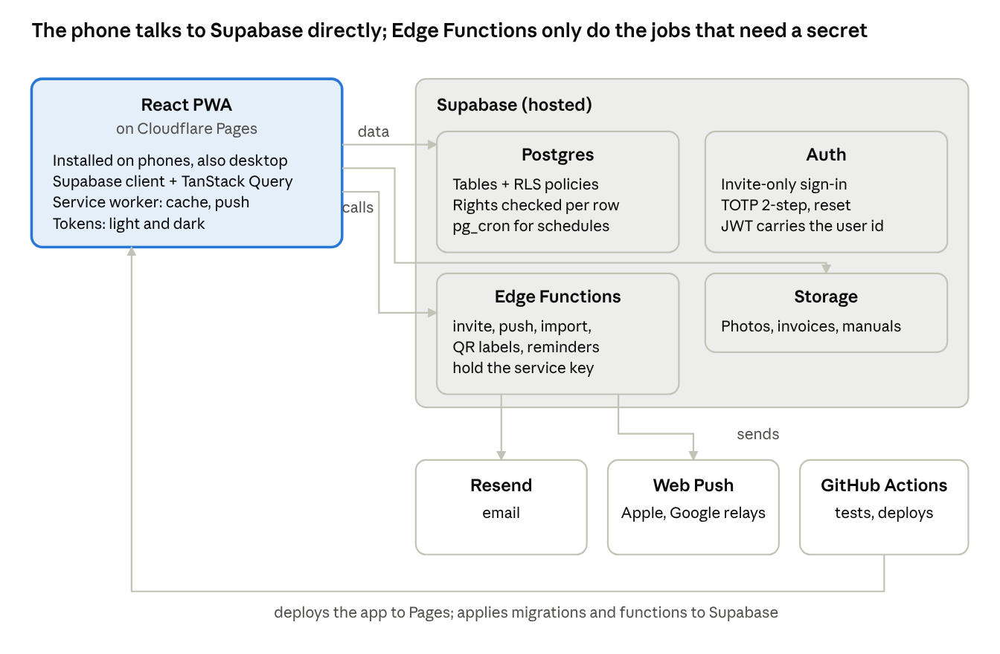

# OnTrack — Build Plan

Oct 28, 2026 · Katie · updated Nov 1, 2026 with Phase 1 as built (2-step verification, the profile photo switch, the group name as data, per-group domains), Phase 2 as built and the Phase 3 pull requests

## How to read this

This is the build order for OnTrack: nine phases, each one a working slice of the app that can be tried on a phone before the next starts. The [Stack & Build Plan](https://claude.ai/artifact/B75SBPJobgaH5nAWhBCU9t) from October 20 holds the pre-design exploration (why a PWA, why Supabase, the auth alternatives, storage costs); this doc supersedes its phases and stack table.

The goal of the first four phases is one thing: an app the Four Corners ops team can install on their phones and use for real tickets, because a working app will land better than the slides and the design canvas have. Everything in the design (about 110 screens) is covered by a phase here; nothing is dropped, only ordered.

Each phase lists what it ships, the screens it covers from the design, the backend it needs, and a done test. Screens are named as they are on the design board so you can open them side by side.

## Status

| Phase | State | Pull requests |
| --- | --- | --- |
| 0 · Foundation | Done, except the real-iPhone check | OT-1 scaffold, tokens, theme, PWA, CI · OT-2 schema, RLS, `can()`, pgTAP, seed · OT-3 component kit, app frame, auth guard, role shells, loading and error boards |
| Kit pass | Done | OT-4 plan update · OT-5 every kit component gets its full set of states in both themes; the `/kit` page gets a desktop layout |
| 1 · Accounts and access | Done, except the real-iPhone check | OT-6 Sign in, signed out, Profile, Help · OT-7 security audit · OT-8 code quality · OT-9 Restaurants · OT-10 invites and the group name as data · OT-11 password reset · OT-15 fixes from trying reset live · OT-12 Roles & rights, User profile, View as · OT-16 reload fix · OT-13 and OT-17 2-step verification · OT-14 and OT-18 group settings and photo messages · OT-20, OT-21 and OT-22 fixes from the 2-step security audit |
| OT-23 | Done, tried on the live app | Small fixes from trying Phase 1 live, before Phase 2 (see below) |
| 2 · Tickets, the manager loop | Done, except the real-iPhone check | OT-24 plan update, then OT-25 to OT-35 (see Phase 2) |
| 3 · Ops dashboard and ticket work | In progress | OT-36 plan update, then OT-37 to OT-50 (see Phase 3) |

Phase 0 notes:

- Production is https://ontrack-app.app (domain bought and connected Oct 2026) and still answers at https://ontrack.katina-sunrise.workers.dev; each branch previews at `https://<branch>-ontrack.katina-sunrise.workers.dev`. `fourcorners.ontrack-app.app` is connected (Oct 30, 2026), and Four Corners installs from there.
- The hosted Supabase project has the full schema (migrations deploy on merge) and no seed data. One admin account exists, made by hand before OT-7: an `invites` row in the SQL editor, then Authentication, Add user with the same email. An invite is claimed only with its link's token or its id in `app_metadata`, which the dashboard cannot set, so the invite flow (OT-10) is the way to add people; by hand means an `auth.users` insert like the seed's, with `role` in `app_metadata`.
- Install and dark mode were checked on Android Chrome. The iPhone part of the done test waits for a BrowserStack pass; Playwright WebKit covers it in CI until then.

Phase 1 note (Oct 30, 2026):

- **What changed:** real accounts. An admin invites someone by email and chooses their role and restaurants; they set up their own account from the link. Sign in, password reset, Profile and Help & support all work. An admin manages restaurants, people, role defaults and one person's rights, can view the app as someone else (read-only and logged), and can rename the group or turn profile photos off. 2-step verification is required for admins and offered to everyone.
- **Security audit:** an independent audit of 2-step verification and group settings (Oct 30, 2026) found 11 issues. OT-20 to OT-22 fix them, except that Supabase accepts a 2-step code more than once, which the app cannot change, and ten wrong backup codes briefly stop the owner's own backup codes too.
- **Security fixes tried on the live app (Oct 31, 2026):** an admin reset ended a test account's live session, and setting up again gave 8 new codes (OT-20). A remembered browser skipped the code, changing the password took a code, and signing in afterwards asked for one again (OT-21). An invite to a new address sent, and its link opened signed out in a private window (OT-22).
- **What that testing turned up:** the `EMAIL_FROM` function secret on the hosted project was missing or still the test sender, so Resend refused invites to anyone but the account's own address. It is set now.
- **OT-23 (Oct 31, 2026):** the fixes that testing led to were tried on the live app and work: Edit restaurant, no near-color warning, signing back in after Sign out goes home, a refresh says Loading, and no fallback email sender.
- **What the client should try:** accept an invite on a phone, sign in, and look at Profile. Change a password, or turn on 2-step verification from Profile. Screens past that are placeholders until Phase 2, and Four Corners has no accounts yet, so this waits until its first admin is chosen (see Open items).
- **How the done test went:** an invite went out and the account was set up from the email on a second phone, against the live app. Turning on See costs for that manager saved as an override, but changes nothing a person can see yet: no screen shows costs until the Closed ticket in Phase 2, and the live project has no cost records. That the database then returns costs is proven on the seeded data, in `e2e/stack/people.spec.ts` and pgTAP, as are the manager seeing only their restaurant and the refusals behind 2-step and the photo switch.

Phase 2 note (Nov 1, 2026):

- **What changed:** a manager can report a problem from a phone and follow it to closed. Open tickets has search and Front / Back. Create ticket goes from area and category to a form with equipment, urgency and photos, shrunk to 1600 px in the browser. A ticket has its thread with system events and a composer. Edit changes the title, description, equipment and urgency, and closes with an optional comment. A closed ticket is read-only and can be reopened within 30 days with a reason; after that it offers a new ticket linked to the old one. The ellipsis menu beside the search leads to a list of closed tickets. The In-house tab checks tasks off and deletes them while open. Cost and contractor show on a closed ticket only with See costs.
- **What the client should try:** sign in as a manager on a phone, create a ticket with a photo, post an update, then close and reopen it. Ops can't see tickets in the app until Phase 3, and Four Corners has no accounts yet, so this also waits until its first admin is chosen (see Open items).
- **What can't be tried on the live app yet:** nothing adds equipment until Phase 4, so the picker is empty there, and nothing adds in-house tasks until Phase 6, so the In-house tab is empty. Nothing notifies anyone until Phase 3. The seeded stack shows the full boards.
- **How the done test went:** `e2e/stack/done-phase-2.spec.ts` runs it on Chromium and WebKit against the seeded stack: Maya at Logan Square creates a ticket with a photo, the database has it at her restaurant with the photo under the ticket, and a manager at Porter can't find it in the list, by search or by link, or read it or sign its photo through the API. It was then tried on a real phone against the live app (Nov 1, 2026): a manager at Logan Square created a ticket with a photo, a manager at Porter did not see it in the list or by search, and the table editor showed the right restaurant. The iPhone part waits for BrowserStack, as in Phases 0 and 1.

## Decisions

The app talks to Supabase directly and Edge Functions handle only the jobs that need a secret or a server. That is the smallest backend that still keeps roles enforced in the database.

| Area | Decision | Why |
| --- | --- | --- |
| Front end | React 19 + Vite + TypeScript, built as an installable PWA | One codebase for phone and desktop; the design is mobile first; installs from Safari and Chrome without an app store |
| Hosting | Cloudflare Workers with static assets, deployed by Workers Builds: `main` is production, every other branch gets a preview URL | Free tier, global CDN, no server to run; the Worker only serves the built files with a single-page fallback, so the backend lives elsewhere. Pages was the first choice; Cloudflare now labels it legacy |
| Database | Supabase Postgres, hosted | Relational data (restaurants, equipment, tickets, service records); row-level security enforces roles |
| Auth | Supabase Auth: email + password, invite-only, TOTP 2-step | Invite flow and MFA built in; the design's sign-in, reset, 2-step and invite screens map onto it directly |
| Data access | The React app reads and writes Supabase over its client library; every table has RLS policies | Fewer moving parts than an API layer; permissions live in one place and are tested as SQL |
| Server logic | Supabase Edge Functions (Deno, TypeScript) for invites, push, imports, QR label PDFs, scheduled jobs | Python was the first thought but is not required; one language across the whole app, and Edge Functions deploy with the Supabase CLI |
| Files | Supabase Storage, photos resized to 1600 px in the browser before upload | Same permission rules as the tables; invoices and photos stay small |
| Email | Resend, through Supabase's custom SMTP setting plus a sending Edge Function | Supabase's built-in email is rate limited to a few per hour |
| Push | Web Push (VAPID keys), subscriptions stored per device, sent from an Edge Function | Push first, as asked; iPhone needs the app installed to the home screen, so email is the fallback for anyone who has not installed |
| UI | Tailwind with the design tokens as CSS variables, headless Radix primitives, components built to match the design | The design is custom, so a styled library would fight it; tokens give light and dark mode from day one |
| Data layer | TanStack Query over the Supabase client; React Router | Caching, retries and optimistic updates without a store to maintain |
| Testing | Vitest for logic, pgTAP for RLS policies, Playwright on Chromium and WebKit for flows | WebKit in Playwright is the stand-in for an iPhone until a real-device pass |
| Repo and CI | One GitHub repo (`app/`, `supabase/`), GitHub Actions: lint, typecheck, Vitest, Playwright, pgTAP and type generation on every PR; Supabase migrations on merge to main. Cloudflare Workers Builds deploys the app itself | Solo, AI-assisted build: every change goes through the same gate |
| Offline | Later (Phase 8). v1 caches what you have read; writes need a connection | The queued-ticket flow in the design is real work on its own |
| Archive and delete | Things people pick from (restaurants, people, equipment, contractors, categories, templates) are archived, not deleted; records of what happened (tickets, walkthroughs, updates, service records, invoices) are never archived or deleted; anything can be deleted only while nothing points to it | Keeps every history and every report intact while still letting an admin clear a mistake or a test entry. The full table is under Archive and delete below and in `CLAUDE.md` |
| Permissions | Four roles with defaults from the Roles & rights screen, overridable per person | Managers can be granted equipment edits and cost visibility by an admin; the database checks the grant, not the screen |
| Avatars | Initials follow the boards: the color comes from the role, and pending and expired invites have their own. An admin can turn profile photos off for the whole group | The color says who is talking on a ticket thread and matches the design. The switch is enforced in the database and keeps the files, so it can be reversed |
| Group name and domains | The group's name is a field in the database, never in the code. Each group gets its own subdomain: `fourcorners.ontrack-app.app`, later `hogsalt.ontrack-app.app` | Another restaurant group may want the app someday, and nothing about Four Corners should have to be edited out of the code when that happens |

One thing stays open until the first demo: whether the group wants Google or Microsoft sign-on later. `fourcorners.ontrack-app.app` is connected, which QR labels need, since they bake the URL in.

## Architecture

The phone never holds a secret: it signs in with Supabase Auth, then reads and writes tables and files under row-level security. Edge Functions run with the service key for the few jobs a phone cannot do safely (send an invite, push to other people's devices, process an import, render a label sheet, create next month's walkthroughs on a schedule). Cloudflare Workers Builds deploys the app on every push (production from `main`, a preview per branch), and GitHub Actions deploys the migrations and functions to Supabase on every merge.

The app gets two public build values, the Supabase URL and the publishable key (`sb_publishable_…`). Both end up in the JavaScript every visitor downloads, so no secret key, `service_role` key or personal access token may ever go in a `VITE_` variable. Cloudflare keeps build variables per environment: Production and each branch need them set separately.

## Data model

Twenty-nine tables in five groups, plus twelve views. Tickets are the center; equipment, service records and walkthroughs all hang off them. The nine-table model in the earlier doc grew by the walkthrough, contractor and rights tables the design added.

| Group | Tables | Notes |
| --- | --- | --- |
| Org and access | `restaurants`, `profiles`, `memberships`, `invites`, `rights`, `push_subscriptions`, `audit_log`, `group_settings`, `support_reports`, `two_step_codes`, `two_step_devices`, `two_step_passes`, `two_step_resets` | `restaurants` holds name, address, phone, accent color, manager. `group_settings` is a single row for the group: its name, its short name, and whether profile photos are allowed. `profiles.role` holds the role (manager, ops, leadership, admin); `memberships` is scope only, one row per restaurant or a single null row for all restaurants, which ops and leadership get by default. `rights` = the Roles & rights grid: a default row per role, plus per-person override rows. Right keys: `create_tickets`, `see_all_tickets`, `update_status`, `log_cost`, `see_costs`, `edit_equipment`, `see_contractors`, `set_walkthrough_schedule`, `invite_users`, `manage_rights` |
| Equipment | `equipment`, `categories` | Category carries area (FOH or BOH). Equipment has brand, model, serial, installed, warranty, location note, manual file, retired_at |
| Tickets | `tickets`, `ticket_updates`, `ticket_photos` | Ticket: restaurant, equipment (optional, at that restaurant and not retired when linked), category, title, description, urgency (low, normal, urgent), status, assignee, source (reported or walkthrough), walkthrough_id, reopened_at. Status is an enum: open, in_progress, waiting_parts, scheduled, reopened, closed. Updates carry text, photo, internal flag, and system events (assigned, status change, closed, reopened) |
| Service and money | `contractors`, `service_records`, `service_line_items`, `invoices` | A service record belongs to a ticket and optionally a contractor; line items are labor, parts, trip. An invoice is a file plus number, amount and status (attached, missing). Per-unit and per-contractor spend are views over service records |
| Walkthroughs | `walkthrough_schedules`, `walkthrough_templates`, `walkthrough_items`, `walkthroughs`, `walkthrough_checks`, `inhouse_fixes`, `quarterly_tasks` | A schedule is group-wide or per restaurant (rotation of months). A walkthrough is one restaurant for one month; checks are its item results (good, in-house, ticket). In-house fixes link back to the check and can convert to a ticket. Quarterly tasks are group-wide with per-restaurant overrides and removals |

**How rights work.** The JWT carries the user id, plus the level and session id Supabase Auth adds for 2-step verification, and no rights. A SQL function `can(action, restaurant_id)` reads `profiles.role`, `memberships` and `rights` and is used by every policy, so a manager with `edit_equipment` granted by an admin passes the same check an ops manager does. Leadership policies are select-only. The service role used by Edge Functions bypasses RLS, which is why those functions check the caller themselves before acting.

**Counting and costs** (open tickets per restaurant, spend this year per unit, visits per contractor) are Postgres views, not client-side sums, so every screen shows the same numbers.

All five groups landed in Phase 0 (OT-2, eight migration files; Phase 1 added its own access tables to the first group) even though phases 1 to 4 use only the first three; adding walkthrough tables later would have meant reworking the ticket table's `source` and `walkthrough_id` columns. Account creation is invite only in the database itself: a trigger on new auth users takes role and restaurants from a pending invite and rejects anyone without one.

## Archive and delete

Decided Oct 30, 2026, after restaurants got archive and delete in OT-9. Each phase builds these for its own entities the same way: a database function per action that checks the caller and logs it, the "only while nothing points to it" rule enforced in the database, and a confirm sheet on the row.

| Entity | Archive (reversible) | Delete | Phase |
| --- | --- | --- | --- |
| Restaurants | Archive / Restore | Only with no history and nobody's home restaurant | 1 (OT-9, done) |
| People | Deactivate / Reactivate: no sign-in, out of pickers, name kept on history | Revoke a pending invite; delete an account only with no history | 1 (OT-10 revoke and ban, OT-12 User profile) |
| Equipment | Retire | Only with no tickets or service records | 4 |
| Contractors | Archive | Only with no service records | 5 |
| Categories, walkthrough templates and items, quarterly tasks | Turn off | Only if never used | 6; categories later, not scheduled |
| Tickets | None (closing ends a ticket) | Never | |
| Walkthroughs, ticket updates, service records, invoices | None (they are the record) | Never; edits are logged | |
| In-house fixes and tasks | None | While still open | 2 (OT-30) |

## Phase 0 · Foundation

An empty app that installs on a phone, switches between light and dark, deploys on every merge, and has a database whose permissions are already tested. Nothing a user would call a feature, but every later phase moves faster for it.

**Status:** done in OT-1 to OT-3; the real-iPhone check waits for BrowserStack (see Status above).

**Ships**

- Repo with `app/` (Vite + React + TypeScript) and `supabase/` (migrations, functions, seed, tests); GitHub Actions running typecheck, Vitest, pgTAP and Playwright on Chromium and WebKit
- Cloudflare Workers Builds connected to the repo: production on `main`, a preview URL per branch
- Supabase project with the full schema from the data model, RLS on every table, the `can()` function, and pgTAP tests that sign in as each role and assert what it can and cannot read
- Seed script with the four restaurants, their colors, sample users for each role, equipment and tickets matching the design's sample data, so every demo starts from the same state
- Design tokens as CSS variables (colors, spacing, type, radii) with a dark set; Tailwind wired to them; the `prefers-color-scheme` default plus a manual toggle saved per device
- Component kit built from the design: button, pill, card, list row, bottom tab bar, sheet, field, select, switch, segmented control, avatar, toast, skeleton. Each one has a Storybook-style page in the app under `/kit` for checking both themes
- PWA shell: manifest, icons, splash, service worker with precaching, install prompt, `100dvh` and safe-area padding, 16 px minimum input size
- App frame: routing, auth guard, the four role shells with their tab bars, loading and error boundaries

**Screens from the design:** Loading states (spinner, list and detail skeletons), Error 404, 500, no access

**Done when:** a teammate can open the preview URL on an iPhone, add it to the home screen, toggle dark mode, and the RLS tests pass for all four roles.

## Phase 1 · Accounts and access

Real people can be invited, sign in, and land in the right role, with rights an admin can adjust. Everything after this is gated on who is looking, so it comes first.

**Ships**

- Admin: Restaurants list and Add restaurant (name, address, phone, manager, accent color with the preset swatches and custom picker, taken-color check)
- Admin: Users list with filters (all, pending, managers, ops), Invite user (name, email, role, restaurants), resend and revoke, user profile with per-person rights override, View as (a read-only view, not impersonation: no token changes hands, and it is logged to the audit table)
- Admin: Roles & rights grid, editable defaults with the confirm sheet, locked admin column
- Invite email through Resend; invite link single-use, 72-hour expiry; Set up account screen (name, password rules, confirm)
- Sign in, password reset (request, sent, email, new password, done), expired link and signed-out screens. The Sign in button stays disabled until the email has a valid shape and the password has at least 12 characters (the provisional screen from Phase 0 only disables it when Supabase is not configured)
- 2-step verification (OT-13): TOTP with authenticator app (choose, scan, verify, backup codes) required for admins and offered to everyone, enforced in the database; once on, it stays on for that person. Backup codes and "Don't ask again on this phone for 30 days" are ours, since Supabase Auth has neither. An admin can reset it for someone, with an email to them; the only admin's recovery is a line of SQL (see CLAUDE.md). The SMS option waits unless the group asks for it, since it adds a Twilio cost
- Profile (name, phone, restaurant, theme toggle, sign out) and Help & support (report a problem to a support inbox, FAQ)
- Group name as data (OT-10, first step): `group_settings` holds the name and short name, and every "4C | Four Corners" reads from it, including the admin header and the invite email. The name and short name can be read before sign-in, because Checking your invite shows them. The migration starts the row as "OnTrack", the seed sets Four Corners, and the hosted project gets its name by one SQL update after merge. Links in emails come from an `APP_URL` function secret, never from a domain in the code. The app description in `index.html` and the manifest drops the group's name
- Group settings on Roles & rights (OT-14): an admin edits the name and short name there, through a database function that writes `audit_log`
- Profile photo switch (OT-14): an admin turns profile photos off or on for the whole group. Off refuses new uploads in the storage policies and on `profiles.avatar_path`, stops serving existing photos, and shows initials everywhere; Profile drops Upload and Change. Files are kept, so turning it back on restores them, and a person can still remove their own photo while it is off: Profile keeps Remove for anyone with a saved photo and tells them it is hidden and comes back if photos are turned on again. Whether photos are on or not, uploading and removing confirm with a message, since neither waits for Save changes. A photo link already handed out works until it expires, within the hour, and other people's screens follow within five minutes or on reload. It follows the OT-9 pattern: an admin-only database function that writes `audit_log`, a confirm sheet, and pgTAP for the role check, the refusal and the log. Ticket and equipment photos are not affected. No board exists for this, so it is a `Switch` row with the kit's confirm sheet on Roles & rights, under Edit defaults
- Edge Functions: `invite-user`, `revoke-user`, `reset-two-step`, `send-email`. They run with the service key, so each checks the caller with `can()` or `is_admin()` first. `revoke-user` sets `profiles.deactivated_at` and also bans the auth user so refresh tokens stop working
- A `/security-review` pass before the invite and sign-in work merges, since this is the first code that holds the service key

**Screens from the design:** Admin · Users, Invite user, Roles & rights, User profile, View as, Restaurants, Add restaurant; Invite email, Set up account, Sign in, Password reset 1 to 5, 2-step setup 1 to 4 and the sign-in code screen, Profile, Help & support, Error · link expired, no access, signed out

**Done when:** an admin invites a manager from a phone, the manager sets up the account from the email on another device (a tablet or a phone on wifi is fine, since nothing here needs a phone number), and the RLS tests show the manager sees only their restaurant. Granting `see_costs` to that manager in Roles & rights changes what the database returns, with no app change.

## Phase 2 · Tickets, the manager loop

A restaurant manager can report a problem from a phone in under a minute and follow it to closed. This is the first thing worth showing the Four Corners team, even before Ops has its own screens.

**Ships**

- Open tickets list: Tickets and In-house tabs with counts, search, All / Front / Back segments, the restaurant label with its color square, cards with status pills and icons
- Create ticket in two steps: area and category grid (counts per category), then the form (title, description, photos, urgency, optional equipment picker filtered to that restaurant)
- Ticket detail: header with status and urgency, description, equipment card, the update thread with photos, the composer with camera, system events in the timeline
- Edit or close ticket (manager side), with the closed state read-only
- Closed ticket: resolution, contractor and cost shown only when `see_costs` is granted, 30-day reopen window, the Reopen ticket sheet that sets status to Reopened and notifies Ops
- Photo upload: resized to 1600 px in the browser, stored under the ticket, thumbnails in the thread
- Empty and no-results states for the lists; the save-failed validation state on the form
- Status icons, pills and the restaurant color square as shared components, since every later list reuses them

**Screens from the design:** Manager · Open tickets, Open in-house tasks, Create ticket area, Create ticket form, Open ticket, Edit / close ticket, Closed ticket; Empty · Manager open tickets; No results · ticket search; Error · validation on save

**Done when:** a manager at Federale’s Logan Square creates a ticket with a photo on an iPhone, it appears in the database with the right restaurant, and a second manager at Porter cannot see it. Ops can still only see tickets through the database at this point; that is Phase 3.

**Pull requests**

| PR | Scope |
| --- | --- |
| OT-25 | Default categories on the hosted project; Open tickets list with search and Front / Back segments; empty and no-results states; the ticket card |
| OT-26 | Create ticket: area and category, then the form with the equipment picker; the save-failed state |
| OT-27 | Ticket detail: header, description, equipment card, thread with system events, text composer |
| OT-28 | Photos: resize to 1600 px, add on the form and in the composer, thumbnails in the thread |
| OT-29 | Edit and close, Closed ticket, the Reopen sheet, cost shown only with `see_costs` |
| OT-30 | In-house tab: list, check off, delete while open |
| OT-33 | From OT-29's open questions: an ellipsis menu beside the search on Open tickets with View Closed Tickets, opening a simple list; Title on Edit ticket |
| OT-34 | From trying Phase 2 live: no scrollbar on the message field at one line |
| OT-35 | Faster CI: docs-only PRs run nothing, the flows run one job per browser, and a `quick` label skips them on a small fix's PR |
| OT-31 | The done test as one flow; the phase note |
| OT-32 | From trying OT-26 live: Open tickets loads in the empty layout when it found nothing last time, so it doesn't jump |

**What this phase has to work around**

- **Categories exist only in `seed.sql`, so the hosted project has none, and a ticket requires one.** OT-25 adds the design's list in a migration, and the seed stops inserting its own. Nothing can be created on the live app until that merges.
- **Open tickets cards always say who is on the ticket.** The board shows a contractor on one card, but managers cannot read service records without `see_costs`, and none exist until Phase 5.
- **The equipment card on a ticket isn't a link until Phase 4,** when the unit has a page to open.
- **A ticket's thread rereads every 30 seconds** while it is on screen and when the app comes back to the front, so a reply turns up without a reload. Live updates can wait for push in Phase 3, if the delay matters.
- **A closed ticket takes no message or photo from a manager,** in the database as well as on screen. Ops keeps the right, for what Phase 3 builds.
- **Edit ticket adds Title to its board** (decided Nov 1, 2026, built in OT-33), alongside description, equipment, a photo and urgency. The closing comment is optional, as the board has it. Urgency adds Low, which Create offers.
- **Reaching a closed ticket:** the board's only way is Equipment Tickets in Phase 4, and a ticket with no equipment would have none. Closing offers View closed ticket, and OT-33 adds an ellipsis menu to the right of the search on Open tickets, with View Closed Tickets opening a simple list (decided Nov 1, 2026). With nothing open there is no search, so the menu sits beside the title. It has room for more items later. Neither the menu nor the list has a board. The list shows the latest 100.
- **The boards' notification promises wait for Phase 3:** "You'll get a notification when work starts" and "Ops has been notified" are left off, since nothing notifies yet.
- **Photos go up after the ticket they belong to,** whose folder and policies they need. If they fail, the ticket stands and the message says to add them in an update. In an update the files go first, so a failure posts nothing. A file uploaded just before a failed post stays in Storage unreferenced, which only people who can see the ticket can reach.
- **Tapping a photo opens it large, and picked photos show in a tray with Remove.** Neither has a board. An update or new ticket takes up to 6 photos.
- **Nothing adds equipment until Phase 4.** On the live app the picker is empty and every category says 0 items, so tickets there have no equipment. The seeded stack shows the full boards.
- **The done test's second manager is seeded.** The boards have nobody at Porter but an expired invite, so the seed adds Dana Ortiz as its manager. That person shows on Users, which the board doesn't draw. On the live app, the same test needs a real invite to a manager at Porter.
- **Nothing adds in-house tasks until Phase 6.** Walkthroughs create them, so the In-house tab stays empty on the live app, and OT-30 is proven on seeded data. That empty list says "Nothing to fix right now", which has no board.
- **A checked-off in-house task offers no Delete,** though the board draws it, since the rule is delete while open and the database refuses it. Unchecking brings the task back, and it can be deleted then.
- **Deleting an in-house task removes the row,** as the board's "permanent" says, and the audit log keeps who deleted what. Each task now carries its area, because Front and Back can't be read from a quarterly task's label; a task with none shows only under All. Phase 6 sets the area when it creates a task, and adds the write that Convert to ticket needs.
- **The QR buttons wait for Phase 4,** since a scan would have nothing to open: Scan an equipment QR code on Create ticket, and Scan a QR code with its sentence on the empty Open tickets screen. These are the planned differences from those boards.
- **Save-failed uses Log service's board.** The only Error-Save-Failed board is drawn on Log service, so Create ticket takes its banner and its Report a problem link. It says what went wrong and keeps everything typed.
- **A manager with more than one restaurant** has no board: they get a Restaurant picker on Create ticket, and the restaurant's name on each Open tickets card.
- **Reopening writes the thread event but notifies nobody yet.** Push and email arrive in Phase 3, which keeps the "notifies Ops" promise.
- **Categories can't be turned off or deleted yet.** That is saved for later (Oct 31, 2026), so the list from OT-25 stays as it is until then, and changing it means a migration.
- **View as:** each screen scopes its data from `useUser()` and hides writes when `viewingAs` is set, and Open tickets replaces the manager's placeholder in `ViewAsScreen`.

## Phase 3 · Ops dashboard and ticket work

The ops managers can run their day in the app: see every restaurant's open work, pick up tickets, talk to the restaurant, close, and handle a reopen. With push, this is the point where the app replaces texting.

**Ships**

- Ops dashboard: tickets under a label for each restaurant, in an order each person can change, an ellipsis menu leading to closed tickets, cards with restaurant color squares, walkthrough tags and a badge naming who is working on the ticket; the restaurant picker (All restaurants plus each one) that scopes every Ops screen
- Ops ticket detail: the status dropdown, description, equipment card, updates thread with the internal-note toggle ("Visible to restaurant"), composer
- Closed tickets grouped by month with totals; closed ticket detail
- A reopened ticket is an ordinary ticket with a Reopened badge
- Push notifications: subscribe on install, store per device, Edge Function `send-push` fired by database triggers for new ticket, status change, new update visible to the restaurant, reopen. Email fallback for anyone with no subscription. A Notifications section on Profile to turn each kind on or off
- One lasting link per ticket, `/t/<id>`, which opens the right screen for whoever taps it, since `/tickets/:id` is for managers only. A signed-out person goes through sign-in and back, and the link grants nothing: someone who can't see the ticket gets the same refusal as today. Push and email notifications use it, built from the group's own address
- Share link on a ticket, in the ellipsis menu from OT-33: the phone's share sheet (Messages, Copy and so on), or on a computer it copies the link and confirms. No board draws it
- Empty states for the dashboard and Closed tab; loading skeleton for the card feed

**Screens from the design:** Ops · Dashboard, Ticket detail, Closed tab, Reopened ticket; Empty · Ops dashboard, Ops closed tab; Loading · card feed skeleton; Error · something went wrong

**Done when:** a manager creates a ticket and the ops manager's phone buzzes; the ops manager marks it In progress, posts an update the manager sees, closes it with a comment; the manager reopens it and Ops sees Reopened on the dashboard. Playwright runs that whole loop on WebKit.

**Pull requests**

| PR | Scope |
| --- | --- |
| OT-36 | Plan update and this split |
| OT-37 | Ops dashboard: Open tab, All / Mine, the restaurant picker that scopes every Ops screen, cards, empty state, loading skeleton; replaces the ops placeholder in View as |
| OT-38 | Saved for later: the dashboard's filter sheet, unless Ops asks for it |
| OT-39 | Ops ticket detail: header, description, photos, equipment card, the status dropdown, marking In progress puts you on it, Take this over, a date for Scheduled |
| OT-40 | Ops thread: composer with photos, the internal-note toggle, Close ticket with a comment |
| OT-41 | Closed tickets, opened from the dashboard's menu: grouped by month with totals, its empty state, closed ticket detail |
| OT-42 | Dropped from feedback (Nov 2, 2026): a reopened ticket has no screen or sheets of its own; see OT-52 |
| OT-43 | Lasting link `/t/<id>` for every role, and Share link on a ticket |
| OT-44 | Push on a device: service worker handles push, subscribe per device, the Notifications section on Profile, a test push to your own phone |
| OT-45 | `send-push`: database triggers for each kind, who gets what, email for anyone with no subscription, links through `/t/<id>` |
| OT-46 | Put back the boards' notification promises; check on BrowserStack how an iPhone opens a link; a temporary ring on a new ticket's card, for Ops and managers |
| OT-48 | Simplify the dashboard from feedback: no assigning, no Unassigned, no All / Mine; a badge names who is working on a ticket |
| OT-49 | Tickets grouped under a label for each restaurant; Closed moves to an ellipsis menu; a reopened ticket is an ordinary card with its pill |
| OT-50 | Change the order of the restaurants on the dashboard by dragging |
| OT-51 | From feedback: a reopened ticket is on the dashboard and not in Closed tickets; the Ops message box hidden until Add update; no "Nobody has this yet" note |
| OT-52 | From feedback: a reopened ticket acts like a new one apart from its badge, with nobody on it and no date |
| OT-55 | Security audit of what Phase 3 added: policies and functions since OT-22, internal notes and their photos, Ops and manager scope, links, push and `send-push` |
| OT-56 | Code quality pass: the repeated ticket header, the similar closed-ticket screens, `v_closed_by_month` that nothing uses, leftovers from simplifying |
| OT-47 | The done test as one flow; the phase note |

**What this phase has to work around**

- **Nobody assigns a ticket (from feedback, Nov 1, 2026; OT-48).** A ticket is Open until an Ops manager marks it In progress, which puts them on it. Every Ops manager sees every ticket, with a badge naming anyone else on it; your own tickets have no badge. This replaces what the boards draw: the Unassigned pill, the assignee dropdown, All / Mine and the initials in the card's corner. `assignee_id` stays as who is working on it, so the thread and history still say who. `set_ticket_status` applies this in one step: In progress puts you on the ticket, taking it from anyone who had it, back to Open takes the person off, and Waiting on parts or Scheduled keeps whoever has it, or you if nobody does. Take this over, in the status menu, is for a ticket a colleague has. Nobody is asked first. Scheduled asks for its date in a sheet with no board.
- **The dashboard is grouped by restaurant (from feedback, Nov 1, 2026; OT-49),** since an Ops manager travels between restaurants through the day. Each restaurant has a label with its count, and a restaurant with nothing open is left out. This replaces the boards' single list, their Open and Closed tabs and the badge on Closed, and the restaurant's name on each card. Closed tickets move to an ellipsis menu by the title. A reopened ticket is an ordinary card with its pill, so the boards' tinted card and quoted reason are gone; the reason is on the ticket.
- **One fixed order under each restaurant (Nov 1, 2026; OT-49):** urgent always on top, then Front of House before Back, then the oldest first. The time on a card is how long ago it was opened, so the order can be read. A manager's Open tickets keeps its own order, the latest activity first.
- **The restaurant order changes by dragging (OT-50),** in a sheet from the same menu, not on the dashboard itself, where dragging would fight with scrolling on a phone. It is saved per person on the device, like the picker's choice, so it doesn't follow someone to another device, and the picker lists restaurants in the same order. It uses `@dnd-kit` for touch and keyboard, loaded only when the sheet opens. The dashboard rereads every 30 seconds, so a new ticket turns up on its own before push arrives. The picker's choice is remembered per person on the device.
- **The message box is hidden until asked for (from feedback, Nov 2, 2026; OT-51).** Ops says writing back and forth will be rare and it took a lot of the screen, so Add update beside the Updates heading opens it. Posting closes it, and hiding it keeps the draft. A manager's ticket keeps its box open. The "Nobody has this yet" note on an open ticket is gone too.
- **Internal notes (OT-40):** the toggle stays where it was set after posting, since a note going out by accident is the worse mistake. Close ticket takes an optional comment, as a manager's does. After closing, Ops goes back to the dashboard.
- **Closed tickets (OT-41):** a screen of its own with a back arrow, since Closed is no longer a tab. It opens on this month, four tickets to a month until Show more, and See <month> adds the month before, which the empty board draws and the full board had no way to reach. Months follow the person's own time zone (`closed_by_month`), so a ticket closed on the evening of Oct 31 in Chicago is under October. A reopened ticket is not on it (from feedback, Nov 2, 2026; OT-51): it is open work, so it is only on the dashboard, and comes back here in the month it closes again. A ticket with no service record shows no amount. Without `see_costs`, no totals or amounts show at all. The board's lines saying closed tickets also appear on each unit wait for Phase 4, so Phase 4 puts them back.
- **A closed ticket on Ops (OT-41)** follows the board's closed state, plus the description and photos, since the board relies on a reopen flag to say what was wrong. Like a manager's Closed ticket it has a timeline and no chat, so messages and internal notes can't be read once it closes. If Ops misses them, add the thread below the timeline.
- **Reopening stays simple (from feedback, Nov 2, 2026; OT-52).** Managers can reopen, but will more likely just make a new ticket, so a reopened ticket acts like a new one apart from its badge: on the dashboard, nobody on it, no date, on the ordinary Ops ticket screen with the reason in the thread. This replaces the Ops-Closed-Ticket board: no flag panel, no Start work or Close again sheets, and no Start work anyway, so Ops can't bring back a closed ticket. It keeps its old number and opened date, so under its restaurant it sorts by when it was first opened.
- **A new ticket has a ring for a few minutes (from feedback, Nov 2, 2026; OT-46).** No board draws it. A ticket's card has a ring for 5 minutes after it was created, on the Ops dashboard and on a manager's Open tickets, worked out from `created_at`, so everyone who can see the ticket sees it on any device, it survives a reload, with no state to store. A timer on each card takes it off on time, since a manager's Open tickets doesn't reread on its own. It stays for the full time even if someone opens the ticket. A reopened ticket gets no ring, since the request was for new tickets.
- **The filter sheet is saved for later (Nov 1, 2026).** With grouping and a fixed order, Ops may rarely need it, so it isn't built unless they ask. If it comes back: Status with Reopened added, Walkthrough only, Area and Category, with no Sort or Urgent only, results staying under their restaurants, and nothing remembered between visits.
- **Links to later phases stay off for now.** Log service waits for Phase 5, so the ticket has no service and cost section until then, rather than an empty one that seeded tickets with costs would contradict. The equipment card opens nothing until Phase 4, and From October walkthrough opens nothing until Phase 6. The Equipment, Walkthroughs and Contractors tabs stay placeholders.
- **Costs are mostly empty until Phase 5.** The Closed tab's month totals and a closed ticket's cost come from service records, which nothing on the live app creates yet, and they need `see_costs`. The seeded stack shows the full boards.
- **Push needs a change to the service worker.** The one `vite-plugin-pwa` generates today has no push handler, so OT-44 adds one without disturbing the app's update prompt.
- **`send-push` needs a server-side library that encrypts Web Push and runs on Edge Functions.** OT-44 proves this with a test push to a real phone before any trigger depends on it.
- **Who gets notified (a default, Nov 1, 2026, until someone asks otherwise):** a new ticket goes to every Ops manager who covers that restaurant, as the board's "all Ops managers notified" says. A status change or an update the restaurant can see goes to the person who opened the ticket and the person working on it, and never to whoever did it, so a manager hears when work starts. A reopen goes to all those Ops managers, as a new ticket does. An internal note never reaches a manager, and notifies nobody at this stage.
- **Setup outside the repo:** VAPID keys are new. The private key goes in the hosted project's function secrets, and the public one in the Worker's build variables, so OT-44 lists the steps. The database also needs a way to call `send-push` from a trigger, set up in OT-45.
- **Playwright can't feel a phone buzz.** The done flow checks that the right people were sent the right notification, and the buzz itself is tried by hand on a real phone. That proves it on Android. iPhone push needs the app installed on a real iPhone, which may be more than BrowserStack can show, so it may wait until someone with an iPhone tries it.
- **Share link (OT-43)** is on every ticket screen, in a menu on its header, including closed tickets. A phone gets its share sheet and a computer copies the link and confirms; the choice follows whether the device has a coarse pointer, since desktop browsers also offer a share sheet. The message carries the ticket number and title, so whoever shares it decides who reads those.
- **`send-push` gets its own security check in OT-45,** since it runs with the service key, then the audit (OT-55) and code quality pass (OT-56) come before the done test, so the done test covers their fixes.
- **`/t/<id>` has no screen to open for admin and leadership until Phase 7,** when their ticket views arrive. Until then they get the no-access screen, whatever the database would let them read.
- **Roles & rights' "everyone affected is notified" stays off.** Changes to rights aren't among this phase's notifications, so that open item carries on.
- **View as:** each Ops screen scopes its data from `useUser()` and hides writes when `viewingAs` is set.

## Phase 4 · Equipment and QR labels · first demo

Every unit has a page, a QR label, and a history. This closes the loop that EcoTrak does not have, and it is the milestone to put on the ops team's phones: phases 1 to 4 together are a complete ticketing app with equipment.

**Ships**

- Ops equipment list: search, filter sheet (restaurant, area, category), category disclosures with open-ticket badges, rows with restaurant color, brand, serial and this year's spend
- Manager equipment list: same list scoped to their restaurant, with Add equipment only when `edit_equipment` is granted
- Equipment detail tabs: Details (serial, QR, brand, model, category, location, installed, warranty, manual), Tickets (open on top, closed in a disclosure), Service & cost (lifetime and 2026 cost, visits, contractors on this unit, service log). Cost tabs hidden without `see_costs`
- Add and Edit equipment, Retire equipment; the saved screen with the QR label and Print
- Domain (done Oct 30, 2026): `fourcorners.ontrack-app.app` connected to the production Worker and set as Supabase Auth's site URL, before anyone in the group installs the app. An installed app and its sign-in belong to one address, so moving later means everyone reinstalls and signs in again
- QR: each label encodes `https://fourcorners.ontrack-app.app/e/<id>`, built from the group's own address; the phone's camera opens the unit; a signed-out scan goes to sign-in and back. Label sheets as a PDF from an Edge Function `qr-labels` (per restaurant or selected units), sized for common label stock
- Share link on a unit, in the same ellipsis menu as a ticket, using `/e/<id>`
- Create ticket from a unit, with the unit prefilled; the equipment breadcrumb with the restaurant color on every equipment screen
- Empty states: no equipment, no tickets on a unit, no service yet, QR not recognized; equipment loading skeletons

**Screens from the design:** Ops · Equipment list, Add equipment, Edit equipment, Equipment added + QR label, Equipment details, Equipment tickets, Equipment service history; Manager · Equipment, Equipment details and tickets tabs; Loading · QR scan, equipment list and detail; Empty · manager equipment, equipment tickets, new equipment; Error · QR code not recognized

**Demo milestone.** Seed the four restaurants with their real equipment where it is known, print a label sheet for one restaurant, hand the assistant ops manager and one restaurant manager an install link, and let them run a real ticket for a week. The next-steps slide in the deck becomes the agenda for that conversation.

**Done when:** scanning a printed label on an iPhone opens the unit in the installed app, and a ticket created from it shows up under that unit's Tickets tab and on the Ops dashboard.

## Phase 5 · Contractors, service records and invoices

Every repair gets a cost, a contractor and an invoice, and the spend views on equipment, contractors and the dashboard start showing real numbers. This is the section of the deck the head of ops is paying for.

**Ships**

- Log service from a ticket: in-house or contractor, contractor select with "Add new", technician, invoice number, service date, labor, parts, trip fee with a live total, work notes, attach invoice; the inline saving state
- Service record: invoice card (view, download, replace, missing state), cost breakdown, details; Edit service record with delete
- Contractor directory: search, trade chips, sort by spend or last used, preferred stars, insurance-expiring flags, one-tap call and email
- Contractor detail: spend, visits, last visit, details, Visits and Invoices tabs; Add and Edit contractor with the preferred switch
- Share link on a contractor, in the same ellipsis menu as a ticket, using `/c/<id>`, which refuses anyone without `see_contractors`
- Invoices tab: by month, missing-invoice filter and count, sort, rows linking to service records
- Spend views in Postgres feeding the ticket total, unit lifetime and yearly cost, contractor spend and visits, and the Closed tab month totals
- Empty states: contractor directory, contractor search; the Add contractor link from Log service

**Screens from the design:** Ops · Log service & cost, Service record, Edit service record, Contractor directory, Contractor detail, Add contractor, Edit contractor, Invoices; Loading · inline button spinner; Empty · contractor directory; No results · contractor search

**Done when:** logging a $397.40 Coldline visit on a ticket raises that unit's 2026 cost, Coldline's spend, and the Closed tab's month total by the same amount, with the invoice PDF openable from all three places.

## Phase 6 · Monthly walkthroughs

Managers walk a checklist each month, log fixes and tickets as they go, and Ops sees who is on track. It is the biggest phase, so it is split into two halves that each ship on their own.

**6a · The manager's walkthrough**

- Walkthrough home for the month: progress by area, due date, what is flagged; the all-done state
- Checklist by area (BOH, FOH, quarterly tasks) with the per-item Good / In-house / Ticket controls, group disclosures, the help panel
- Quick ticket sheet from an item (creates a ticket with `source = walkthrough` and the Walkthrough tag), and the walkthrough edit/close ticket screen
- In-house fixes: the shared list opened filtered from an item or whole from review, check off, delete with confirm
- Review & submit with the partial-submit warning; the all-tickets list from review
- Walkthrough creation: `pg_cron` opens next month's walkthrough per restaurant from its schedule; reminders 7 and 2 days before due go out by push and email

**6b · Ops and the schedule**

- Ops walkthroughs overview: progress per restaurant, submitted dates, the last-6-months list; one restaurant's walkthrough with flagged items, the reminder button, past walkthroughs
- Ops in-house fixes view, read-only with Convert to ticket
- Walkthrough schedule: group rotation, per-restaurant own schedule and switch back, the 12-month preview, settings
- Quarterly tasks: group list with per-restaurant overrides, removals and restores, the task editor with directions and video link
- Checklist template editor so Ops can change the items without a deploy (the design has no screen for this yet; a simple list editor is enough)

**Screens from the design:** Walkthrough · Manager (11 screens: this month, checklist, quick ticket, quarterly task, all done, review, partial warning, in-house fixes from item and from review, edit ticket, all tickets); Ops (5 screens: all restaurants, one restaurant, schedule, quarterly tasks, in-house fixes)

**Done when:** October's walkthrough is created automatically for all four restaurants, a manager submits one from a phone with two tickets and one fix, those tickets show the Walkthrough tag on the Ops dashboard, and the Ops overview shows one of four submitted.

## Phase 7 · Leadership, Admin tickets and imports

The read-only views for leadership and admin, and the spreadsheet imports that make a real rollout to all nine restaurants practical.

**Ships**

- Leadership: Overview (open, urgent, spend, time to close, by restaurant), Restaurant view with open tickets and equipment, Ticket detail, Contractors directory and invoices, Contractor detail, Service record, Walkthroughs; all read-only, driven by the same views as Ops
- Admin: Tickets list and ticket detail, read-only with the view-only banner
- Import contractors and Import equipment: choose a file (xlsx or csv), match columns with guesses and one-tap suggestions, review rows with grouped fixes and duplicate handling (skip or update), done screen with counts, QR labels for imported units, 24-hour undo. Parsing and matching run in an Edge Function `import` so the phone only uploads the file
- Import template downloads for both lists
- Entry points: the banners on Add contractor and Add equipment, the button on the empty contractor list

**Screens from the design:** Leadership (9 screens plus 2 empty states and the loading skeleton); Admin · Tickets, Ticket detail; Ops · Import contractors 1 to 4, Import equipment 1 to 4

**Done when:** the assistant ops manager imports the group's real contractor spreadsheet from a phone with no help, and leadership can open the Overview on a laptop and see the same totals Ops sees.

## Phase 8 · Desktop layouts, offline, and later

These come after the group is using the app daily, in whatever order the feedback puts them.

- **Desktop layouts.** Tablet and desktop up to 1440 px: the tab bar becomes a sidebar, lists become list-plus-detail panes, sheets become dialogs, and the import review becomes a table. The phone layouts stay as the base; this is CSS and a few layout components, not new screens
- **Offline.** Cache the lists and tickets you have opened; queue new tickets and updates with the Not sent yet card and the Saved-at banner; retry on reconnect; handle a conflict by appending, never overwriting. This is the Error · Offline screen from the design
- **Reports.** Monthly spend per restaurant and per category as a PDF or CSV for leadership; repeat-repair flags on a unit
- **Single sign-on** with Google Workspace or Microsoft 365 if the group wants it; Supabase Auth supports both as providers
- **App Store wrapper** with Capacitor only if someone asks for it; the PWA covers the need
- **Second restaurant group.** Each group gets its own deployment from the same repo: its own Supabase project, its own Cloudflare Worker on `<group>.ontrack-app.app`, and its own `group_settings` row. No policy changes, and one group's data cannot reach another's, because they share no database. The deploy workflow pushes migrations to each project. The cost is one more Supabase project per group. A shared database with a `group_id` on every table is cheaper to run, but it changes every policy and makes a cross-group leak possible, so it waits until there are enough groups to justify it

## Working method

One person with AI help can move fast on this stack as long as every phase has the same shape: schema and policies first, then the screens against the design, then a Playwright flow that proves the done test. Order inside a phase:

1. **Migration and policies.** Write the tables, the `can()` cases and the pgTAP tests for the phase before any UI. Docker Desktop runs on the dev machine (since Oct 30, 2026), so pgTAP and the stack flows run locally before a push, and CI runs them again on every PR
2. **Data hooks.** One TanStack Query hook per screen's data, typed from the generated Supabase types (CI builds them as the `database-types` artifact), with the seed data as fixtures
3. **Screens against the design.** Build each screen from its board on the design canvas, in both themes, in the `/kit` page first when a new component is needed. The canvas's sample data and the seed data match on purpose, so a screen is done when it looks like its board
4. **Flow test.** One Playwright test per phase on Chromium and WebKit, driving the done test end to end against the seeded local stack (`app/e2e/stack`)
5. **Preview and try on a phone.** Every branch gets a Cloudflare preview URL; open it on a phone (Android today) before merging. A BrowserStack real-iPhone pass before each milestone handed to the client

**Conventions**

- Small pull requests, one screen or one function each, merged to `main` only when CI is green; `main` deploys to production (Workers Builds) and applies migrations (`supabase-deploy.yml`) automatically
- A `CLAUDE.md` in the repo holding the stack, the folder layout, the token names, the done test for the current phase and the rules from the earlier doc (16 px inputs, `100dvh`, safe areas), so each AI session starts with the same context
- No restaurant data in the repo; the seed is fictional except restaurant names and colors
- Secrets only in Supabase and GitHub Actions settings, never in `.env` files that get committed. The Cloudflare build variables hold only the two public values
- Each phase ends with a short written note of what changed and what the client should try, which becomes the message to the ops team

**What done means for a phase:** its done test passes in CI on both engines, the screens match their boards in light and dark, RLS tests cover its tables, and it has been tried on a real phone from the preview URL.

## Design reference

The agents building each phase cannot open the design canvas or the slide deck, so the design is exported into the repo as a `design/` folder (the `ontrack-design.zip` from October 28). It is the source of truth for how every screen looks; the canvas stays the place where the design changes, and the folder is re-exported whole when it does.

| File | What it holds | When an agent reads it |
| --- | --- | --- |
| `design/INDEX.md` | Every screen: file name, title, role, and the phase it belongs to | At the start of a phase, to list the screens to build |
| `design/screens/<Name>.dc.html` | The screen's markup, CSS, copy and sample data as drawn on the canvas, with its `data-props` states and the `href` links that define navigation | Before building or changing that screen |
| `design/screens/<Name>.png` | The same screen rendered at 390×844, light mode, 2x | Alongside the HTML, as the picture to match |
| `design/tokens.md` | Colors, type scale, status pill colors and icons, restaurant colors and presets, radii, spacing, and the proposed dark theme | When setting up Tailwind and the CSS variables in Phase 0, and whenever a value is in doubt |
| `design/canvas.json` | Board positions and section titles from the canvas | Rarely; it shows how screens group on the board |
| `design/README.md` | How to use the folder and the rule to paste into `CLAUDE.md` | Once, when the repo is set up |

The rule that goes in the repo's `CLAUDE.md`, so every agent session follows it: before building or changing any screen, read its file in `design/screens/` and look at its PNG; match it, do not reinterpret it; styles come only from `design/tokens.md`; a phase is done when every screen listed for it in `design/INDEX.md` renders on a phone and matches its PNG, in light and dark mode.

Two things the export does not carry. The screens are light mode only, so dark mode is built from the proposed values in `tokens.md` and checked in `/kit` before any screen uses it. And the HTML files depend on the canvas runtime, so they are read, not run; the PNG is the rendered view, and a new state that needs a picture gets a fresh export rather than a hand edit.

The slide deck is for people, not agents. If a screen in the deck and the same screen in `design/` ever disagree, `design/` wins, and the deck gets updated from the canvas.

## Risks and open items

| Risk | Why it matters | What to do |
| --- | --- | --- |
| iPhone push only works when the app is installed to the home screen | The ops team may open it in Safari and wonder why nothing buzzes | Install prompt on first sign-in with a two-step picture; email fallback until a subscription exists; a Profile row that shows whether push is on |
| RLS policies get complex with per-person rights overrides | A bug here leaks another restaurant's data | Every rule goes through one `can()` function with pgTAP tests per role; never a second code path in the app |
| Supabase free tier pauses after a week idle | A paused project during the pilot looks like a crash | Move to Pro ($25 a month) before handing the app to the client |
| An iPhone may open a link in Safari and not the installed app | Safari has its own sign-in, so a shared link, a notification's email link or a QR scan could ask for a password first, and Phase 4's done test expects a scan to open the installed app. Not yet tried on an iPhone | Check on BrowserStack during Phase 3, before Phase 4 relies on it; signing in on the way still lands on the right page |
| QR labels bake in the domain | Reprinting labels is a real cost once they are on units | `fourcorners.ontrack-app.app` is connected (Oct 30, 2026), so print from that; use a short path like `/e/` so labels stay small |
| Resend domain needs DNS records before invite emails land in inboxes | First invites bounce or go to spam | SPF, DKIM and DMARC are set on `ontrack-app.app`, and a real invite reached a Gmail inbox (Oct 30, 2026). Four Corners uses Gmail only; test another provider when a group uses one |
| The walkthrough phase is large | It can stall the pilot | It is after the demo milestone and split in two; 6a alone is useful |
| A secret pasted into a `VITE_` build variable | It ships in the public JavaScript; on Oct 28 a Supabase personal access token went out in the OT-3 preview this way and was revoked | Only the URL and the `sb_publishable_` key go in Cloudflare; check the key's prefix when setting a new branch's variables |
| Solo build with AI help drifts from the design | Screens that look close but not right erode trust with a team that already struggled with the canvas | Build from the boards one at a time, check both themes in `/kit`, and put the preview on a phone before merging |

**OT-23**

- [x] Remove the "Looks a lot like a color already in use" warning from Add restaurant; two restaurants may then look alike, which is accepted. An exact match is still refused, and so are the reserved brand and urgent colors
- [x] Add Edit restaurant (name, address, phone, color), reusing the Add form. It opens from the restaurant's sheet, archived ones too, and logs what changed. There is no board for it
- [x] Signing back in after a deliberate sign-out goes to the role's home, not the page they left; only a timed-out session returns to its page
- [x] A refresh says "Loading…", not "Signing you in…"
- [x] Remove the silent fallback to the Resend test sender, so a missing `EMAIL_FROM` gives a clear error in the function log

**Open items**

- [x] Buy `ontrack-app.app` and connect it to the production Worker
- [x] Connect `fourcorners.ontrack-app.app`, so QR labels and emails have a stable base
- [x] Set `APP_URL` (Edge Functions, Secrets) and the Site URL (Authentication, URL Configuration) to `https://fourcorners.ontrack-app.app`, so emails link there (Oct 30, 2026)
- [x] Set up `ontrack-app.app` as the Resend sending domain, which replaces the `onboarding@resend.dev` test sender
- [x] Add the live address to the hosted Supabase project's Auth site and redirect URLs
- [x] Try the invite flow on two devices, which is the Phase 1 done test as written (Oct 30, 2026)
- [ ] Notifications for the promises the Roles & rights and User profile boards make ("everyone affected is notified"), left off those screens until Phase 3 has them
- [ ] View as answers from the admin's own access, scoped by the app. Each screen added from Phase 2 on must scope its data from `useUser()` and hide writes when `viewingAs` is set
- [ ] Whether the group uses Google Workspace or Microsoft 365, for sign-on later
- [ ] The real walkthrough checklist items per area (the design has 48 placeholders)
- [ ] Who at Four Corners is the first admin, and whether the head of ops wants admin or ops (Katie holds the only admin account until then, and an only admin who loses their phone and backup codes can be recovered only by a line of SQL, so a second admin removes that risk)
- [ ] Turn off or delete a category, following the archive and delete rule. It has no board, and is saved for later, not scheduled. `categories` has no `active` column yet, so this starts with one. Today the write policy lets anyone with `edit_equipment` change the group-wide list through the API, though no screen does; decide whether that should be admin only when this is built
- [ ] Whether an admin may post in a ticket thread. Leadership can't since OT-28, but an admin still can through the API, though no screen offers it. Phase 7 builds the admin's view-only tickets, so decide there
- [x] How a manager finds a closed ticket: an ellipsis menu beside the search on Open tickets opens a simple list, in OT-33 (Nov 1, 2026)
- [x] Whether Edit ticket should offer the title: yes, in OT-33 (Nov 1, 2026)
- [x] Sharing a link to a ticket, a unit or a contractor: lasting links that work for every role, then Share link in the ellipsis menu, across Phases 3, 4 and 5 (Nov 1, 2026)
- [ ] Whether Ops wants a filter sheet on the dashboard. Saved for later, not scheduled (OT-38, see Phase 3)
- [ ] Label stock size for the QR sheets
- [ ] Whether SMS 2-step is wanted, given its per-message cost
- [ ] Whether admins should keep "Don't ask again on this phone for 30 days". It follows the board for now: on for everyone and checked by default
