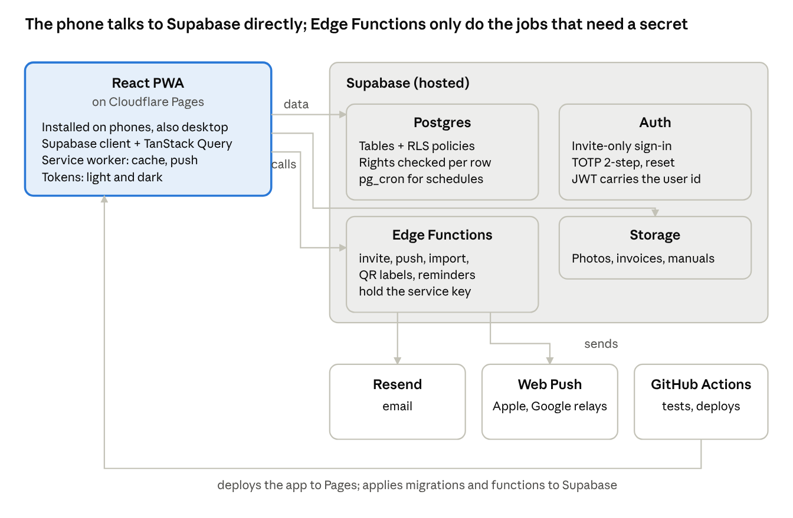

# OnTrack — Build Plan

Oct 28, 2026 · Katie · updated Nov 19, 2026 with Phases 1 to 6 as built, who does what between 6a and 6b, Admin on any role, and the Phase 7 pull requests

## How to read this

This is the build order for OnTrack: nine phases, each one a working slice of the app that can be tried on a phone before the next starts. The [Stack & Build Plan](https://claude.ai/artifact/B75SBPJobgaH5nAWhBCU9t) from October 20 holds the pre-design exploration (why a PWA, why Supabase, the auth alternatives, storage costs); this doc supersedes its phases and stack table.

The goal of the first four phases is one thing: an app the Four Corners ops team can install on their phones and use for real tickets, because a working app will land better than the slides and the design canvas have. Everything in the design (about 110 screens) is covered by a phase here; nothing is dropped, only ordered.

Each phase lists what it ships, the screens it covers from the design, the backend it needs, and a done test. Screens are named as they are on the design board so you can open them side by side.

## Status

| Phase | State | Pull requests |
| --- | --- | --- |
| 0 · Foundation | Done, except the real-iPhone check | OT-1 scaffold, tokens, theme, PWA, CI · OT-2 schema, RLS, `can()`, pgTAP, seed · OT-3 component kit, app frame, auth guard, role shells, loading and error boards |
| Kit pass | Done | OT-4 plan update · OT-5 every kit component gets its full set of states in both themes; the `/kit` page gets a desktop layout |
| 1 · Accounts and access | Done, except the real-iPhone check | OT-6 Sign in, signed out, Profile, Help · OT-7 security audit · OT-8 code quality · OT-9 Restaurants · OT-10 invites and the group name as data · OT-11 password reset · OT-15 fixes from trying reset live · OT-12 Roles & rights, User profile, View as · OT-16 reload fix · OT-13 and OT-17 2-step verification · OT-14 and OT-18 group settings and photo messages · OT-20, OT-21 and OT-22 fixes from the 2-step security audit |
| OT-23 | Done, tried on the live app | Small fixes from trying Phase 1 live, before Phase 2 (see below) |
| 2 · Tickets, the manager loop | Done, except the real-iPhone check | OT-24 plan update, then OT-25 to OT-35 (see Phase 2) |
| 3 · Ops dashboard and ticket work | Done, except the real-iPhone checks | OT-36 plan update, then OT-37 to OT-64 (see Phase 3). The buzz and its badge were tried on Android (Nov 5, 2026). Google sign-in (OT-59) is deferred until the group's IT person is involved |
| 4 · Equipment · first demo | Done, except the real-iPhone checks; tried on the live app (Nov 11, 2026) | OT-65 plan update, then OT-66 to OT-88 (see Phase 4). QR labels (OT-74) are deferred until the iPhone link check |
| 5 · Contractors, service records and invoices | Done, except the real-iPhone checks; the contractor page tried on the live app (Nov 12, 2026), the done test waits for a try there | OT-89 plan update, then OT-90 to OT-100 (see Phase 5) |
| 6 · Monthly walkthroughs | Done, except the real-iPhone checks and a try on the live app (6a Nov 16, 6b Nov 18, 2026) | OT-101 plan update, then OT-102 to OT-111 for 6a; OT-125 numbers 6b, OT-126 to OT-139 (see Phase 6) |
| Between 6a and 6b · Who does what | Done (Nov 17, 2026) | OT-112 and OT-113 plan updates, then OT-114 to OT-120: role names, the IT area, My categories' backend, job titles, My categories and its switches (see its section after Phase 6) |
| Between 6a and 6b · Admin on any role | Done (Nov 17, 2026) | OT-121 plan update, then OT-122 to OT-124: Admin held on top of a role, the shield and the admin view, a security pass (see its section after Phase 6) |
| 7 · Leadership, Admin tickets and imports | Started (Nov 19, 2026) | OT-140 plan update, then OT-141 to OT-155 (see Phase 7) |

Phase 0 notes:

- Production is https://ontrack-app.app (domain bought and connected Oct 2026) and still answers at https://ontrack.katina-sunrise.workers.dev; each branch previews at `https://<branch>-ontrack.katina-sunrise.workers.dev`. `fourcorners.ontrack-app.app` is connected (Oct 30, 2026), and Four Corners installs from there.
- The hosted Supabase project has the full schema (migrations deploy on merge) and no seed data. One admin account exists, made by hand before OT-7: an `invites` row in the SQL editor, then Authentication, Add user with the same email. An invite is claimed only with its link's token or its id in `app_metadata`, which the dashboard cannot set, so the invite flow (OT-10) is the way to add people; by hand means an `auth.users` insert like the seed's, with `role` in `app_metadata`.
- Install and dark mode were checked on Android Chrome. The iPhone part of the done test waits for a try on a real iPhone; Playwright WebKit covers it in CI until then.

Phase 1 note (Oct 30, 2026):

- **What changed:** real accounts. An admin invites someone by email and chooses their role and restaurants; they set up their own account from the link. Sign in, password reset, Profile and Help & support all work. An admin manages restaurants, people, role defaults and one person's rights, can view the app as someone else (read-only and logged), and can rename the group or turn profile photos off. 2-step verification is required for admins and offered to everyone.
- **Security audit:** an independent audit of 2-step verification and group settings (Oct 30, 2026) found 11 issues. OT-20 to OT-22 fix them, except that Supabase accepts a 2-step code more than once, which the app cannot change, and ten wrong backup codes briefly stop the owner's own backup codes too.
- **Security fixes tried on the live app (Oct 31, 2026):** an admin reset ended a test account's live session, and setting up again gave 8 new codes (OT-20). A remembered browser skipped the code, changing the password took a code, and signing in afterwards asked for one again (OT-21). An invite to a new address sent, and its link opened signed out in a private window (OT-22).
- **What that testing turned up:** the `EMAIL_FROM` function secret on the hosted project was missing or still the test sender, so Resend refused invites to anyone but the account's own address. It is set now.
- **OT-23 (Oct 31, 2026):** the fixes that testing led to were tried on the live app and work: Edit restaurant, no near-color warning, signing back in after Sign out goes home, a refresh says Loading, and no fallback email sender.
- **What the client should try:** accept an invite on a phone, sign in, and look at Profile. Change a password, or turn on 2-step verification from Profile. Screens past that are placeholders until Phase 2, and Four Corners has no accounts yet, so this waits until its first admin is chosen (see Open items).
- **How the done test went:** an invite went out and the account was set up from the email on a second phone, against the live app. Turning on See costs for that manager saved as an override, but changes nothing a person can see yet: no screen shows costs until the Closed ticket in Phase 2, and the live project has no cost records. That the database then returns costs is proven on the seeded data, in `e2e/stack/people.spec.ts` and pgTAP, as are the manager seeing only their restaurant and the refusals behind 2-step and the photo switch.

Phase 2 note (Nov 1, 2026):

- **What changed:** a manager can report a problem from a phone and follow it to closed. Open tickets has search and Front / Back. Create ticket goes from area and category to a form with equipment, urgency and photos, shrunk to 1600 px in the browser. A ticket has its thread with system events and a composer. Edit changes the title, description, equipment and urgency, and closes with an optional comment. A closed ticket is read-only and can be reopened within 30 days with a reason; after that it offers a new ticket linked to the old one. The ellipsis menu beside the search leads to a list of closed tickets. The In-house tab checks tasks off and deletes them while open. Cost and contractor show on a closed ticket only with See costs.
- **What the client should try:** sign in as a manager on a phone, create a ticket with a photo, post an update, then close and reopen it. Ops can't see tickets in the app until Phase 3, and Four Corners has no accounts yet, so this also waits until its first admin is chosen (see Open items).
- **What can't be tried on the live app yet:** nothing adds equipment until Phase 4, so the picker is empty there, and nothing adds in-house tasks until Phase 6, so the In-house tab is empty. Nothing notifies anyone until Phase 3. The seeded stack shows the full boards.
- **How the done test went:** `e2e/stack/done-phase-2.spec.ts` runs it on Chromium and WebKit against the seeded stack: Maya at Logan Square creates a ticket with a photo, the database has it at her restaurant with the photo under the ticket, and a manager at Porter can't find it in the list, by search or by link, or read it or sign its photo through the API. It was then tried on a real phone against the live app (Nov 1, 2026): a manager at Logan Square created a ticket with a photo, a manager at Porter did not see it in the list or by search, and the table editor showed the right restaurant. The iPhone part waits for a real iPhone, as in Phases 0 and 1.

Phase 3 note (Nov 4, 2026):

- **What changed:** the ops managers can run their day in the app. The dashboard lists every restaurant's open tickets under a label for each, in an order each person can drag, with a picker that scopes every Ops screen and a badge naming anyone else on a ticket. A ticket has a status menu: In progress puts you on it, Take this over is for a colleague's, and Scheduled asks for a date. Ops writes to the restaurant or in internal notes, with photos, and closes with a comment. Closed tickets are grouped by month, with totals for anyone with See costs. A reopened ticket is an ordinary one with a Reopened badge and nobody on it. Each ticket has a lasting link, `/t/OT-1042`, and Share link. Push on each device, email as well on by default, and switches per kind on Profile tell people what happened, and lists change as tickets do. A new ticket has a ring for 5 minutes. From feedback along the way: no assigning, a manager's Open tickets with a shorter header, Show / Hide on passwords, and an Update bar that says it is updating. A security audit (OT-55) and a code quality pass (OT-56) came last.
- **What the client should try:** the ops manager installs the app on a phone, turns on Push notifications on this device in Profile, and a manager at one restaurant creates a ticket. The phone should buzz within seconds, and the email arrive. Then mark it In progress, post an update, close it with a comment, and have the manager reopen it. This waits until Four Corners has accounts (see Open items).
- **What can't be tried on the live app yet:** the equipment card and the walkthrough line open nothing until Phases 4 and 6, costs stay empty until Phase 5 logs service, and admin and leadership have no ticket screens until Phase 7, so a ticket link tells them so. Google sign-in waits for the group's IT person.
- **How the done test went:** `e2e/stack/done-phase-3.spec.ts` runs it on Chromium and WebKit against the seeded stack. Dana at Porter creates a ticket, and Bert is sent a push and an email, and Chris an email. Bert marks it In progress, which puts Bert on it and sends Dana a push. Bert's update reaches Dana's screen and phone. Bert closes it with a comment, and Dana is sent a push. Dana reopens it with a reason, Bert is sent a push and Chris an email, and Bert's dashboard shows it Reopened with nobody on it. Playwright can't feel a buzz, so the flow checks the delivery log, and the push to a real phone was tried by hand on Android against the live app (Nov 5, 2026): a manager's new ticket buzzed the ops manager's phone, the status bar showed the check rather than a bell, and Push notifications on this device came back on after signing out and in again. iPhone push and the iPhone link check wait for a real iPhone.

Phase 4 note (Nov 11, 2026):

- **What changed:** every unit has a page and a history. Ops has an equipment list across restaurants with search, a filter sheet, category cards with open-ticket badges and this year's spend; a manager browses their restaurant's units by Front / Back and then category. A unit's page has Details (with the manual and a data plate photo), Tickets, open and closed, and Service & cost for Ops with See costs. Ops, and a manager with Add / edit equipment, add and edit units, and retire, restore or delete them by the archive and delete rule; retired units wait in a closed Retired card. A manager creates a ticket from a unit with the unit filled in, a ticket's equipment card opens its unit, and each unit has a lasting link, `/e/<id>`, and Share link. Ops and admins look after the group's categories. From feedback along the way: swipe down closes a sheet, Submit ticket with no photo asks first and offers Photo tips, a manager adds in-house tasks by hand and older finished ones sit behind Show older, and the app offers to install itself once. A security pass (OT-73) and an independent audit (OT-84) came before the done test, so it covers their fixes.
- **What the client should try:** the demo. Ops enters a restaurant's real equipment through Add equipment (importing waits for Phase 7), with a manual or a data plate photo where there is one. A manager at that restaurant finds a unit by Back of House and its category, creates a ticket from it, and sees the ticket on the unit; Ops sees it on the dashboard and can open the unit from the ticket. Then the assistant ops manager and one restaurant manager install the app and run real tickets for a week. This waits until Four Corners has accounts (see Open items).
- **What can't be tried on the live app yet:** QR labels, scanning and Print QR label wait for OT-74 and the iPhone link check. Service & cost shows its no-service-yet state until Phase 5 logs service, so spend on the lists stays empty. Importing equipment from a spreadsheet waits for Phase 7.
- **How the done test went:** `e2e/stack/done-phase-4.spec.ts` runs it on Chromium and WebKit against the seeded stack. Maya at Logan Square opens Equipment, Back of House and Refrigeration, opens Walk-in Cooler 1 and creates a ticket from it with the unit already chosen; the ticket is under the unit's Tickets tab and opens from there, and Bert's dashboard lists it with the unit on it. Bert adds a unit at Logan Square through Add equipment, and it shows in Maya's Refrigeration card and in the ticket form's picker. Bert retires it, and it leaves both; Maya has Add / edit equipment, so it waits in her Retired card. The demo on the live app was then tried by hand (Nov 11, 2026) and worked as expected. QR labels and the iPhone checks wait for a real iPhone.

Phase 5 note (Nov 12, 2026):

- **What changed:** every repair can carry its cost, its contractor and its invoice. Ops logs a visit from a ticket, from a unit (a ticket optional, for a maintenance call nobody reported) or from a contractor's page: in-house or a contractor, the technician, the invoice number, labor, parts and trip fee with a live total, notes and the invoice file. A service record shows the invoice (View, Download, Replace, or Missing with Attach), the cost line by line and its details, and Edit corrects it, with no Delete, since a visit is part of the record. The Contractors tab is a directory with search, trade chips, preferred stars, insurance warnings and one-tap call; a contractor's page has this year's spend, visits and last visit, Visits and Invoices tabs, Add and Edit, Archive and Delete, and a lasting link, `/c/<id>`. The Invoices tab lists each month's contractor visits with a Missing filter, sort, search and the month's total. The spend on a unit, a contractor, an open ticket and the Closed tab's months comes from the same views in the database, and only with See costs. From feedback along the way: a contractor has one or more trades, and Ops and admins look after the trade list. A security and code quality pass (OT-97) came before the done test.
- **What the client should try:** the ops manager logs a real contractor visit from a ticket on a phone, with a photo of the paper invoice or the PDF, then closes the ticket. The unit's Service & cost, the contractor's page and Closed tickets should each show the amount, and the invoice should open from each. Then look at Invoices for this month and chase anything under Missing. This waits until Four Corners has accounts (see Open items).
- **What can't be tried on the live app yet:** importing contractors from a spreadsheet and leadership's read-only contractor and invoice screens wait for Phase 7.
- **How the done test went:** `e2e/stack/done-phase-5.spec.ts` runs it on Chromium and WebKit against the seeded stack. It reads Walk-in Cooler 1's 2026 cost, Coldline's spend and this month's total on Closed tickets. Maya at Logan Square then reports the cooler from its page. Bert logs Coldline's $397.40 visit on the ticket (labor $120, parts $212.40, trip $65) with the invoice PDF, and closes the ticket. All three figures rise by exactly $397.40, and the invoice opens, as the same file, from the closed ticket in Closed tickets, from the unit's service log and from Coldline's visits. To open the invoice from the Closed tab, a closed ticket now lists its visits under Resolution, as an open ticket does (OT-98).

Phase 6a note (Nov 16, 2026):

- **What changed:** managers walk their restaurant each month in the app. The database opens one walkthrough per restaurant on the first of the month, due on the last day, and reminds the managers there 7 and 2 days before, by push and email, with a switch on Profile. The Walkthrough tab shows this month's progress by section, what is flagged, who started it, and past walkthroughs. The checklist goes section by section, with groups that open and close and hand on to the next when full, and Good, In-house or Ticket on each item, each tap saved as it happens. A ticket from an item takes the item's category and carries the Walkthrough tag to Ops' dashboard, and its walkthrough line opens the walkthrough again. In-house fixes are added on the item and checked off or deleted from the same list as the In-house tab. The quarter's tasks sit in their own tab, with directions and a how-to video link. Review & submit counts what is done and still open, lists every ticket and fix, takes a note for Ops and asks first when checks are still to do. Everyone at a restaurant with Create tickets shares the one walkthrough. A security and code quality pass (OT-110) came before the done test.
- **What the client should try:** a manager does this month's walkthrough on a phone: one section with a ticket and an in-house fix, then Review & submit with a note. The ops manager should see the ticket on the dashboard with the Walkthrough tag, and its walkthrough line should open the walkthrough. This needs the group's real checklist first (see Open items), and waits until Four Corners has accounts.
- **What can't be tried on the live app yet:** Ops has no walkthrough screens until 6b: no overview, no Send reminder, no schedule, rotation, checklist editor or spreadsheet import, so every restaurant gets the one checklist every month. Leadership's walkthrough is Phase 7's.
- **How the done test went:** `e2e/stack/last/done-phase-6a.spec.ts` runs it on Chromium and WebKit against the seeded stack. The seed's newest walkthroughs are October's, so the test opens November as the scheduled job does, with the stack's service key, and finds one for each of the four restaurants, due November 30. Maya at Logan Square (Chromium), or Dana at Porter (WebKit), finds November on the home, marks two Electrical items Good, adds an in-house fix to a third, and creates a ticket from each of the other two, one urgent; the group closes with "2 tickets, 1 in-house". Review counts the fix and the two tickets, and Submit anyway sends the note. The database has the walkthrough submitted with the note, the two tickets from the walkthrough and the fix, and Bert's dashboard shows both tickets under the restaurant with the Walkthrough tag. Opening November makes it every restaurant's current walkthrough, which the other walkthrough flows don't expect, so the test runs in its own Playwright project after the rest of its browser's suite (`chromium-last`, `webkit-last`), and CI passes the stack's service key as `STACK_SECRET_KEY`. The Ops overview's "one of four submitted" is 6b's.

Phase 6 note (Nov 18, 2026):

- **What changed in 6b:** Ops runs the walkthroughs from the app. The Walkthroughs tab shows a month at a time: how many restaurants have submitted and how many days are left, a row per restaurant with its progress, standing and what it flagged, and the last six months as On time, Late, Missed or In progress, scoped by the restaurant picker as the dashboard is. One restaurant's page shows its progress by section, who is working on it, what is flagged, past walkthroughs, and Send reminder with when the last one went. Ops reads a restaurant's in-house fixes and turns one into a ticket with Convert to ticket, adds a task to a restaurant's In-house list from a new Ops In-house list, and hands a ticket back as an in-house task from its status menu; the Reporters there hear about each one. The Schedule sets the group's rotation (a cycle of months, each with its own checklist), gives a restaurant its own or one it shares with others, or switches it back, and sets the due date and the reminder days. Quarterly tasks are the group's list, with each restaurant's removals, changes and own tasks, and an editor with directions and a how-to video link. Each checklist has an editor, and can be replaced from a spreadsheet (a CSV template of the checklist as it is, uploaded as .xlsx or .csv, with what will change shown first). A walkthrough already open keeps the checklist and quarterly tasks it opened with; a change makes a new version for the months after. Before 6b, from the ops manager's answers: the groups' own names for the roles (Reporters and Support Team here), IT as a third area, My categories for what each person is told about and sees, job titles, and Admin held on top of a role. A security and code quality pass (OT-138) came before the done test.
- **What the client should try:** the ops manager sets up next month on the live app. On Schedule, set the group's rotation and its checklists, and give Ranalli's, or any restaurant that walks differently, its own. Load the group's real checklist from a spreadsheet: download the template from a checklist's editor, fill it in, upload it, read what will change, and replace. Give every item a category where one fits, since a ticket from an item without one asks the manager to pick (found trying OT-138, Nov 18, 2026); some items, like walls, floors and paint, have no category that fits today, so the group may want to add one or two on Categories first. (Superseded by OT-141, Nov 19, 2026: an item needs no category, and its ticket reads as the walkthrough's path.) Set this quarter's tasks. On the first of the month each restaurant's walkthrough opens; a manager walks it on a phone, and the ops manager watches the Walkthroughs tab, sends a reminder, converts a fix into a ticket, adds a task and hands a ticket back. A large .xlsx (several hundred rows) should finish reading on import, which is the content security policy change from OT-138, tried only in Playwright so far. This waits until Four Corners has accounts (see Open items).
- **What can't be tried on the live app yet:** leadership's read-only walkthrough is Phase 7's, as are the contractor and equipment imports that reuse the spreadsheet pieces. The quick ticket's Scan QR waits for QR labels (OT-74). No board draws the Ops In-house list or the checklist editor, so they follow the app's other lists and Categories.
- **How the done test went:** `e2e/stack/last/done-phase-6.spec.ts` (6a's done test, renamed, with 6b's part added in OT-139) runs it on Chromium and WebKit against the seeded stack. The test opens November as the scheduled job does, and finds one walkthrough for each of the four restaurants, due November 30, each from its rotation. Maya at Logan Square (Chromium), or Dana at Porter (WebKit), walks the Kitchen's Electrical group: two items Good, an in-house fix on a third, a ticket from each of the other two, one urgent, then Submit anyway with a note. The database has it submitted with the note, the two tickets from the walkthrough and the fix, and Bert's dashboard shows both tickets with the Walkthrough tag. Bert then opens Walkthroughs, which opens on November: "1 of 4 submitted", "2 checklists · due Nov 30" (the group's Kitchen + Exterior, and Ranalli's own Dining + Patio), the restaurant's row Submitted with its 2 tickets and 1 in-house, and the other three not submitted. CI runs each browser on its own stack, so each sees one of four; locally both share one, and the second sees two. The iPhone checks wait for a real iPhone.

## Decisions

The app talks to Supabase directly and Edge Functions handle only the jobs that need a secret or a server. That is the smallest backend that still keeps roles enforced in the database.

| Area | Decision | Why |
| --- | --- | --- |
| Front end | React 19 + Vite + TypeScript, built as an installable PWA | One codebase for phone and desktop; the design is mobile first; installs from Safari and Chrome without an app store |
| Hosting | Cloudflare Workers with static assets, deployed by Workers Builds: `main` is production, every other branch gets a preview URL | Free tier, global CDN, no server to run; the Worker only serves the built files with a single-page fallback, so the backend lives elsewhere. Pages was the first choice; Cloudflare now labels it legacy |
| Database | Supabase Postgres, hosted | Relational data (restaurants, equipment, tickets, service records); row-level security enforces roles |
| Auth | Supabase Auth: email + password, invite-only, TOTP 2-step | Invite flow and MFA built in; the design's sign-in, reset, 2-step and invite screens map onto it directly |
| Data access | The React app reads and writes Supabase over its client library; every table has RLS policies | Fewer moving parts than an API layer; permissions live in one place and are tested as SQL |
| Server logic | Supabase Edge Functions (Deno, TypeScript) for invites, push, imports, QR label PDFs, scheduled jobs | Python was the first thought but is not required; one language across the whole app, and Edge Functions deploy with the Supabase CLI |
| Files | Supabase Storage, photos resized to 1600 px in the browser before upload | Same permission rules as the tables; invoices and photos stay small |
| Email | Resend, through Supabase's custom SMTP setting plus a sending Edge Function | Supabase's built-in email is rate limited to a few per hour |
| Push | Web Push (VAPID keys), subscriptions stored per device, sent from an Edge Function | Push first, as asked; iPhone needs the app installed to the home screen, so email is the fallback for anyone who has not installed |
| UI | Tailwind with the design tokens as CSS variables, headless Radix primitives, components built to match the design | The design is custom, so a styled library would fight it; tokens give light and dark mode from day one |
| Data layer | TanStack Query over the Supabase client; React Router | Caching, retries and optimistic updates without a store to maintain |
| Testing | Vitest for logic, pgTAP for RLS policies, Playwright on Chromium and WebKit for flows | WebKit in Playwright is the stand-in for an iPhone until a real-device pass |
| Repo and CI | One GitHub repo (`app/`, `supabase/`), GitHub Actions: lint, typecheck, Vitest, Playwright, pgTAP and type generation on every PR; Supabase migrations on merge to main. Cloudflare Workers Builds deploys the app itself | Solo, AI-assisted build: every change goes through the same gate |
| Offline | Later (Phase 8). v1 caches what you have read; writes need a connection | The queued-ticket flow in the design is real work on its own |
| Archive and delete | Things people pick from (restaurants, people, equipment, contractors, categories, templates) are archived, not deleted; records of what happened (tickets, walkthroughs, updates, service records, invoices) are never archived or deleted; anything can be deleted only while nothing points to it | Keeps every history and every report intact while still letting an admin clear a mistake or a test entry. The full table is under Archive and delete below and in `CLAUDE.md` |
| Permissions | Four roles with defaults from the Roles & rights screen, overridable per person. The roles' names are the group's, and a job title on each person says who they are (Nov 16, 2026) | Managers can be granted equipment edits and cost visibility by an admin; the database checks the grant, not the screen. A chef files tickets like a manager and IT works tickets like Ops, so neither needs a role of its own |
| Avatars | Initials follow the boards: the color comes from the role, and pending and expired invites have their own. An admin can turn profile photos off for the whole group | The color says who is talking on a ticket thread and matches the design. The switch is enforced in the database and keeps the files, so it can be reversed |
| Group name and domains | The group's name is a field in the database, never in the code. Each group gets its own subdomain: `fourcorners.ontrack-app.app`, later `hogsalt.ontrack-app.app` | Another restaurant group may want the app someday, and nothing about Four Corners should have to be edited out of the code when that happens |

Google sign-in is planned as OT-59: the group is on Google Workspace with its own domain, and it is deferred until their IT person is involved (see Open items). `fourcorners.ontrack-app.app` is connected, which QR labels need, since they bake the URL in.

## Architecture

The phone never holds a secret: it signs in with Supabase Auth, then reads and writes tables and files under row-level security. Edge Functions run with the service key for the few jobs a phone cannot do safely (send an invite, push to other people's devices, process an import, render a label sheet, create next month's walkthroughs on a schedule). Cloudflare Workers Builds deploys the app on every push (production from `main`, a preview per branch), and GitHub Actions deploys the migrations and functions to Supabase on every merge.

The app gets two public build values, the Supabase URL and the publishable key (`sb_publishable_…`). Both end up in the JavaScript every visitor downloads, so no secret key, `service_role` key or personal access token may ever go in a `VITE_` variable. Cloudflare keeps build variables per environment: Production and each branch need them set separately.

## Data model

Twenty-nine tables in five groups, plus twelve views. Tickets are the center; equipment, service records and walkthroughs all hang off them. The nine-table model in the earlier doc grew by the walkthrough, contractor and rights tables the design added.

| Group | Tables | Notes |
| --- | --- | --- |
| Org and access | `restaurants`, `profiles`, `memberships`, `invites`, `rights`, `push_subscriptions`, `audit_log`, `group_settings`, `support_reports`, `two_step_codes`, `two_step_devices`, `two_step_passes`, `two_step_resets` | `restaurants` holds name, address, phone, accent color, manager. `group_settings` is a single row for the group: its name, its short name, and whether profile photos are allowed. `profiles.role` holds the role (manager, ops, leadership, admin); `memberships` is scope only, one row per restaurant or a single null row for all restaurants, which ops and leadership get by default. `rights` = the Roles & rights grid: a default row per role, plus per-person override rows. Right keys: `create_tickets`, `see_all_tickets`, `update_status`, `log_cost`, `see_costs`, `edit_equipment`, `see_contractors`, `set_walkthrough_schedule`, `invite_users`, `manage_rights` |
| Equipment | `equipment`, `categories` | Category carries area (FOH or BOH). Equipment has brand, model, serial, installed, warranty, location note, manual file, retired_at |
| Tickets | `tickets`, `ticket_updates`, `ticket_photos` | Ticket: restaurant, equipment (optional, at that restaurant and not retired when linked), category, title, description, urgency (low, normal, urgent), status, assignee, source (reported or walkthrough), walkthrough_id, reopened_at. Status is an enum: open, in_progress, waiting_parts, scheduled, reopened, closed. Updates carry text, photo, internal flag, and system events (assigned, status change, closed, reopened) |
| Service and money | `contractors`, `service_records`, `service_line_items`, `invoices` | A service record belongs to a restaurant, optionally a ticket (whose restaurant and unit it then takes, since OT-90) and a unit, and optionally a contractor; line items are labor, parts, trip. An invoice is a file plus number, amount and status (attached, missing). Per-unit and per-contractor spend are views over service records |
| Walkthroughs | `walkthrough_schedules`, `walkthrough_templates`, `walkthrough_items`, `walkthroughs`, `walkthrough_checks`, `inhouse_fixes`, `quarterly_tasks` | A schedule is group-wide or per restaurant (rotation of months). A walkthrough is one restaurant for one month; checks are its item results (good, in-house, ticket). In-house fixes link back to the check and can convert to a ticket. Quarterly tasks are group-wide with per-restaurant overrides and removals |

**How rights work.** The JWT carries the user id, plus the level and session id Supabase Auth adds for 2-step verification, and no rights. A SQL function `can(action, restaurant_id)` reads `profiles.role`, `memberships` and `rights` and is used by every policy, so a manager with `edit_equipment` granted by an admin passes the same check an ops manager does. Leadership policies are select-only. The service role used by Edge Functions bypasses RLS, which is why those functions check the caller themselves before acting.

**Counting and costs** (open tickets per restaurant, spend this year per unit, visits per contractor) are Postgres views, not client-side sums, so every screen shows the same numbers.

All five groups landed in Phase 0 (OT-2, eight migration files; Phase 1 added its own access tables to the first group) even though phases 1 to 4 use only the first three; adding walkthrough tables later would have meant reworking the ticket table's `source` and `walkthrough_id` columns. Account creation is invite only in the database itself: a trigger on new auth users takes role and restaurants from a pending invite and rejects anyone without one.

## Archive and delete

Decided Oct 30, 2026, after restaurants got archive and delete in OT-9. Each phase builds these for its own entities the same way: a database function per action that checks the caller and logs it, the "only while nothing points to it" rule enforced in the database, and a confirm sheet on the row.

| Entity | Archive (reversible) | Delete | Phase |
| --- | --- | --- | --- |
| Restaurants | Archive / Restore | Only with no history and nobody's home restaurant | 1 (OT-9, done) |
| People | Deactivate / Reactivate: no sign-in, out of pickers, name kept on history | Revoke a pending invite; delete an account only with no history | 1 (OT-10 revoke and ban, OT-12 User profile) |
| Equipment | Retire | Only with no tickets or service records | 4 |
| Contractors | Archive | Only with no service records | 5 |
| Categories, walkthrough templates and items, quarterly tasks | Turn off | Only if never used | Categories 4 (OT-86); the rest 6b |
| Tickets | None (closing ends a ticket) | Never | |
| Walkthroughs, ticket updates, service records, invoices | None (they are the record) | Never; edits are logged | |
| In-house fixes and tasks | None | While still open | 2 (OT-30) |

## Phase 0 · Foundation

An empty app that installs on a phone, switches between light and dark, deploys on every merge, and has a database whose permissions are already tested. Nothing a user would call a feature, but every later phase moves faster for it.

**Status:** done in OT-1 to OT-3; the real-iPhone check waits for a real iPhone (see Status above).

**Ships**

- Repo with `app/` (Vite + React + TypeScript) and `supabase/` (migrations, functions, seed, tests); GitHub Actions running typecheck, Vitest, pgTAP and Playwright on Chromium and WebKit
- Cloudflare Workers Builds connected to the repo: production on `main`, a preview URL per branch
- Supabase project with the full schema from the data model, RLS on every table, the `can()` function, and pgTAP tests that sign in as each role and assert what it can and cannot read
- Seed script with the four restaurants, their colors, sample users for each role, equipment and tickets matching the design's sample data, so every demo starts from the same state
- Design tokens as CSS variables (colors, spacing, type, radii) with a dark set; Tailwind wired to them; the `prefers-color-scheme` default plus a manual toggle saved per device
- Component kit built from the design: button, pill, card, list row, bottom tab bar, sheet, field, select, switch, segmented control, avatar, toast, skeleton. Each one has a Storybook-style page in the app under `/kit` for checking both themes
- PWA shell: manifest, icons, splash, service worker with precaching, install prompt, `100dvh` and safe-area padding, 16 px minimum input size
- App frame: routing, auth guard, the four role shells with their tab bars, loading and error boundaries

**Screens from the design:** Loading states (spinner, list and detail skeletons), Error 404, 500, no access

**Done when:** a teammate can open the preview URL on an iPhone, add it to the home screen, toggle dark mode, and the RLS tests pass for all four roles.

## Phase 1 · Accounts and access

Real people can be invited, sign in, and land in the right role, with rights an admin can adjust. Everything after this is gated on who is looking, so it comes first.

**Ships**

- Admin: Restaurants list and Add restaurant (name, address, phone, manager, accent color with the preset swatches and custom picker, taken-color check)
- Admin: Users list with filters (all, pending, managers, ops), Invite user (name, email, role, restaurants), resend and revoke, user profile with per-person rights override, View as (a read-only view, not impersonation: no token changes hands, and it is logged to the audit table)
- Admin: Roles & rights grid, editable defaults with the confirm sheet, locked admin column
- Invite email through Resend; invite link single-use, 72-hour expiry; Set up account screen (name, password rules, confirm)
- Sign in, password reset (request, sent, email, new password, done), expired link and signed-out screens. The Sign in button stays disabled until the email has a valid shape and the password has at least 12 characters (the provisional screen from Phase 0 only disables it when Supabase is not configured)
- 2-step verification (OT-13): TOTP with authenticator app (choose, scan, verify, backup codes) required for admins and offered to everyone, enforced in the database; once on, it stays on for that person. Backup codes and "Don't ask again on this phone for 30 days" are ours, since Supabase Auth has neither. An admin can reset it for someone, with an email to them; the only admin's recovery is a line of SQL (see CLAUDE.md). The SMS option waits unless the group asks for it, since it adds a Twilio cost
- Profile (name, phone, restaurant, theme toggle, sign out) and Help & support (report a problem to a support inbox, FAQ)
- Group name as data (OT-10, first step): `group_settings` holds the name and short name, and every "4C | Four Corners" reads from it, including the admin header and the invite email. The name and short name can be read before sign-in, because Checking your invite shows them. The migration starts the row as "OnTrack", the seed sets Four Corners, and the hosted project gets its name by one SQL update after merge. Links in emails come from an `APP_URL` function secret, never from a domain in the code. The app description in `index.html` and the manifest drops the group's name
- Group settings on Roles & rights (OT-14): an admin edits the name and short name there, through a database function that writes `audit_log`
- Profile photo switch (OT-14): an admin turns profile photos off or on for the whole group. Off refuses new uploads in the storage policies and on `profiles.avatar_path`, stops serving existing photos, and shows initials everywhere; Profile drops Upload and Change. Files are kept, so turning it back on restores them, and a person can still remove their own photo while it is off: Profile keeps Remove for anyone with a saved photo and tells them it is hidden and comes back if photos are turned on again. Whether photos are on or not, uploading and removing confirm with a message, since neither waits for Save changes. A photo link already handed out works until it expires, within the hour, and other people's screens follow within five minutes or on reload. It follows the OT-9 pattern: an admin-only database function that writes `audit_log`, a confirm sheet, and pgTAP for the role check, the refusal and the log. Ticket and equipment photos are not affected. No board exists for this, so it is a `Switch` row with the kit's confirm sheet on Roles & rights, under Edit defaults
- Edge Functions: `invite-user`, `revoke-user`, `reset-two-step`, `send-email`. They run with the service key, so each checks the caller with `can()` or `is_admin()` first. `revoke-user` sets `profiles.deactivated_at` and also bans the auth user so refresh tokens stop working
- A `/security-review` pass before the invite and sign-in work merges, since this is the first code that holds the service key

**Screens from the design:** Admin · Users, Invite user, Roles & rights, User profile, View as, Restaurants, Add restaurant; Invite email, Set up account, Sign in, Password reset 1 to 5, 2-step setup 1 to 4 and the sign-in code screen, Profile, Help & support, Error · link expired, no access, signed out

**Done when:** an admin invites a manager from a phone, the manager sets up the account from the email on another device (a tablet or a phone on wifi is fine, since nothing here needs a phone number), and the RLS tests show the manager sees only their restaurant. Granting `see_costs` to that manager in Roles & rights changes what the database returns, with no app change.

## Phase 2 · Tickets, the manager loop

A restaurant manager can report a problem from a phone in under a minute and follow it to closed. This is the first thing worth showing the Four Corners team, even before Ops has its own screens.

**Ships**

- Open tickets list: Tickets and In-house tabs with counts, search, All / Front / Back segments, the restaurant label with its color square, cards with status pills and icons
- Create ticket in two steps: area and category grid (counts per category), then the form (title, description, photos, urgency, optional equipment picker filtered to that restaurant)
- Ticket detail: header with status and urgency, description, equipment card, the update thread with photos, the composer with camera, system events in the timeline
- Edit or close ticket (manager side), with the closed state read-only
- Closed ticket: resolution, contractor and cost shown only when `see_costs` is granted, 30-day reopen window, the Reopen ticket sheet that sets status to Reopened and notifies Ops
- Photo upload: resized to 1600 px in the browser, stored under the ticket, thumbnails in the thread
- Empty and no-results states for the lists; the save-failed validation state on the form
- Status icons, pills and the restaurant color square as shared components, since every later list reuses them

**Screens from the design:** Manager · Open tickets, Open in-house tasks, Create ticket area, Create ticket form, Open ticket, Edit / close ticket, Closed ticket; Empty · Manager open tickets; No results · ticket search; Error · validation on save

**Done when:** a manager at Federale’s Logan Square creates a ticket with a photo on an iPhone, it appears in the database with the right restaurant, and a second manager at Porter cannot see it. Ops can still only see tickets through the database at this point; that is Phase 3.

**Pull requests**

| PR | Scope |
| --- | --- |
| OT-25 | Default categories on the hosted project; Open tickets list with search and Front / Back segments; empty and no-results states; the ticket card |
| OT-26 | Create ticket: area and category, then the form with the equipment picker; the save-failed state |
| OT-27 | Ticket detail: header, description, equipment card, thread with system events, text composer |
| OT-28 | Photos: resize to 1600 px, add on the form and in the composer, thumbnails in the thread |
| OT-29 | Edit and close, Closed ticket, the Reopen sheet, cost shown only with `see_costs` |
| OT-30 | In-house tab: list, check off, delete while open |
| OT-33 | From OT-29's open questions: an ellipsis menu beside the search on Open tickets with View Closed Tickets, opening a simple list; Title on Edit ticket |
| OT-34 | From trying Phase 2 live: no scrollbar on the message field at one line |
| OT-35 | Faster CI: docs-only PRs run nothing, the flows run one job per browser, and a `quick` label skips them on a small fix's PR |
| OT-31 | The done test as one flow; the phase note |
| OT-32 | From trying OT-26 live: Open tickets loads in the empty layout when it found nothing last time, so it doesn't jump |

**What this phase has to work around**

- **Categories exist only in `seed.sql`, so the hosted project has none, and a ticket requires one.** OT-25 adds the design's list in a migration, and the seed stops inserting its own. Nothing can be created on the live app until that merges.
- **Open tickets cards always say who is on the ticket.** The board shows a contractor on one card, but managers cannot read service records without `see_costs`, and none exist until Phase 5.
- **The equipment card on a ticket isn't a link until Phase 4,** when the unit has a page to open.
- **A ticket's thread rereads every 30 seconds** while it is on screen and when the app comes back to the front, so a reply turns up without a reload. Live updates can wait for push in Phase 3, if the delay matters.
- **A closed ticket takes no message or photo from a manager,** in the database as well as on screen. Ops keeps the right, for what Phase 3 builds.
- **Edit ticket adds Title to its board** (decided Nov 1, 2026, built in OT-33), alongside description, equipment, a photo and urgency. The closing comment is optional, as the board has it. Urgency adds Low, which Create offers.
- **Reaching a closed ticket:** the board's only way is Equipment Tickets in Phase 4, and a ticket with no equipment would have none. Closing offers View closed ticket, and OT-33 adds an ellipsis menu to the right of the search on Open tickets, with View Closed Tickets opening a simple list (decided Nov 1, 2026). With nothing open there is no search, so the menu sits beside the title. It has room for more items later. Neither the menu nor the list has a board. The list shows the latest 100.
- **The boards' notification promises wait for Phase 3:** "You'll get a notification when work starts" and "Ops has been notified" are left off, since nothing notifies yet. OT-46 puts them back.
- **Photos go up after the ticket they belong to,** whose folder and policies they need. If they fail, the ticket stands and the message says to add them in an update. In an update the files go first, so a failure posts nothing. A file uploaded just before a failed post stays in Storage unreferenced, which only people who can see the ticket can reach.
- **Tapping a photo opens it large, and picked photos show in a tray with Remove.** Neither has a board. An update or new ticket takes up to 6 photos.
- **Nothing adds equipment until Phase 4.** On the live app the picker is empty and every category says 0 items, so tickets there have no equipment. The seeded stack shows the full boards.
- **The done test's second manager is seeded.** The boards have nobody at Porter but an expired invite, so the seed adds Dana Ortiz as its manager. That person shows on Users, which the board doesn't draw. On the live app, the same test needs a real invite to a manager at Porter.
- **Nothing adds in-house tasks until Phase 6** (until OT-83, Nov 6, 2026, which lets a manager add one by hand). Walkthroughs create them, so the In-house tab stays empty on the live app, and OT-30 is proven on seeded data. That empty list says "Nothing to fix right now", which has no board.
- **A checked-off in-house task offers no Delete,** though the board draws it, since the rule is delete while open and the database refuses it. Unchecking brings the task back, and it can be deleted then.
- **Deleting an in-house task removes the row,** as the board's "permanent" says, and the audit log keeps who deleted what. Each task now carries its area, because Front and Back can't be read from a quarterly task's label; a task with none shows only under All. Phase 6 sets the area when it creates a task, and adds the write that Convert to ticket needs.
- **The QR buttons wait for Phase 4,** since a scan would have nothing to open: Scan an equipment QR code on Create ticket, and Scan a QR code with its sentence on the empty Open tickets screen. These are the planned differences from those boards.
- **Save-failed uses Log service's board.** The only Error-Save-Failed board is drawn on Log service, so Create ticket takes its banner and its Report a problem link. It says what went wrong and keeps everything typed.
- **A manager with more than one restaurant** has no board: they get a Restaurant picker on Create ticket, and the restaurant's name on each Open tickets card.
- **Reopening writes the thread event but notifies nobody yet.** Push and email arrive in Phase 3, which keeps the "notifies Ops" promise.
- **Categories can't be turned off or deleted yet.** That is saved for later (Oct 31, 2026), so the list from OT-25 stays as it is until then, and changing it means a migration.
- **View as:** each screen scopes its data from `useUser()` and hides writes when `viewingAs` is set, and Open tickets replaces the manager's placeholder in `ViewAsScreen`.

## Phase 3 · Ops dashboard and ticket work

The ops managers can run their day in the app: see every restaurant's open work, pick up tickets, talk to the restaurant, close, and handle a reopen. With push, this is the point where the app replaces texting.

**Ships**

- Ops dashboard: tickets under a label for each restaurant, in an order each person can change, an ellipsis menu leading to closed tickets, cards with restaurant color squares, walkthrough tags and a badge naming who is working on the ticket; the restaurant picker (All restaurants plus each one) that scopes every Ops screen
- Ops ticket detail: the status dropdown, description, equipment card, updates thread with the internal-note toggle ("Visible to restaurant"), composer
- Closed tickets grouped by month with totals; closed ticket detail
- A reopened ticket is an ordinary ticket with a Reopened badge
- Push notifications: subscribe on install, store per device, Edge Function `send-push` fired by database triggers for new ticket, status change, new update visible to the restaurant, reopen. Email as well as push, on by default, with its own switch. A Notifications section on Profile to turn each kind on or off
- One lasting link per ticket, `/t/OT-1042` (OT-62; it was `/t/<id>` until then, and those links still open), which opens the right screen for whoever taps it, since `/tickets/:id` is for managers only. A signed-out person goes through sign-in and back, and the link grants nothing: someone who can't see the ticket gets the same refusal as today. Push and email notifications use it, built from the group's own address. The number is forgiving to type (`ot-1042`, `OT-01042` and `1042` open the same ticket) and is turned into the ticket under RLS, so it grants no more than the id did
- Share link on a ticket, in the ellipsis menu from OT-33: the phone's share sheet (Messages, Copy and so on), or on a computer it copies the link and confirms. No board draws it
- Empty states for the dashboard and Closed tab; loading skeleton for the card feed

**Screens from the design:** Ops · Dashboard, Ticket detail, Closed tab, Reopened ticket; Empty · Ops dashboard, Ops closed tab; Loading · card feed skeleton; Error · something went wrong

**Done when:** a manager creates a ticket and the ops manager's phone buzzes; the ops manager marks it In progress, posts an update the manager sees, closes it with a comment; the manager reopens it and Ops sees Reopened on the dashboard. Playwright runs that whole loop on WebKit.

**Pull requests**

| PR | Scope |
| --- | --- |
| OT-36 | Plan update and this split |
| OT-37 | Ops dashboard: Open tab, All / Mine, the restaurant picker that scopes every Ops screen, cards, empty state, loading skeleton; replaces the ops placeholder in View as |
| OT-38 | Saved for later: the dashboard's filter sheet, unless Ops asks for it |
| OT-39 | Ops ticket detail: header, description, photos, equipment card, the status dropdown, marking In progress puts you on it, Take this over, a date for Scheduled |
| OT-40 | Ops thread: composer with photos, the internal-note toggle, Close ticket with a comment |
| OT-41 | Closed tickets, opened from the dashboard's menu: grouped by month with totals, its empty state, closed ticket detail |
| OT-42 | Dropped from feedback (Nov 2, 2026): a reopened ticket has no screen or sheets of its own; see OT-52 |
| OT-43 | Lasting link `/t/<id>` for every role, and Share link on a ticket |
| OT-44 | Push on a device: service worker handles push, subscribe per device, the Notifications section on Profile, a test push to your own phone |
| OT-45 | `send-push`: an outbox written by a database trigger for each kind, who gets what, email on by default as well as push, links through `/t/<id>` |
| OT-46 | Put back the boards' notification promises; check on a real iPhone how it opens a link; a temporary ring on a new ticket's card, for Ops and managers; the small notification icon on Android; a clearer name for the device switch, which comes back on after signing back in; from feedback, Update says it is updating, and Create ticket opens on Front of House |
| OT-48 | Simplify the dashboard from feedback: no assigning, no Unassigned, no All / Mine; a badge names who is working on a ticket |
| OT-49 | Tickets grouped under a label for each restaurant; Closed moves to an ellipsis menu; a reopened ticket is an ordinary card with its pill |
| OT-50 | Change the order of the restaurants on the dashboard by dragging |
| OT-51 | From feedback: a reopened ticket is on the dashboard and not in Closed tickets; the Ops message box hidden until Add update; no "Nobody has this yet" note |
| OT-52 | From feedback: a reopened ticket acts like a new one apart from its badge, with nobody on it and no date |
| OT-55 | Security audit of what Phase 3 added: policies and functions since OT-22, internal notes and their photos, Ops and manager scope, links, push and `send-push` |
| OT-56 | Code quality pass: the repeated ticket header, the similar closed-ticket screens, `v_closed_by_month` that nothing uses, leftovers from simplifying |
| OT-57 | From feedback: Edit, Close and Share in the menu on a manager's ticket, with Close still on Edit ticket |
| OT-58 | From trying OT-45 live: a failed call to `send-push` says why in `notify_problems`, and lists change as tickets do, through Realtime |
| OT-59 | Deferred (Nov 4, 2026) until the group's IT person is involved: Google sign-in, tried on an installed iPhone app first, then Google alongside invites, with no password for people on the company domain |
| OT-61 | From feedback (Nov 4, 2026): Show / Hide on every password field, as the setup and reset boards draw it |
| OT-62 | From feedback (Nov 4, 2026): ticket links by number, `/t/OT-1042`, forgiving to type; older links with the id still open |
| OT-63 | From feedback (Nov 4, 2026): a shorter header on a manager's Open tickets and In-house: no search and no Front / Back, and the ellipsis menu beside the title |
| OT-64 | Faster CI: the flows run in Playwright's own Docker image, since installing WebKit's system packages from Ubuntu's mirror took 12 to 22 minutes |
| OT-47 | The done test as one flow; the phase note |

**What's left (Nov 5, 2026)**

Done: everything above but OT-38 (saved for later) and OT-59 (deferred), through OT-56's code quality pass and OT-47's done test (Nov 4, 2026; see the Phase 3 note). The buzz from a new ticket and the notification badge were tried by hand on Android (Nov 5, 2026).

Left: OT-46's iPhone link check, deferred with QR labels (Nov 5, 2026; see the open item), and iPhone push, which waits for a real iPhone.

**What this phase has to work around**

- **Nobody assigns a ticket (from feedback, Nov 1, 2026; OT-48).** A ticket is Open until an Ops manager marks it In progress, which puts them on it. Every Ops manager sees every ticket, with a badge naming anyone else on it; your own tickets have no badge. This replaces what the boards draw: the Unassigned pill, the assignee dropdown, All / Mine and the initials in the card's corner. `assignee_id` stays as who is working on it, so the thread and history still say who. `set_ticket_status` applies this in one step: In progress puts you on the ticket, taking it from anyone who had it, back to Open takes the person off, and Waiting on parts or Scheduled keeps whoever has it, or you if nobody does. Take this over, in the status menu, is for a ticket a colleague has. Nobody is asked first. Scheduled asks for its date in a sheet with no board.
- **The dashboard is grouped by restaurant (from feedback, Nov 1, 2026; OT-49),** since an Ops manager travels between restaurants through the day. Each restaurant has a label with its count, and a restaurant with nothing open is left out. This replaces the boards' single list, their Open and Closed tabs and the badge on Closed, and the restaurant's name on each card. Closed tickets move to an ellipsis menu by the title. A reopened ticket is an ordinary card with its pill, so the boards' tinted card and quoted reason are gone; the reason is on the ticket.
- **One fixed order under each restaurant (Nov 1, 2026; OT-49):** urgent always on top, then Front of House before Back, then the oldest first. The time on a card is how long ago it was opened, so the order can be read. A manager's Open tickets keeps its own order, the latest activity first.
- **The restaurant order changes by dragging (OT-50),** in a sheet from the same menu, not on the dashboard itself, where dragging would fight with scrolling on a phone. It is saved per person on the device, like the picker's choice, so it doesn't follow someone to another device, and the picker lists restaurants in the same order. It uses `@dnd-kit` for touch and keyboard, loaded only when the sheet opens. The dashboard rereads every 30 seconds, so a new ticket turns up on its own before push arrives. The picker's choice is remembered per person on the device.
- **The message box is hidden until asked for (from feedback, Nov 2, 2026; OT-51).** Ops says writing back and forth will be rare and it took a lot of the screen, so Add update beside the Updates heading opens it. Posting closes it, and hiding it keeps the draft. A manager's ticket keeps its box open. The "Nobody has this yet" note on an open ticket is gone too.
- **Internal notes (OT-40):** the toggle stays where it was set after posting, since a note going out by accident is the worse mistake. Close ticket takes an optional comment, as a manager's does. After closing, Ops goes back to the dashboard.
- **Closed tickets (OT-41):** a screen of its own with a back arrow, since Closed is no longer a tab. It opens on this month, four tickets to a month until Show more, and See <month> adds the month before, which the empty board draws and the full board had no way to reach. Months follow the person's own time zone (`closed_by_month`), so a ticket closed on the evening of Oct 31 in Chicago is under October. A reopened ticket is not on it (from feedback, Nov 2, 2026; OT-51): it is open work, so it is only on the dashboard, and comes back here in the month it closes again. A ticket with no service record shows no amount. Without `see_costs`, no totals or amounts show at all. The board's lines saying closed tickets also appear on each unit wait for Phase 4, so Phase 4 puts them back.
- **A closed ticket on Ops (OT-41)** follows the board's closed state, plus the description and photos, since the board relies on a reopen flag to say what was wrong. Like a manager's Closed ticket it has a timeline and no chat, so messages and internal notes can't be read once it closes. If Ops misses them, add the thread below the timeline.
- **Reopening stays simple (from feedback, Nov 2, 2026; OT-52).** Managers can reopen, but will more likely just make a new ticket, so a reopened ticket acts like a new one apart from its badge: on the dashboard, nobody on it, no date, on the ordinary Ops ticket screen with the reason in the thread. This replaces the Ops-Closed-Ticket board: no flag panel, no Start work or Close again sheets, and no Start work anyway, so Ops can't bring back a closed ticket. It keeps its old number and opened date, so under its restaurant it sorts by when it was first opened.
- **A new ticket has a ring for a few minutes (from feedback, Nov 2, 2026; OT-46).** No board draws it. A ticket's card has a ring for 5 minutes after it was created, on the Ops dashboard and on a manager's Open tickets, worked out from `created_at`, so everyone who can see the ticket sees it on any device, it survives a reload, with no state to store. A timer on each card takes it off on time, since a manager's Open tickets doesn't reread on its own. It stays for the full time even if someone opens the ticket. A reopened ticket gets no ring, since the request was for new tickets.
- **The filter sheet is saved for later (Nov 1, 2026).** With grouping and a fixed order, Ops may rarely need it, so it isn't built unless they ask. If it comes back: Status with Reopened added, Walkthrough only, Area and Category, with no Sort or Urgent only, results staying under their restaurants, and nothing remembered between visits.
- **Links to later phases stay off for now.** Log service waits for Phase 5, so the ticket has no service and cost section until then, rather than an empty one that seeded tickets with costs would contradict. The equipment card opens nothing until Phase 4, and From October walkthrough opens nothing until Phase 6. The Equipment, Walkthroughs and Contractors tabs stay placeholders.
- **Costs are mostly empty until Phase 5.** The Closed tab's month totals and a closed ticket's cost come from service records, which nothing on the live app creates yet, and they need `see_costs`. The seeded stack shows the full boards.
- **Push on a device (OT-44).** The worker `vite-plugin-pwa` generates stays as it is and imports `public/push-sw.js`, so the update prompt is untouched. A device's row follows whoever signed in last, signing out removes it, and deactivating someone removes all of theirs. The app re-saves the row each time it opens, since a browser can change its subscription. Notification switches are per person, on unless turned off, and Profile shows the kinds that role is sent. Those switches and the email fallback have no effect until OT-45.
- **Encrypting Web Push on Edge Functions uses `@negrel/webpush` (JSR),** since `web-push` relies on Node crypto calls. OT-44's `test-push` proves it with a real phone before any trigger depends on it. It posts to the stored endpoint with no further check, so `push_subscriptions` only accepts the browsers' own push services; a new one needs adding to that constraint.
- **Email is on by default, not a fallback (from feedback, Nov 2, 2026; OT-45).** The ops manager has Claude summarize his work from his inbox, so email goes out as well as push, and Ops managers also get email about their own actions, including their internal notes. They also get email when another Ops manager picks up a ticket (marks it In progress or takes it over) or closes it at a restaurant they cover, also from feedback. Other status changes and updates on other Ops managers' tickets stay out, for now. Someone who only wants email leaves This device off. A better way to make weekly summaries may replace this later. A kind's switch covers both push and email, and there is no email-only setting per kind.
- **Taking a ticket over with no status change reaches only Ops, by email (OT-45),** so the manager who opened it isn't told, since the work is the same.
- **A status change goes to the manager who opened the ticket, not every manager at the restaurant (confirmed Nov 2, 2026).**
- **Lists change as tickets do (from trying OT-45 live; OT-58).** Realtime sends a signal when a ticket changes, RLS decides who gets it, and each screen rereads its usual query. A manager's Open tickets also rereads every 30 seconds now, as the dashboard does, in case the connection drops. Realtime replaces nothing else, and the stack and CI now run with it on.
- **The device switch (from feedback, Nov 2, 2026; OT-46).** "This device" reads as unclear, so it becomes "Push notifications on this device", which still reads right when it is on. Signing out turns it off on purpose, so a shared phone stops getting the last person's tickets, but having to turn it back on is easy to miss. So a phone remembers, per person, that they had it on, and turns it back on when they sign back in. Turning it off yourself stays off, and someone else signing in starts with it off. If the app can't read the subscription, it says so rather than showing Off.
- **Google sign-in (from feedback, Nov 2, 2026; OT-59),** moved up from Phase 8, since the group has no accounts yet and nobody would have to move over later. The ops manager expects deactivating to happen at Google, but that only stops new sign-ins: a session already open lasts up to 12 hours, since the cap is on the app's side, a password set in OnTrack still works, and push keeps arriving with ticket details. So people on the company domain sign in only with Google and have no password, and Deactivate in OnTrack stays, as the one switch that works at once and stops notifications. A scheduled check of Google's directory that deactivates suspended people could come later, with help from whoever runs their Google admin. Invites stay, since Google says who someone is and the invite says their role and restaurants. That changes `handle_new_user`'s rule that an email alone never claims an invite, so it needs care, and a Google-verified address on the company domain is the only new thing it may trust. 2-step stays required for admins and optional for others, and a remembered phone needs changing, since it now asks for a password sign-in. Google sign-in from an installed iPhone app can finish in Safari rather than the app, so OT-59 tries that first, before building the rest. It was planned before the security audit so the audit would cover it; the audit (OT-55) went first while the open questions wait, so OT-59 gets its own security check, like OT-45's. **Deferred (Nov 4, 2026)** until after more of the major features: the group is on Google Workspace on its own domain and everyone has a work account, but their IT person isn't involved yet and should be before anything is set up on their Google admin, and nobody has asked the managers who is on an iPhone. Deferring costs little. Accounts made before it arrive with passwords, so OT-59 then also moves them over: someone on the company domain signs in with Google once, it joins their existing account by the verified address, and their password is removed. It is best done before accounts go out widely, which Phase 4's demo starts, but nothing waits on it.
- **The notification promises (OT-46)** come back where they are now true. The reopen banner says "You'll get a notification when work starts", since a status change reaches whoever opened the ticket. Edit ticket's close says "Ops has been notified" only when someone is on the ticket, since a manager's close reaches only them, and otherwise keeps "Ops will see it as closed". On Ops, the opened line in the thread says "all Ops managers notified" when a manager opened it, as the board does; a manager's thread doesn't say it, as their board doesn't. Help already said Ops is notified right away. Roles & rights and User profile stay off, since rights changes notify nobody.
- **Update says it is updating (from feedback, Nov 4, 2026; OT-46).** Tapping Update waits for the new version to take over, which can take a few seconds and looked like nothing happening. So the bar says "Updating, one moment please…" with a spinner, and a light scrim over the page takes taps, since anything started then is lost in the reload. If the new version never reports back, the page reloads itself after 10 seconds. No board draws the bar; it moved onto the primary button's green, since the darker green it had turned pale in dark mode.
- **A manager's tickets have a shorter header (from feedback, Nov 4, 2026; OT-63).** The boards stack the restaurant, the title, the Tickets / In-house tabs, a search field and Front / Back above the first card. A manager has few tickets, fewer than Ops, so Open tickets and In-house drop the search and Front / Back, and the list starts under the tabs, in the same order as before. The ellipsis menu that leads to closed tickets moves beside the title, where it already sat with nothing open and where the Ops dashboard keeps its own. This replaces the Empty-Search-Tickets board and the empty state for an area with nothing open. Each card still names its area. Equipment in Phase 4 is a separate list and decides its own search then.
- **Create ticket opens on Front of House (from feedback, Nov 4, 2026; OT-46),** where the board opens on Back. Coming back from the form still keeps the area that was picked.
- **The small notification icon (OT-46).** Android shows a generic bell in the status bar until a push names a `badge`, a white shape on transparent, so it gets the mark's check. The picture beside the message is the app icon already. An iPhone always shows the app's own icon, and none of this can change that.
- **Who gets notified (a default, Nov 1, 2026, until someone asks otherwise):** a new ticket goes to every Ops manager who covers that restaurant, as the board's "all Ops managers notified" says. A status change or an update the restaurant can see goes to the person who opened the ticket and the person working on it, and never to whoever did it, so a manager hears when work starts. A reopen goes to all those Ops managers, as a new ticket does. An internal note never reaches a manager, and notifies nobody at this stage.
- **Setup outside the repo:** VAPID keys are new, from `node scripts/vapid.mjs`. `VAPID_KEYS` goes in the hosted project's function secrets and `VITE_VAPID_PUBLIC_KEY` in the Worker's build variables, per environment. The database calls `send-push` through `pg_net`, which needs `send_push_url` and `send_push_secret` in its vault and the same secret as the `SEND_PUSH_SECRET` function secret; OT-45 lists the steps.
- **Playwright can't feel a phone buzz.** The done flow checks that the right people were sent the right notification, and the buzz itself is tried by hand on a real phone. That proves it on Android. iPhone push needs the app installed on a real iPhone, so it waits until it is tried on one by hand.
- **A manager's ticket header has only its menu (from feedback, Nov 2, 2026; OT-57):** Edit ticket, Close ticket and Share link replace the board's Edit link, which left the header crowded. Close ticket stays on Edit ticket too. Closing from the menu stays on the ticket, which becomes its Closed ticket screen.
- **Share link (OT-43)** is on every ticket screen, in a menu on its header, including closed tickets. A phone gets its share sheet and a computer copies the link and confirms; the choice follows whether the device has a coarse pointer, since desktop browsers also offer a share sheet. The message carries the ticket number and title, so whoever shares it decides who reads those.
- **`send-push` gets its own security check in OT-45,** since it runs with the service key, then the audit (OT-55) and code quality pass (OT-56) come before the done test, so the done test covers their fixes.
- **`/t/OT-1042` has no screen to open for admin and leadership until Phase 7,** when their ticket views arrive. Until then they get the no-access screen, whatever the database would let them read.
- **Roles & rights' "everyone affected is notified" stays off.** Changes to rights aren't among this phase's notifications, so that open item carries on.
- **View as:** each Ops screen scopes its data from `useUser()` and hides writes when `viewingAs` is set.
- **Security audit (OT-55, Nov 4, 2026).** An audit of everything merged after OT-22 (the migrations from `20261031120000` on, `send-push`, `test-push` and the shared push code), tested against the API directly as the seeded people, found 13 items, none critical or high. Fixed in OT-55: writing in a thread needed only to see the ticket, so an admin, a manager with `see_all_tickets` and an Ops manager narrowed to one restaurant could post messages, internal notes and photos outside their scope, and anyone could upload a file under a closed ticket (one rule now, `can_post_on_ticket()`, for messages, photo rows and uploads); a manager could rewrite a ticket's `reopen_count`, `reopened_at`, `last_closed_at` and `closed_by`, Ops could backdate `closed_at`, and a ticket could link to another restaurant's ticket or walkthrough (the guard keeps that record itself, and links stay at the restaurant); a reopen needed no reason, since a bare status change out of closed skipped `reopen_ticket`, for Ops too (leaving closed now needs `reopen_ticket`'s mark); a message's `created_at` and `meta` were the client's (the database sets both); the push endpoint guard had no end anchor, so a URL with a newline after the host passed (anchored, no whitespace); and the return path after sign-in was not checked (`safeReturnPath`; it was unreachable, since the 404 route sits outside `RequireAuth`, and is now checked anyway). Accepted: `see_all_tickets` reads every restaurant whatever the memberships say, which is what the Roles grid promises, so narrowing an Ops manager also means switching their override to Own (written into CLAUDE.md); `pg_net` grants `net.http_post` to signed-in roles and a migration cannot revoke the extension owner's grant, while `net` is not an exposed schema; `ticket_restaurant()` and its siblings map any id to its restaurant for any signed-in person, which the cost policies need (pre-existing, OT-7); a guessed photo path is confirmed by the unique constraint; `notify_problems` may carry the vault's URL in a pg_net error, for admins only; and `/t/<not a uuid>` shows the 500 board rather than 404, left for OT-56. Confirmed sound: internal notes and their photos stay hidden from managers, admins and leadership in every table, in Storage listing and through `can_see_ticket_photo()`; nobody can flip `internal`, edit or delete an update; leadership writes nothing; deactivated people and a session owing its second step get nothing from every new table and function; `send-push` and `test-push` refuse what they should; `notification_recipients` matches the rules here; the vault is readable by `service_role` and `postgres` only; Realtime delivers a ticket's change only to people who can read the ticket, and only `tickets` is published; every new function sets `search_path` and is closed to `anon`; the CSP gained no origins; nothing secret sits in a `VITE_` variable. Each fix has a pgTAP test that failed before it (`33_phase3_audit.test.sql`), and the return path has `e2e/return-path.spec.ts`.
- **Code quality pass (OT-56, Nov 4, 2026).** The four ticket screens, a manager's and Ops's, open and closed, share one top bar, photo strip and equipment card (`screens/tickets/TicketParts.tsx`), and the two closed ones share the closing comment and the timeline (`ClosedParts.tsx`), each drawn as before. `v_closed_by_month` is dropped, since Closed tickets reads `closed_by_month()`, which cuts months in the person's own time zone. The Edit icon left from OT-57 is gone. The audit's `/t/<not a ticket>` turned out to show 404 already, since both ticket queries treat a malformed id as no ticket, and `ticket-link.spec.ts` checks it.

## Phase 4 · Equipment and QR labels · first demo

Every unit has a page, a QR label, and a history (QR labels deferred, Nov 5, 2026; see OT-74). This closes the loop that EcoTrak does not have, and it is the milestone to put on the ops team's phones: phases 1 to 4 together are a complete ticketing app with equipment.

**Ships**

- Ops equipment list: search, filter sheet (restaurant, area, category), category disclosures with open-ticket badges, rows with restaurant color, brand, serial and this year's spend
- Manager equipment list: their restaurant's units, browsed by Front / Back and then category, with no search (OT-68), and Add equipment only when `edit_equipment` is granted
- Equipment detail tabs: Details (serial, QR from OT-74, brand, model, category, location, installed, warranty, manual), Tickets (open on top, closed in a disclosure), Service & cost (lifetime and 2026 cost, visits, contractors on this unit, service log). Cost tabs hidden without `see_costs`
- Add and Edit equipment, Retire equipment; the saved screen with the QR label and Print waits for OT-74
- Domain (done Oct 30, 2026): `fourcorners.ontrack-app.app` connected to the production Worker and set as Supabase Auth's site URL, before anyone in the group installs the app. An installed app and its sign-in belong to one address, so moving later means everyone reinstalls and signs in again
- QR (deferred to OT-74, Nov 5, 2026): each label encodes `https://fourcorners.ontrack-app.app/e/<id>`, built from the group's own address; the phone's camera opens the unit; a signed-out scan goes to sign-in and back. Label sheets as a PDF from an Edge Function `qr-labels` (per restaurant or selected units), sized for the group's label stock, about 2.5 in and adjustable
- Share link on a unit, in the same ellipsis menu as a ticket, using `/e/<id>`
- Create ticket from a unit, with the unit prefilled; the equipment breadcrumb with the restaurant color on every equipment screen
- Empty states: no equipment, no tickets on a unit, no service yet, QR not recognized; equipment loading skeletons

**Screens from the design:** Ops · Equipment list, Add equipment, Edit equipment, Equipment added + QR label, Equipment details, Equipment tickets, Equipment service history; Manager · Equipment, Equipment details and tickets tabs; Loading · QR scan, equipment list and detail; Empty · manager equipment, equipment tickets, new equipment; Error · QR code not recognized

**Demo milestone.** Seed the four restaurants with their real equipment where it is known, entered through Add equipment, since importing waits for Phase 7. Hand the assistant ops manager and one restaurant manager an install link, and let them run a real ticket for a week. Printed labels join the demo only if QR labels (OT-74) are back by then; the demo doesn't wait for them. The next-steps slide in the deck becomes the agenda for that conversation.

**Done when:** a manager at Logan Square finds a unit by browsing Back of House and its category, creates a ticket from it with the unit filled in, and the ticket shows up under that unit's Tickets tab and on the Ops dashboard; an Ops manager adds a unit, which then shows on that manager's list, and retires it, which takes it off the list and out of the ticket form's picker. Playwright runs it on WebKit. The original test, scanning a printed label on an iPhone, moves to OT-74 with the labels.

**Pull requests**

| PR | Scope |
| --- | --- |
| OT-65 | Plan update and this split; the Phase 3 note from trying push on Android |
| OT-66 | Equipment backend: Retire / Restore and Delete following the archive and delete rule (a history view, one `security invoker` function per action with its `audit_log` row), a guard so a retired unit or an archived restaurant takes no new ticket, the data plate photo, the list's counts (open tickets per unit and category, this year's spend only with `see_costs`), pgTAP |
| OT-67 | Ops equipment list: the restaurant picker, search, the filter sheet (area, category), category disclosures with open-ticket badges, rows with restaurant color, brand, serial and this year's spend, empty state, loading skeleton; View as |
| OT-68 | Manager equipment list: Front / Back and category disclosures, with no search (from feedback, Nov 5, 2026), Add equipment only with `edit_equipment`, empty state; View as |
| OT-76 | From feedback (Nov 5, 2026): swipe down closes a sheet, on every sheet in the app, when its content is scrolled to the top; past about a third of its height or a quick flick closes it, less springs back. Signed out never closes on a swipe, a swipe from a drag handle in Reorder restaurants keeps reordering, and a computer's centered dialog is unchanged. Tried by hand on Android and the borrowed iPhone |
| OT-77 | From feedback (Nov 5, 2026): a photo prompt on a manager's Create ticket. Submit ticket with no photo asks first, with Open Camera and Proceed without photo |
| OT-78 | From the Ops manager's ticket submission guide (Nov 5, 2026): Photo tips, a sheet with how to frame a photo and a drawn example, opened beside Add photo and from Add a photo? |
| OT-69 | Equipment detail for both roles: the breadcrumb with the restaurant color, Details (serial, brand, model, category, location, installed, warranty, manual), Tickets (open on top, closed in a disclosure), Service & cost only with `see_costs`, with its no-service-yet state until Phase 5; a ticket's equipment card now opens its unit |
| OT-70 | Add and Edit equipment: the form, manual PDF and data plate photo, Retire / Restore and Delete in a sheet with a confirm step; saving opens the new unit. Also, from feedback (Nov 5, 2026): a manager's equipment list opens with every card closed, as the Ops list does since OT-69 |
| OT-71 | Lasting link `/e/<id>` for every role and Share link on a unit; Create ticket from a unit with the unit filled in. Also (Nov 5, 2026): a closed Retired · N card at the bottom of the equipment list, for Ops and for managers with Add / edit equipment, so a retired unit can be found and restored; search finds retired units too, inside that card |
| OT-72 | Install prompt: the hook from Phase 0 put on a screen, with Android's Install button and iPhone's two-step picture |
| OT-73 | Security and code quality pass over what Phase 4 added |
| OT-74 | Deferred (Nov 5, 2026): QR labels. The QR on a unit's Details and Print QR label, the Equipment added + QR label screen and Save & create QR code, the scan button on a manager's list, Loading · QR scan and Error · QR code not recognized, `qr-labels` label sheets, the serial barcode button on the form. Labels about 2.5 in, adjustable. Waits on the iPhone link check |
| OT-81 | From feedback (Nov 6, 2026): the equipment lists' header button says Add, with room between it and the title |
| OT-82 | Faster CI: the App job's Playwright runs in Playwright's own image, as the flows do, since installing the browsers' system packages ran it out of time on OT-81 |
| OT-83 | From feedback (Nov 6, 2026): Add on a manager's In-house tab, for a task that isn't from a walkthrough; walkthrough tasks carry the Walkthrough tag |
| OT-84 | From an independent audit of Phase 4 (Nov 6, 2026): categories changed only by Ops and admins, the database picks a unit's id, a service record is about its ticket's unit and never deleted, a task once checked off stays on the record, a new ticket locks its unit |
| OT-85 | From feedback (Nov 6, 2026): closed in-house tasks older than 30 days sit behind Show older, still there to look at |
| OT-86 | From feedback (Nov 6, 2026): Categories for Ops and admins, from the ⋯ menu on Ops equipment: add, rename, turn off and on, delete only one never used, each logged |
| OT-79 | Fewer Actions minutes (Nov 5, 2026): the flows run once when a PR opens, or with the `flows` label, and not on `main` after a merge |
| OT-87 | Photo tips' drawing redrawn and smaller (Nov 8, 2026) |
| OT-88 | Outside the app (Nov 10, 2026): `design-system/`, a docs site and token editor that renders the app's own components and tokens, as its own Worker at `ktoc.dev/ontrack/design-system` |
| OT-75 | The done test as one flow; the phase note |

**What this phase has to work around**

- **QR labels are deferred (Nov 5, 2026; OT-74).** Equipment comes first, and how a scan opens the app on an iPhone isn't known yet, and the labels are about 2.5 in, a size that can be adjusted (from Ops, Nov 5, 2026). Until OT-74, a unit's Details tab shows the serial number in the card where the board draws its QR, with no Print QR label; Add equipment's button reads Save equipment and opens the new unit instead of the QR label screen; the subtitle saying a QR label is created when you save is left off; and a manager's list has no scan button. `/e/<id>` ships in OT-71 anyway, for Share link, and is the address labels will encode, so nothing printed later has to change.
- **A manager's equipment has no search (from feedback, Nov 5, 2026; OT-68).** A manager browses to a unit by Front / Back and then its category, so the board's search field and its No results board are left off, as on Open tickets (OT-63). The Ops list keeps its search, since it spans every restaurant.
- **The filter sheet on Ops equipment (OT-67)** has area and category only, since the restaurant picker at the top already scopes every Ops screen, as on the dashboard.
- **Closed tickets on each unit come back (OT-69).** Phase 3 left off Closed tickets' line saying closed tickets also appear on each unit; it returns once a unit's Tickets tab exists.
- **The Add equipment banner for importing a spreadsheet waits for Phase 7,** when Import equipment is built, so it is left off.
- **Retire and delete (OT-66, OT-70)** follow the archive and delete rule: a retired unit leaves the lists (it waits in a closed Retired card at the bottom from OT-71, as archived restaurants sit below the rest) and the ticket form's picker, keeps its history and opens from a ticket or a link with a Retired label, and can be restored. Delete is offered only while no ticket or service record points to the unit, and is disabled with the reason otherwise. No board draws the sheet, so it follows the restaurant one from OT-9.
- **The data plate photo** has no column or bucket yet; OT-66 adds it under `equipment-photos/<equipment id>/`, with the same scope rules as manuals, resized to 1600 px like ticket photos.
- **The install prompt (OT-72)** has no board. Chrome on Android can offer its own install sheet from a button; Safari on an iPhone has no such call, so the app shows the two steps (Share, then Add to Home Screen). It appears once after signing in, on a phone that hasn't installed the app, and stays as a row on Profile until it is installed. It matters most for iPhone, where push works only from the installed app. Built (Nov 6, 2026): an Install OnTrack sheet, opened once per phone the first time a tab-bar screen opens and the browser can install (remembered on the device, so a second person on that phone isn't asked again), never on a computer or under View as. On Android, Install opens Chrome's own sheet, and Not now closes it; Chrome's offer is spent once used, so the Profile row goes until Chrome offers again. On an iPhone it shows the two steps with Safari's icons and says notifications only work from the Home Screen. Profile has Install the app under This device while the browser can install it. Chrome's offer comes early in a page's life, so the app keeps it from the start. Every Playwright test starts on a phone that was already offered it (`storageState` in both configs), and `e2e/install.spec.ts` starts without; a real install is tried on Android and the borrowed iPhone.
- **A photo with every ticket, asked for, not required (from feedback, Nov 5, 2026; OT-77).** The ops manager wants a photo on each ticket. So when a manager taps Submit ticket on Create ticket with no photo on the form, a sheet titled "Add a photo?" says "It is best practice to include a photo with a ticket." and offers Open Camera, the primary button, and Proceed without photo, a danger button. Open Camera opens the phone's camera (on a computer, the file picker), and the photo joins the form like any other, so the manager sees it and taps Submit ticket again. Closing the camera with no photo, or swiping the sheet away, leaves the form as it was and creates nothing. Proceed without photo creates the ticket as before. It is a nudge, not a rule: the database still accepts a ticket with no photo, a manager's later updates aren't asked, and Ops isn't asked when posting. No board draws the sheet.
- **Photo tips (from the Ops manager's ticket submission guide, Nov 5, 2026; OT-78).** Directions and area nicknames don't always help a technician find a unit, so the guide asks for a photo that shows what is around the unit and has its ID label and maker in the frame, with the problem in a second photo if it helps, and safety first. A Photo tips link beside Add photo on Create ticket, and under the buttons on Add a photo?, opens a sheet with those four tips and an example. The guide's example is a real photo of one of the group's bars, which can't ship in the app (no restaurant data in the repo, and another group may run it), so a line drawing made from it stands in (Katie's, Nov 5, 2026; OT-80): a cooler under a bar with the guide's blue and yellow boxes, and the labels as text on top, so they stay sharp and are read out. It is a 157 KB WebP, dimmed a little in dark mode and no taller than about half the screen. If the group wants their own photo there, it would be group content in storage, set per deployment. No board draws the sheet.
- **A unit's page (OT-69)** is one screen for both roles, each as its boards draw it: Ops has the restaurant and Installed in the header and the details in a card under a label; a manager's details sit on the screen. The tabs are routes (`/equipment/<id>`, `/tickets`, `/service`, and the same under `/ops`), so Back returns to the tab. A detail with no value is left out rather than shown empty. Closed tickets sit under a disclosure, open to begin with, for both roles (the Ops board lists them plainly). Service & cost is for Ops only (from feedback, Nov 5, 2026): a manager won't need it, so it is gone for managers whatever their rights, though one with See costs still sees what each closed ticket cost. The Tickets tab's badge is the number alone, for both roles (from the same feedback). On the equipment lists, a card's head keeps its "1 open" pill and each unit inside it gets a quieter dot and "1 open" with no fill, so the open card doesn't repeat the same pill down its rows. The Ops equipment list opens with every card closed (from feedback, Nov 5, 2026), where the board opens the first; a manager's list does the same from OT-70 (from feedback, Nov 5, 2026). A contractor's amount is this year's on the unit, as the board's is, and one who worked on it only in earlier years says so. The service log is grouped by year and its rows open nothing until Phase 5 builds the service record, and Log service waits for Phase 5 too, so the empty Service & cost says what will show up there instead of asking to log. Edit comes with OT-70 and Create ticket for this equipment with OT-71. The manual opens through a signed link; a file that won't sign shows as its name. A ticket's equipment card opens the unit, and Closed tickets has the board's note again ("Closed tickets also appear on each piece of equipment, with their costs", the last part only with See costs). The empty Closed tickets board's line that a closed ticket is saved to its unit's service history stays off, since closing logs no service.
- **Add and Edit equipment (OT-70)** follow the boards, for Ops and for a manager with Add / edit equipment, who has no board and gets the same form at their restaurant (no Restaurant field when they have one). It opens on Back of House, as the board does. Installed and Warranty through are the phone's own month pickers; a month left as it was keeps its day, and changing the warranty drops the old free-text warranty note, so the unit's page then reads "Through Oct 2029". The manual is a PDF up to 50 MB, saved under its own name; the data plate photo is shrunk to 1600 px, and the unit's page gets a Data plate row with View photo, which no board draws. The row is saved first and its files after, so a file that fails leaves the unit saved and says so. While anything points to a unit its Restaurant is locked, with the reason, since the database refuses the move. Edit is on a unit's page for anyone with Add / edit equipment. Retire this equipment, at the bottom of Edit as the board draws it, opens a sheet that confirms and offers Delete instead, disabled with the reason when the unit has history; a retired unit's link reads Restore this equipment. Deleting removes the unit's manual and photo first, after checking again that nothing points to it.
- **The Service & cost tab is mostly empty until Phase 5,** which logs service, so the live app shows the no-service-yet state; the seeded stack shows the full board.
- **Security and code quality pass (OT-73, Nov 6, 2026).** What Phase 4 added was read through, from `20261105120000` on, the equipment and in-house screens, the links and the install prompt, and probed on the local stack through the API and Storage. Three fixes, in `20261106130000_phase4_audit.sql` with `35_phase4_audit.test.sql`. (1) Files that belong to nothing: `can()` reads a null restaurant as any, and a storage path whose first folder names no unit gave null, so a manager with Add / edit equipment at one restaurant could upload to, read and remove files in `manuals` and `equipment-photos` under a made-up folder, or a deleted unit's, and the same held in `invoices` with Log cost or See costs; each policy now needs the unit or service record to exist. The tables were never open this way, since their foreign keys are not null. (2) A person's in-house task is a hand-added one: no walkthrough, check, origin or converted ticket, so the Walkthrough tag can't be claimed, and its date is the database's. (3) A unit keeps its id on update. Checked and fine: retire, restore and delete check the caller first and log; a retired unit or an archived restaurant takes no ticket, on insert or change; a unit moves only while unused and with Add / edit equipment at both ends; signed links last an hour; file names are cleaned; the lasting link and the form's Back go through `safeReturnPath` or the role's path. Code quality: the Closed tickets note's test turned on whether anything had closed this month, so it now sets the browser in October 2026; doc comments that earlier edits left unwrapped were rewrapped.
- **Categories (from feedback, Nov 6, 2026; OT-86).** Categories are the group's, shared by every restaurant, and Ops looks after them, since Ops knows what is on the ground; admins can too. Ops opens Categories from the ⋯ menu beside Add on Equipment (with Add / edit equipment), an admin from a row on Restaurants. Front and Back of House list theirs in order, turned-off ones under their own label with an Off tag. Add takes a name and an area and puts it at the end; a name already used in that area is refused, whatever its case. A row's sheet renames it (everywhere, old tickets included), turns it off or back on, or deletes it while no ticket or unit has used it, disabled with the reason otherwise, following the restaurant sheet from OT-9. A turned-off category leaves Create ticket and the equipment form, except a unit that already has it keeps it on its form, and the database refuses it on a new ticket or unit; what already uses it keeps it. Each change goes through a function that checks the caller and logs it, and nobody writes categories around them (`20261106150000_categories.sql`, `37_categories.test.sql`). No board draws it.
- **Old closed in-house tasks (from feedback, Nov 6, 2026; OT-85).** A finished task is a record, so it is never deleted, but Closed doesn't have to grow forever: it shows what was checked off in the last 30 days, latest first, and older ones wait behind Show older (N) at the bottom, under "Checked off more than 30 days ago". Nothing to tidy by hand, and nothing lost. No board draws it.
- **An independent audit (OT-84, Nov 6, 2026).** After OT-73, a separate agent with none of this context audited the same scope and probed the local stack. Its four proven findings were reproduced and fixed in `20261106140000_phase4_audit_followup.sql` with `36_phase4_audit_followup.test.sql`. (1) Categories are the group's, but a manager granted Add / edit equipment at one restaurant could rename, add or delete them for every restaurant, unlogged; now only Ops with Add / edit equipment and admins change them, and none are deleted through the API (decided Nov 6, 2026: Ops knows what is on the ground, and admins can too; OT-86 gives them a screen). (2) A client chose a new unit's id, so a deleted unit's id could be taken again to reach its leftover files; the database now picks it, and the app stops a Delete when a file won't go. (3) A service record could name a unit at another restaurant, putting spend on it and keeping it from deletion, and could be deleted; its unit is now always its ticket's, and records are never deleted. (4) A checked-off in-house task could be unchecked, unlogged, and then deleted; unchecking is now logged and a task once checked off is never deleted (`first_done_at`), so its Delete is gone. A fifth, a ticket created on a unit at the moment Ops moves it, was reasoned rather than reproduced; a new ticket now locks its unit while it checks it.
- **A unit's link and Create ticket (OT-71).** `/e/<id>` opens the unit's page for a manager or Ops, through sign-in when signed out, and grants nothing, so a unit outside someone's scope is not found; admin and leadership have no equipment screen, so it says so, as a ticket link does. Share link is in an ellipsis menu beside Edit on every unit, as on a ticket; no board draws it. Create ticket for this equipment is the bar a manager's boards draw at the bottom of a unit, for a manager with Create tickets at that restaurant; it opens the form on the unit's category with the unit chosen, its Back returns to the unit, and saving goes to Open tickets as usual. The Ops boards draw no such bar, and Ops has no Create ticket, so it is a manager's only, and a retired unit has none. The Retired card (Ops, and a manager with Add / edit equipment) sits closed at the bottom of the list with its count; a search or filter reaches retired units too, inside it, and opens it as it opens the other cards.
- **In-house tasks by hand (from feedback, Nov 6, 2026; OT-83).** Plenty of what a restaurant fixes itself never needs Ops or a unit, like cleaning the grease under the prep table, so a manager adds a task from the In-house tab, not only from a walkthrough. Add opens a sheet with the task (up to 140 characters, as a ticket's title), Front or Back, opening on Front of House as Create ticket does, and the restaurant for someone with more than one. It is not a checkbox on Create ticket: a task has no category, unit, urgency, photos or thread, and a box ticked by mistake would keep a real repair from Ops. Tasks notify nobody, and pgTAP checks that. A walkthrough's task (or a quarterly one) has the Walkthrough tag before its origin line; one added by hand reads "Added by Maya · Nov 6". Add is there for anyone with Create tickets, and gone under View as. No board draws the sheet.
- **View as:** each equipment screen scopes its data from `useUser()` and hides Add, Edit, Retire and Delete when `viewingAs` is set.

## Phase 5 · Contractors, service records and invoices

Every repair gets a cost, a contractor and an invoice, and the spend views on equipment, contractors and the dashboard start showing real numbers. This is the section of the deck the head of ops is paying for.

**Ships**

- Log service from a ticket: in-house or contractor, contractor select with "Add new", technician, invoice number, service date, labor, parts, trip fee with a live total, work notes, attach invoice; the inline saving state
- Service record: invoice card (view, download, replace, missing state), cost breakdown, details; Edit service record with delete
- Contractor directory: search, trade chips, sort by spend or last used, preferred stars, insurance-expiring flags, one-tap call and email
- Contractor detail: spend, visits, last visit, details, Visits and Invoices tabs; Add and Edit contractor with the preferred switch
- Share link on a contractor, in the same ellipsis menu as a ticket, using `/c/<id>`, which refuses anyone without `see_contractors`
- Invoices tab: by month, missing-invoice filter and count, sort, rows linking to service records
- Spend views in Postgres feeding the ticket total, unit lifetime and yearly cost, contractor spend and visits, and the Closed tab month totals
- Empty states: contractor directory, contractor search; the Add contractor link from Log service

**Screens from the design:** Ops · Log service & cost, Service record, Edit service record, Contractor directory, Contractor detail, Add contractor, Edit contractor, Invoices; Loading · inline button spinner; Empty · contractor directory; No results · contractor search

**Done when:** logging a $397.40 Coldline visit on a ticket raises that unit's 2026 cost, Coldline's spend, and the Closed tab's month total by the same amount, with the invoice PDF openable from all three places.

**Pull requests**

| PR | Scope |
| --- | --- |
| OT-89 | Plan update and this split; the Phase 4 note from the live demo |
| OT-90 | Service backend: a ticket becomes optional on a service record, which gets its own `restaurant_id` (filled from the ticket for every existing row), and the policies, `service_record_restaurant()` and the invoice storage rules read it; with a ticket, the restaurant and unit are the ticket's, as since OT-84; without one, the unit is optional and must be at that restaurant and not retired. `log_service` and `update_service_record`, each one step that checks `log_cost` at the record's restaurant, writes the record, its line items and its invoice row together and logs it in `audit_log`; no delete; the invoice file under `invoices/<service record id>/`; the spend views (ticket total, unit lifetime and this year, contractor spend, visits and last visit this year, month totals), all `security_invoker` so they need `see_costs`; pgTAP |
| OT-91 | Contractors backend by the archive and delete rule: `save_contractor`, `set_contractor_archived` and `delete_contractor` (only with no service records), each checking the caller and logging; trade from a fixed list; an archived contractor takes no new service; pgTAP |
| OT-92 | Log service & cost, from an Ops ticket (the ticket filled in), from a unit's Service & cost (the unit filled in, a ticket optional) and from a contractor's page (restaurant, then a unit and a ticket, both optional): In-house or Outside contractor, the contractor picker (preferred first, "+ Add new contractor"), technician, invoice number, service date, labor, parts and trip fee with a live total, work notes, Attach invoice; the inline saving spinner and the save-failed state; the ticket's Service & cost section with its running total |
| OT-93 | Service record: invoice card (View, Download, Replace, and Missing with Attach), cost breakdown, details linking to the contractor, the unit and the ticket; Edit service record without Delete, where a ticket can be added or changed; opened from a ticket, a unit's service log, a contractor's visits and Invoices; a record with no ticket leaves out the Ticket row |
| OT-94 | Contractor directory: search, trade chips with counts, Most used first or by spend, preferred stars, insurance flags 30 days out, one-tap call; its empty state and No results; the Contractors tab replaces its placeholder; View as |
| OT-95 | Contractor detail: spend, visits and last visit, details, Call and Email, Visits and Invoices tabs; Add and Edit contractor with the preferred switch; Archive / Restore and Delete sheet; lasting link `/c/<id>` and Share link, refused without `see_contractors`. Tried on the live app (Nov 12, 2026): the contractor page, Call, Email, and a shared link opened on a second device |
| OT-96 | Invoices tab: by month, the Missing filter and its count, sort, search by contractor, unit, ticket or invoice number, the month's count and total, rows opening the service record |
| OT-97 | Security and code quality pass over Phase 5 |
| OT-98 | The done test as one flow; the phase note. A closed Ops ticket lists its visits under Resolution, each opening its service record, so the invoice opens from Closed tickets as well |
| OT-100 | Plan update: the contractor page tried on the live app, the finished OT-23 checklist removed |
| OT-99 | From feedback (Nov 12, 2026): a contractor has one or more trades, linked through `contractor_trades` to a `trades` table that replaces the fixed list; `save_contractor` takes the trades; Trades for Ops with Log cost and admins (from Contractors' menu and from Restaurants), by the archive and delete rule like Categories; the add sheet picks trades with chips, a card shows a tag for each, and every chip of theirs finds them; pgTAP and a flow |

**What this phase has to work around**

- **A service record is never deleted (OT-84).** Edit service record draws "Delete this record"; the archive and delete rule makes a service record part of the record, so it is left off, and a mistake is edited, with the edit logged. A record logged on the wrong ticket is corrected by Ops in the database until someone asks for a way in the app.
- **Contractors follow the archive and delete rule.** No board draws Archive or Delete, so the sheet follows the restaurant one from OT-9: Archive takes a contractor out of the directory and the Log service picker and keeps their visits; Delete is there only while no service record names them. Today `contractors` is written straight through the API with `log_cost` and no log; OT-91 moves every write into functions.
- **A visit needs no ticket (decided Nov 11, 2026).** Ops shouldn't have to open a ticket to log a contractor's visit, like a preventive maintenance call, so the ticket is optional. The schema from Phase 0 hangs every service record on a ticket and takes its restaurant from there, so OT-90 gives a record its own restaurant and loosens the ticket. Log service opens from a ticket, as the board draws, and also from a unit's "+ Log service" (the unit's board) with a ticket optional, offering that unit's open tickets first, and from a contractor's page, which no board draws, starting with the restaurant. A visit with no ticket counts toward the unit's cost, the contractor's spend and Invoices, but not the Closed tab's month totals, which are about closed tickets.
- **Line item descriptions.** Service record shows "Labor · 2 hrs" and "Parts · fan motor, capacitor", but Log service and Edit only ask for amounts. The descriptions show when there are some (the seed has them) and the forms leave them off, as the boards do.
- **The invoice amount** is the record's total; the invoice row holds its number, file and status (attached or missing), so a record logged with no file shows under Missing until one is attached.
- **Restaurant scope.** Contractors are the group's, shared by every restaurant, so the directory lists every one; the spend, visits and invoices on it follow the restaurant picker at the top, as the dashboard does. Who sees what is `see_contractors` for the directory and `see_costs` at a restaurant for any amount; logging needs `log_cost` at the record's restaurant, Ops by default.
- **Several trades per contractor (from feedback, Nov 12, 2026; OT-99).** Some contractors do more than one thing, like refrigeration and HVAC, so a contractor has one or more trades, where the boards draw one Trade dropdown. They are picked with chips you tap on and off, the style Invite user uses for restaurants, and a card shows a tag for each, wrapping when needed. The trade list is no longer fixed: Ops with Log cost and admins add, rename, turn off and delete trades on a Trades screen that follows Categories, since no board draws one. A turned-off trade leaves the choices, and contractors who have it keep it.
- **The contractor page and its forms (OT-95).** The page's spend, visits and both tabs follow the Ops restaurant picker, as the directory does, and a line says which restaurant when it is one. The board draws no way to log a visit there, so Log service sits in the ⋯ menu with Share link, and an empty Visits tab offers it. Contact name and phone are required on Add and Edit, as the boards draw them; the quick sheet in Log service still asks only for the name, trades and an optional phone, so a contractor added there gets the rest when someone edits them. Insurance is a month, kept as the month's last day. The board's "Remove contractor" opens Archive, with Delete instead while no visit names them; an archived contractor's page says Archived, and the directory lists archived contractors under a closed Archived disclosure at the bottom, so they can be restored.
- **The Invoices tab (OT-96).** It opens on this month, or on the newest month with visits when this one has none, and the month menu ends with All months, so a missing invoice from an earlier month can still be chased. Missing · N counts the month and restaurants shown, whatever the search. Each row is a contractor's visit; in-house work is not an invoice, as `v_invoices_by_month` counts them. The restaurant picker scopes it, as it does the directory.
- **The Import contractors banner on Add contractor and the empty directory waits for Phase 7,** when Import contractors is built, so it is left off.
- **Leadership's read-only contractor and invoice screens are Phase 7's.** A contractor link opened by leadership says so, as a ticket link does.
- **View as:** each screen scopes its data from `useUser()` and hides Add, Edit, Log service, Attach and Replace when `viewingAs` is set.
- **Security and code quality pass (OT-97, Nov 12, 2026).** What Phase 5 added was read through, from `20261111120000` on, with the service, contractor and trade screens, their links and routes, and probed on the local stack as each seeded role, in SQL and through the API and Storage. Three fixes, in `20261112160000_phase5_audit.sql` with `42_phase5_audit.test.sql`. (1) An invoice file could be changed or removed. The `invoices` bucket's write rule covered every action for anyone with Log cost, so a Replace whose file had the same name as the old one (a phone gives every photo the same name) wrote over it; an attached invoice could be moved or removed through Storage, with nothing in the log and the record still saying it was attached; and someone with Log cost but See costs switched off could read every invoice file at that restaurant. Storage now takes new invoice files only, reading stays with See costs, and each upload goes in a folder of its own under the record's, so the old file stays beside the new one. (2) When an invoice number is refused because the contractor already has it, the refusal named the visit that has it, even a visit at a restaurant where the caller can't see costs (a manager granted Log cost at one restaurant, or an Ops manager narrowed to some). The number is still refused, since a contractor's bill is logged once across the group; the visit is named only to someone with See costs at its restaurant. (3) A contractor's email could carry more than an address: `a@b.co?cc=x%40y.z` passed the check, and the Email button would then copy someone else in on every email. Only Ops and admins save contractors, so it took a trusted person; the check now takes an address and nothing more, and the page links only an address of that shape. Accepted: `contractor_in_use()` and `trade_in_use()` tell anyone who reads the directory whether a contractor has a visit anywhere, or a trade a contractor, which is a yes or no the Delete button needs and never an amount; someone with Log cost can still learn that a contractor has a given invoice number from the refusal itself; someone with Log cost can add files to a record's folder that no invoice names, which nothing shows; a file's contents aren't checked against its type, but Storage serves it from its own origin under the type it was given, so nothing runs in the app; and the service role can still delete a service record, directly or by deleting its ticket, which nothing in the app or the Edge Functions does (a contractor with visits and a trade in use are held by foreign keys even then). Checked and fine: `log_service`, `update_service_record` and `attach_invoice` refuse a restaurant, ticket or record where the caller lacks Log cost, a move needs it at both ends, and a visit with no ticket takes only a unit in service at its own restaurant; none of the six tables can be written through the API; contractors and trades change only for Ops with Log cost and admins, not a manager granted Log cost, leadership, a deactivated person or a session that owes its second step; a turned-off trade is given by no path; the spend views return only restaurants with See costs; every new function sets its search path, is closed to signed-out visitors, checks the caller first and logs; uploads are refused under a made-up folder, another restaurant's record or an odd name; `/c/<id>` only redirects Ops to a page that asks the database; the service record's Back is a link inside the app; View as shows only the home screen, so none of these screens render under it; the content security policy gained no origins. Code quality: an empty or error state under a tab screen's header now sits in `ScreenEmpty`, which scrolls when it doesn't fit, on the dashboard, both equipment lists, the ticket lists, Users, Contractors and Invoices (`empty-states.spec.ts`); the Show / Hide list heading on a unit's closed tickets and the archived contractors is one `DisclosureList`, on `/kit` and the docs site; the invoice tile and the dropdown option style are shared; Add contractor and the quick sheet on Log service word a failed save the same way; comments that earlier PRs left behind were brought up to date. The contractor page's figures and the equipment page's were left apart, since their boards draw them at different sizes, as were the two visit rows, which hold different things.

## Phase 6 · Monthly walkthroughs

Managers walk a checklist each month, log fixes and tickets as they go, and Ops sees who is on track. It is the biggest phase, so it is split into two halves that each ship on their own: 6a is everything a manager does, with the walkthroughs opened each month by the database; 6b is everything Ops sees and changes. 6a alone is useful, since Ops already sees walkthrough tickets on the dashboard with their Walkthrough tag.

**6a · The manager's walkthrough**

- Walkthrough home for the month: progress by section, due date, what is flagged (tickets and in-house fixes per section), Saved automatically, past walkthroughs; the all-done state, where Review & submit becomes the primary button
- Checklist by section (Back of House, Front of House, the quarter's tasks), with Good / In-house / Ticket on each item, group disclosures with their counts, and the Help panel. An item can have several in-house fixes and tickets; an item with an open fix or ticket can't be marked Good until those are done or deleted
- Quick ticket sheet from an item: the item filled in, what's wrong, equipment (optional), photo, Normal or Urgent; "Already on this item" names its open tickets. It creates a ticket with `source = walkthrough` and the Walkthrough tag, and Ops is notified as for any new ticket. The walkthrough's Edit ticket screen edits and closes it and goes back to the checklist
- Quarterly tasks in the walkthrough: directions, the how-to video link, and the same Good / In-house / Ticket result
- In-house fixes: the same list as the In-house tab, opened filtered from an item or whole from Review; check off, and delete while open with a confirm step. Tasks added by hand (OT-83) sit in the same list, without the Walkthrough tag
- Review & submit: counts of Good, In-house and Tickets, the tickets and fixes made, a note for Ops; the warning sheet when checks are still to do (Keep going or Submit anyway); the all-tickets list from Review
- Opening each month's walkthroughs: `pg_cron` runs a database function on the first of the month that opens one walkthrough per restaurant from its schedule. Reminders 7 and 2 days before the due date go to the restaurant's managers by push and email, through the notification outbox Phase 3 built

**6b · Ops and the schedule**

- Ops walkthroughs overview: this month's progress per restaurant, submitted dates, days left, and the last 6 months as On time, Late, Missed or In progress; the restaurant picker scopes it as on the dashboard
- One restaurant's walkthrough: progress by section, who is working on it, what is flagged so far, past walkthroughs, and Send reminder with when the last one went
- Ops in-house fixes, read-only, with Convert to ticket: the fix leaves the restaurant's in-house list, becomes a ticket with the Walkthrough tag, and the manager is notified. Ops can also add a task to a restaurant's list and hand a ticket back as one (decided Nov 16, 2026; see Between 6a and 6b)
- Walkthrough schedule: the group rotation (a cycle of months, each with its own checklist, like "A · Kitchen + Exterior, B · Back of House + Front of House"), a restaurant's own rotation and Switch back to group schedule, the year's preview, the restaurant list with Group or Own, and the settings (due date, reminders)
- Quarterly tasks: the group list with per-restaurant removals, restores, changes and additions; the task editor with directions and a video link
- Import checklist from a spreadsheet (asked for, Nov 12, 2026): download a template, fill in sections, groups, items, directions and video links, upload it, see what changes, and replace the checklist. A walkthrough already open keeps the checklist it opened with. Built so Phase 7's contractor and equipment imports can reuse it
- Checklist editor, for small changes without a spreadsheet. No board draws it, so it follows Categories (OT-86): add, rename, reorder, turn off and on, delete only if never used, each logged

**Screens from the design:** Walkthrough · Manager (11 screens: this month, checklist, quick ticket, quarterly task, all done, review, partial warning, in-house fixes from item and from review, edit ticket, all tickets); Ops (5 screens: all restaurants, one restaurant, schedule, quarterly tasks, in-house fixes). Leadership's read-only walkthrough (`WT-Exec`) is Phase 7's.

**Done when:** next month's walkthrough is opened by the database for all four restaurants, a manager submits one from a phone with two tickets and one fix, those tickets show the Walkthrough tag on the Ops dashboard, and the Ops overview shows one of four submitted. 6a's half is the first three; the overview is 6b's. (The plan first said October's; the seed already has October's, so the test opens the month after.)

**Pull requests**

| PR | Scope |
| --- | --- |
| OT-101 | Plan update and this split; Phase 5 moves to the record in `CLAUDE.md` (merged into the OT-98 branch after #97, so it reached `main` with OT-102) |
| **6a** | |
| OT-102 | Walkthrough backend. The checklist in sections (a section is a name, like Back of House or Kitchen, in place of the Front / Back area), so 6b's rotation needs no rework; a walkthrough keeps the checklist it opened with, so a later edit changes next month's, not this one. A check changes only through functions that check the caller (`create_tickets` at the restaurant) and refuse a submitted walkthrough: mark Good or clear, add an in-house fix from an item, create a ticket from an item (`source = walkthrough`, linked to the walkthrough and the check). Good is refused while the item has an open fix or ticket. `submit_walkthrough` with an optional note, allowed with checks still to do. The progress per section as a view. The month's opening as one function (`open_walkthroughs(period)`), safe to run twice, with the due date and the checklist from the schedule, and the `pg_cron` job; quarterly tasks shown in each month of their quarter until done; pgTAP |
| OT-103 | Reminders: a daily `pg_cron` job writes a reminder for each open walkthrough 7 and 2 days before its due date, to the managers at that restaurant, once each, through `notifications` and `send-push`, push and email; a switch for it on Profile; `notification_recipients` and pgTAP say who gets it. Built as: one reminder for each day, written at 15:00 UTC; a missed morning or a walkthrough opened late sends one, the nearest day that has come, never both; a reminder that waits past a submit goes to nobody; it links to `/walkthrough` and says how far along the walkthrough is |
| OT-104 | Walkthrough home: this month with progress by section, the due date, flagged counts, past walkthroughs, the all-done state, the empty state before a month's walkthrough exists; replaces the Walkthrough placeholder; View as |
| OT-105 | Checklist: the section tabs, group disclosures with counts, Good / In-house / Ticket on each item, adding an in-house fix inline, the Help panel; saving each tap as it happens |
| OT-106 | Quick ticket sheet from an item and the walkthrough's Edit ticket screen; the Walkthrough tag and a ticket's walkthrough line now open the walkthrough |
| OT-107 | Quarterly tasks in the walkthrough: directions, how-to video link, result |
| OT-108 | In-house fixes from an item (filtered, Show all) and from Review (all); check off, delete with confirm; the same rows as the In-house tab |
| OT-109 | Review & submit, the partial warning sheet, the all-tickets list, the note for Ops |
| OT-110 | Security and code quality pass over 6a |
| OT-111 | 6a's done test as one flow; the note for 6a |
| **6b** | Numbered in OT-125 (Nov 17, 2026), after 6a's done test and the work between 6a and 6b. Each screen's backend comes first, in its own PR with pgTAP, then the screens |
| OT-125 | Plan update: 6b numbered |
| OT-126 | Rotations backend: a rotation is a named cycle of months, each month with its own checklist and a short label ("A · Kitchen + Exterior"); it stands on its own and restaurants point to it, the group's rotation by default and a restaurant's own otherwise, never a copy per restaurant; the cycle counts from a starting month so every year's months are known; the due day (last day of the month) and the reminder days are the rotation's; `open_walkthroughs` takes each restaurant's checklist from its rotation; changed only through checked, logged functions holding `set_walkthrough_schedule`; the seed's group rotation A / B and a three-month one for Ranalli's, as the board draws; pgTAP |
| OT-127 | Overview backend: a `security_invoker` view of each restaurant's walkthrough for a month (progress, tickets and in-house counts, who started it, submitted date, days left) and of the last six months as On time, Late, Missed or In progress; `send_walkthrough_reminder` (Update status at the restaurant, logged, through the same notification as the scheduled reminder) with when the last one went, by the job or by hand; pgTAP |
| OT-128 | In-house tasks from Ops, backend: `inhouse_fixes` gains an optional unit, category and `from_ticket_id`; `convert_inhouse_fix` (the fix leaves the list and becomes a ticket with the Walkthrough tag when it came from one, nobody on it), `add_inhouse_task` and `hand_back_ticket` (closes the ticket with the note and adds the task in one step), definer, checked (Update status at the restaurant) and logged; a notification kind for a task from Ops, sent by My categories, with its own Profile switch; pgTAP for who gets what |
| OT-129 | Ops overview (`WT-Ops-Overview`): the month stepper with the month's checklist and due date, "N of 4 submitted · N days left", a row per restaurant with progress, status and its counts, Last 6 months; the restaurant picker scopes it as on the dashboard; replaces the Ops Walkthroughs placeholder; View as |
| OT-130 | One restaurant (`WT-Ops-Restaurant`): progress by section, who is working on it, what is flagged, past walkthroughs, Send reminder with when the last one went; read-only, as the boards draw |
| OT-131 | Ops in-house fixes (`WT-Ops-Fix`), read-only, with Convert to ticket; Add task for a restaurant; a task from Ops shows who sent it and its unit on the manager's In-house list; the Notify setting on My categories shows to Reporters now that something reaches them |
| OT-132 | Hand back as in-house task on an Ops ticket: a sheet like Close ticket; the closed ticket links to its task and the task to its ticket |
| OT-133 | Schedule (`WT-Ops-Schedule`): Schedule for (the group's or a restaurant's), the rotation's months with Edit and Add a month to the cycle, the year's preview, the restaurant list with each one's rotation, a restaurant's own rotation and Switch back to group schedule, the due date and reminder settings |
| OT-134 | Quarterly tasks backend: the group's tasks and a restaurant's removals, changes, additions and restores, through checked, logged functions holding `set_walkthrough_schedule`; turn off, delete only if never used; a walkthrough already open keeps its quarter's tasks as they were; pgTAP |
| OT-135 | Quarterly tasks (`WT-Ops-Tasks`): Tasks for, the quarter segments, the group's list, Add task for all restaurants, the restaurant list with what each has changed, a restaurant's own view; the task editor with directions and the how-to video link |
| OT-136 | Checklist editor, which no board draws, like Categories (OT-86): a rotation month's Edit opens its checklist; sections, groups and items with directions, video link and category; add, rename, reorder, turn off and on, delete only if never used, each logged; a walkthrough already open keeps the checklist it opened with; its backend and pgTAP in the same PR, since it is small beside the screens |
| OT-137 | Import checklist from a spreadsheet: download a template, fill in sections, groups, items, directions and video links, upload it (xlsx or csv), see what will change, and replace the checklist in one logged step; a walkthrough already open keeps its own; the parsing and matching built so Phase 7's contractor and equipment imports reuse them |
| OT-138 | Security and code quality pass over 6b |
| OT-139 | 6b's done test as one flow (the Ops overview shows one of four submitted after a manager submits); the phase note |

**What this phase has to work around**

- **The rotation is more than the schema holds (decided Nov 12, 2026: build it, in 6b).** The schedule board draws a cycle of months, each with its own checklist ("A · Kitchen + Exterior", "B · Back of House + Front of House"), and a restaurant with its own cycle and its own checklist (Ranalli's, three months, "6 zones · 20 items"). Phase 0's tables hold the months a walkthrough is due and one checklist split into Front and Back. 6a makes the checklist sections rather than Front / Back, so nothing in 6a has to change for the rotation. Until 6b, every restaurant gets the group's one checklist every month.
- **A checklist and a rotation can be shared (decided Nov 12, 2026).** The board offers the group's schedule or a restaurant's own. Katie wants the same one usable at several restaurants, say both Federale's on one and Ranalli's on another, so a checklist (from OT-102) and a rotation (in 6b) stand on their own and restaurants point to them, never a copy per restaurant. Each restaurant still gets its own walkthrough each month. The board's Group and Own become the rotation's name on the restaurant list.
- **The real checklist is an open item.** The seed has a starter template; the boards draw seven groups (Electrical, Plumbing, Envelope, Aesthetics, HVAC, Health and safety, Inventory control) with 24 items for each of Back and Front of House, which the seed will follow. The group's own checklist, and what "Kitchen + Exterior" holds, come from Ops. Until Import checklist in 6b, Ops sends it and a migration loads it.
- **Who does the walkthrough.** One walkthrough per restaurant per month, shared by everyone with Create tickets there: any manager at the restaurant can tick items and submit, each tap saves at once, and the home names who started it. Ops can read every one and its screens tick nothing, as the boards draw. Ops holds Create tickets by default, so the database would let Ops tick one; a role check on top would be a second permission path, which the app avoids (OT-102).
- **A ticket from an item needs a category (OT-102).** Every ticket has one, and the quick ticket sheet draws no picker. A checklist item may name its category, and the default checklist does where one plainly fits (Outlets is Electrical, Light bulbs is Lighting); for an item without one, like Walls or Paint, the sheet asks for it (OT-106).
- **Due date (decided Nov 12, 2026).** The last day of the month, as the boards say, where the table's default was the 25th. A walkthrough submitted after it counts as Late.
- **Quarterly tasks** show in each month of their quarter ("Q4 location tasks · Due Dec 31") until they are done; once done they show as done in the rest of the quarter. A walkthrough submitted with a quarterly task still to do doesn't count it as missed until the quarter ends.
- **The quick ticket's Scan QR** waits for OT-74, as on Create ticket, so it is left off.
- **Convert to ticket (6b)** says the ticket is "unassigned"; nobody assigns since OT-48, so it is simply a new ticket on the dashboard, with nobody on it.
- **In-house fixes** keep the rules from OT-30, OT-83 and OT-84: a fix checked off once stays on the record and loses its Delete; one never checked off can be deleted. A walkthrough's fix is added by the function that records the check, never by a direct insert, so the Walkthrough tag can't be claimed.
- **Leadership's read-only walkthrough is Phase 7's;** its tab stays a placeholder.
- **View as:** each screen scopes its data from `useUser()` and hides every control that writes when `viewingAs` is set.
- **Open for 6b (Nov 17, 2026), to settle in the PR that needs it:** the group's real checklist and what each rotation month holds, from Ops (OT-126 seeded the board's; Import loads theirs in OT-137); whether a submitted walkthrough's fixes keep Delete (from OT-110; settled Nov 18, 2026 in OT-131: they keep it, as the boards draw, and the audit log records it); the rotation and quarterly tasks go with `set_walkthrough_schedule`, which Ops and admins hold by default. Settled: Send reminder goes with Update status at the restaurant (OT-127).
- **6b so far (Nov 17, 2026): OT-125 to OT-130 merged.** Built as planned, apart from these:
  - **Rotations (OT-126)** replace `walkthrough_schedules`, which nothing in the app read; its month-skipping and on/off switch, which no board draws, went with it, so every month opens. On the live app the migration made the group's rotation one month long with today's checklist, so nothing changes there until Ops sets the real rotation (the Schedule screen, OT-133). The seed follows the schedule board: the group's A Kitchen + Exterior and B Back of House + Front of House from January 2026, so November is A, and Ranalli's own three months. 6a's done test now walks November's Kitchen section, whose Electrical group has the same five items.
  - **The overview needed one view, not two (OT-127):** `v_walkthrough_summary`, one row per walkthrough with its standing (on time, late, missed, in progress, not started); a month and the last six are that view by month. Nobody reads `notifications`, so a walkthrough keeps when its last reminder went. A reminder sent by hand names its sender, and one past the due date says "overdue".
  - **One notification kind for Ops' tasks (OT-128):** `inhouse_task` covers Add task, Convert to ticket and Hand back, with one Profile switch for Reporters, "Tasks from" and the group's name for the Ops role. Hand back closes the ticket without its own notification, so the task is the one message. A fix made into a ticket stays on the record and can't be changed or deleted after.
  - **Screens (OT-129, OT-130):** the overview and one restaurant follow their boards. The seed gained May to September for every restaurant, the overview board's history. Long titles in Flagged so far wrap rather than get cut off. The Schedule button opens a placeholder until OT-133.
  - **Not yet in the app:** Add task, Convert to ticket and Hand back exist in the database only; their screens are OT-131 and OT-132, and an in-house row on one restaurant's page opens nothing until OT-131.
  - **To try on the live app now:** the Walkthroughs tab for the Support Team (a month at a time, the last six months, the restaurant picker), one restaurant's page, and Send reminder, which reaches the restaurant's Reporters by push and email. Reporters see a new Tasks from switch on Profile.
  - **OT-131 (Nov 18, 2026):** the walkthrough's fixes for Ops follow `WT-Ops-Fix` (`/ops/walkthroughs/<id>/fixes`), opened from an in-house row on one restaurant's page at its item. No board draws where Ops adds a task, so Katie chose an Ops In-house list (`/ops/in-house`): every task at the picker's restaurants (or one, from the restaurant's page), read-only with Convert to ticket, Closed for what was fixed or converted, and Add (task, note, a unit or else an area). Convert asks for a category only when neither the fix nor its item has one. The sheet's "unassigned" became "with nobody on it yet" (OT-48). A Reporter's In-house shows a task from the Support Team as "From Bert · Nov 18 · <unit>" with the note under the title, and a converted fix leaves their lists and the tab's count. Notify shows to Reporters on My categories.
  - **OT-132 (Nov 18, 2026):** Hand back as in-house task is the last item in an Ops ticket's status menu, after Close ticket: a sheet with what to do and an optional note, then back to the dashboard. The closed ticket's Resolution names the task (To fix or Fixed) and opens the In-house list it is on; the task says "Handed back from OT-1042" and opens the ticket, on both the Reporter's and the Support Team's lists.
  - **OT-133 (Nov 18, 2026):** the Schedule follows `WT-Ops-Schedule`, with what sharing changed. Schedule for picks the group's rotation (All restaurants) or a restaurant's (`?restaurant=`). The board's Own reads as the rotation's name ("Ranalli's · 3-month") on the restaurant list, and Give it its own schedule offers a new rotation, copied from the group's and named, or one that already exists, which says who else uses it; Switch back puts the restaurant on the group's. A month's Edit picks its checklist (or removes the month from a longer cycle) until OT-136 adds the checklist editor; Add a month appends one; the due date is the last day or a day from 1 to 28; reminders are up to four days, picked as chips. A restaurant that follows the group's shows its months without Edit. The Checklist items row shows this month's checklist; the Quarterly location tasks row waits for OT-135. The month badges' third tone is a new token pair, `rotation-3-{bg,text}`, with a derived dark value. A rotation nobody uses any more stays, to be picked again; nothing deletes one yet.
  - **OT-134 (Nov 18, 2026):** quarterly tasks follow Phase 0's table, which already held a restaurant's own task and its version of a group task (changed or removed); one version per restaurant and group task now. Until now a walkthrough read the live list, so an edit would have reached one already open; each walkthrough now keeps a copy of its quarter's tasks from when it opens (`walkthrough_tasks`, filled in once for the walkthroughs there already), as it keeps its checklist. Done is still once per quarter, matched by the group task a version came from, so changing a task mid-quarter keeps the check made the month before. "Use the all-restaurants version" turns the restaurant's version off rather than deleting it, since walkthroughs that had it point to it; a removed task that had a version brings that version back on Restore. Delete is only for a task no walkthrough has had; anything else is turned off. The functions take quarters (1 to 4) and store each as its first month, as the table's months always meant.
  - **OT-135 (Nov 18, 2026):** Quarterly tasks follow `WT-Ops-Tasks` (`/ops/walkthroughs/tasks`, from the schedule's Quarterly location tasks row): Tasks for, the quarter segments starting on this quarter, the group's list with Add, each restaurant's with its tags (All restaurants, Changed for, Only), Remove and Removed for with Restore, the restaurants with what each has changed, and the editor with its delete confirm. By the archive rule, Delete shows only for a task no walkthrough has had; otherwise the editor offers Turn off and says why, and what is turned off waits under Turned off with Turn on, which no board draws. Building it showed a gap in OT-134: Remove wrote a version and Restore left it in use, so the task read as Changed for the restaurant with its title frozen. A version now says whether the restaurant changed the task (`20261126120000_quarterly_task_restore.sql`, pgTAP), and Restore brings back only a changed one.
  - **OT-136 (Nov 18, 2026):** the checklist editor (`/ops/walkthroughs/checklists/<id>`) opens from a rotation month's sheet (Edit this checklist, and Make a new checklist from this one, a copy to change and then pick) and from the schedule's Checklist items row. Sections with their groups and items: add, edit (an item's group, title, directions, how-to video link and category), rename a group, order sections, groups and items by dragging, turn off and on, and delete what has no history, as Categories do. A walkthrough reads its checklist live, so "keeps the checklist it opened with" needed versions: the first change to a checklist any walkthrough has had is made on a copy, every rotation month moves to it, and every walkthrough so far, submitted ones too, keeps the earlier one; the screen follows to the copy and says so. A replaced version can't go back on a rotation. `ReorderList` now also orders things that aren't restaurants.
  - **OT-137 (Nov 18, 2026):** Import from a spreadsheet opens from the checklist editor. The template is a CSV of the checklist as it is (Section, Section short name, Area, Group, Item, Directions, How-to video link, Category), which Excel, Numbers and Google Sheets open; upload takes .xlsx or .csv, read in the browser by `read-excel-file` (9.3.14, pinned; npm's `xlsx` has unfixed security issues there), loaded only on that screen. Problems are named by row; otherwise the screen shows what is added, changed, as it was and taken off (turned off and kept where it has history), and Replace checklist does it in one logged step (`import_checklist`), as a new version when a walkthrough has had the checklist. Three category names (Electrical, Lighting, Plumbing) exist in both Front and Back of House, so the template writes those with their area ("Electrical (Back of House)") and a bare name takes the section's area. The reading, CSV, header matching and diff are in `app/src/lib/import/` for Phase 7's contractor and equipment imports.
  - **OT-139 (Nov 18, 2026):** the done test as one flow, 6a's with the overview added (see the Phase 6 note at the top), and the phase note. Phase 6 is done, apart from the iPhone checks and a try on the live app.
  - **Next:** Phase 7, split into pull requests in OT-140 (Nov 19, 2026).
- **Security and code quality pass over 6b (OT-138, Nov 18, 2026).** What 6b added was read through, from `20261121120000` on, with its screens and routes, the import pieces and the task message in `send-push`, and probed on the local stack as each seeded role, signed out, deactivated, with Set walkthrough schedule and Update status switched off, as a Reporter given Set walkthrough schedule, and as an admin who owes a second step. Five fixes in the database, in `20261129120000_phase6b_audit.sql` with `62_phase6b_audit.test.sql`. (1) The group's rotation, every checklist and the group's quarterly tasks asked only for Set walkthrough schedule at any restaurant, so a Reporter given that right at their own restaurant could change what every restaurant walks, and a rotation only another restaurant is on. They are the group's, like categories: Ops holding the right, and admins. A Reporter with the right still puts their own restaurant on a rotation and changes its own quarterly tasks. (2) A rotation saved at the same moment as the first edit to a checklist a walkthrough has had could keep the old version, which the editor then refused to change and the schedule refused to save again; found by running the two side by side. The rule that keeps a month off a replaced checklist now waits for an edit in progress, and covers a month that is moved as well as one that is added. (3) The editor and an import could put a turned-off category on a checklist item, and a ticket from that item was then refused, with nothing to pick, since the quick ticket sheet asks only for an item with no category. A turned-off category now goes on no item new to it, as on no new ticket or unit, and an item that has one keeps it. Where an item's or a fix's category was turned off later, a ticket from the item, and Convert to ticket on its fix, now ask for a category instead of failing. (4) Send reminder went out for an archived restaurant, where the daily reminders skip it. (5) A change to a restaurant's quarterly task was logged without the restaurant when the task was named by its own id. Three fixes in the app. A large workbook never finished reading on the deployed app: `read-excel-file` unzips any part over 512 KB in a web worker it makes from a blob, the content security policy allowed workers from this origin only, and the flows upload CSVs and send no policy, so nothing showed it. The policy now allows `blob:` workers, which only this app's own script can start and which run under the same policy, and a flow reads a small workbook and a large one with the built policy on the page (`checklist-import-workbook.spec.ts`; it fails on the old policy). **Katie to confirm on the branch preview, since it is a change to the policy;** the other way is to leave the policy and tell people with a large sheet to save it as CSV. The quick ticket sheet and Convert to ticket ask for a category when the one they would have used is turned off. The import keeps a turned-off category on an item that already has it, so a downloaded template uploads again unchanged, and names one that is turned off instead of saying no category has that name. Accepted: an Ops person narrowed to some restaurants still changes the group's rotation, a rotation other restaurants share, every checklist and the group's quarterly tasks, as with categories; a rotation nobody uses stays until someone picks it again (`delete_rotation` exists, and no screen calls it), and a checklist gains a version for each month that opens after an edit, neither of which is wrong; a workbook is unzipped in the browser, so a file made to unpack far beyond its 2 MB could stall the tab of the person who picked it, and nothing but the rows it yields goes anywhere; a bad value sent to the import through the API is refused with the database's own words and no row number, where the screen names the row; a walkthrough or its fixes opened by id under View as shows what the admin may read, as tickets and units opened by id do. Checked and fine: the eleven helpers behind the new functions, and the trigger functions, can be run by nobody signed in or out; nothing writes rotations, their months, a restaurant's rotation, a walkthrough's copy of its tasks, the checklist or quarterly tasks through the API; every new function refuses leadership, a deactivated person, someone with the right switched off and an admin who owes a second step, who also reads none of it; a manager reads only their own restaurant's walkthrough tasks; a quarterly task's version or a restaurant's own task is refused with another restaurant, and any of them with an archived one; a task a walkthrough has had is not deleted; a how-to video link that is not a web address is refused from the editor, the import and the task editor alike; the import refuses anything but a list of 1 to 1,000 rows, an unknown area or category, and directions over 2,000 characters, all before anything is kept; of two people editing one checklist at once, the second is told to reload; the settings that let Convert and Hand back past the ticket rules last for their transaction only and cannot be set through the API; the task email escapes its title and note and links only to this app; every new screen hides what writes under View as; the two Back links that come from history go through `safeReturnPath`, and nothing else takes a path from the address; the template never starts a cell with a formula; no new origins. Code quality: a call to one of the ten checklist functions is checked against that function's own arguments, where one cast used to cover them all; the first-name and short-day helpers repeated in the in-house lists, and the how-to link check, are in `lib/words.ts`, and the walkthrough's video card uses that same check; the policy written for a local build names the stack's `ws:` address, so Realtime runs under it. Left alone: `ScheduleNote` is still the name of the note on the checklist editor and Quarterly tasks; the schedule, checklist editor and Quarterly tasks screens still hold their sheets' wiring; older screens still write out the short day themselves.
- **Security and code quality pass (OT-110, Nov 13, 2026).** What 6a added was read through, from `20261113120000` on, with the walkthrough screens, their links and routes, and the reminder in `send-push`, and probed on the local stack as each seeded role, signed out, deactivated, with Create tickets switched off, and as an admin who owes a second step. Three fixes in the database, in `20261113160000_phase6a_audit.sql` with `47_phase6a_audit.test.sql`. (1) Ops could give any ticket the Walkthrough tag or link it to a walkthrough, and take both off a walkthrough's ticket, with a plain update through the API: Ops may change where a ticket came from, and the rule that only the walkthrough makes a walkthrough ticket watched inserts only. It now covers updates too, for everyone. (2) Deleting an item's only in-house fix left its check behind, saying In-house with nothing under it. Nothing counted it as done, but 6b keeps a turned-off item on a walkthrough that already checked it, and would have kept these. Deleting the last fix now removes the check, and the ones already left were removed. (3) Before 6b lets Ops edit them: a how-to video link is a web address and nothing else, since people tap it (the app already showed only a web address), and a schedule's months are 1 to 12 and its reminder days 0 to 31. One fix in the app: a ticket linked to a walkthrough but to no item, like the seed's and like 6b's Convert to ticket will make, showed "From the October walkthrough" as a link to a page that doesn't exist; it now opens that walkthrough's review. Accepted: Good stays on an item whose ticket is later reopened or whose fix is unchecked, and the screens show it as open, with Good hidden until it is done again; a fix never checked off can still be deleted after the walkthrough is submitted, as the boards draw Delete on every open fix, which takes one item off a submitted walkthrough's count and is in the audit log (a question for Ops before 6b's overview: should a submitted walkthrough's fixes lose Delete?); Ops can work a walkthrough through the API, as planned; any signed-in person reads the checklist, the schedule and the quarterly tasks, which are the group's. Checked and fine: every walkthrough function refuses another restaurant's walkthrough with the same words as one that doesn't exist, and refuses leadership, admins, a deactivated person, someone with Create tickets off, an archived restaurant and a submitted walkthrough; an item from another checklist and another restaurant's quarterly task are refused; a ticket from an item still goes through the unit, category and title checks every ticket does; nothing writes walkthroughs, checks, the checklist, schedules, quarterly tasks or the outbox through the API; the functions that open the month and queue reminders run only for the scheduled job, and nobody signed in can reach `cron`; every new function sets its search path and is closed to signed-out visitors; reminders go only to managers at that restaurant, and nobody reads another person's deliveries; the reminder email escapes what it shows and links only to this app; the fixes screen's Back goes through `safeReturnPath`; no new origins in the content security policy. Code quality: the checklist and Review hide their buttons from someone without Create tickets, where each tap used to fail with a message; the list heading style repeated in four screens is the `eyebrow` utility; the box a list shows when it has no rows is one `TaskListEmpty`, on `/kit` and the docs site; "still open" is worked out in one place for items and quarterly tasks. Left alone: a dropped connection on the checklist says the page wasn't found, as the other detail screens do, which is worth its own look across the app.

## Between 6a and 6b · Who does what, and what each person sees

From a talk with the ops manager (Nov 16, 2026). Three things the app didn't fit:

- **IT works the same pool.** POS and tech problems go to the IT department, who use the same tickets as Ops. The ops manager sees every IT ticket but doesn't take them; IT takes them and closes them. Nov 12's removal of POS & tech ("Ops doesn't handle it") is reversed, since IT will be in the app.
- **Chefs file tickets too.** They are in effect back-of-house managers. What matters is that they file tickets for their restaurant, not their title.
- **Ops makes in-house tasks for the restaurants.** Sometimes new, sometimes a ticket handed back with more detail ("replace the bulb, it's the 2-pin kind"). In his old system a task and a ticket were the same thing; ours keeps the manager's In-house list a plain checklist and lets Ops add to it.

OT-112 planned this; OT-113 adds the ops manager's answers and makes IT an area of its own (both Nov 16, 2026).

**Decided (Nov 16, 2026)**

- **No new roles.** A role is a default set of rights; the four stay as they are in the database. What changes is what people see: the names of the roles are the group's, kept in `group_settings` and edited by an admin on Roles & rights, and another group can use its own words. Defaults are today's names, so nothing changes until an admin renames them. This group's (from the ops manager): the manager role is **Reporters** and the Ops role is **Support Team**; leadership and admin keep theirs. The names show as written wherever the app names a role (Roles & rights, Invite user's role picker, the Users list's filter); where the app names a person, their job title comes first and the role name only when they have none. A chef is a Reporter with the title Chef; an IT person is on the Support Team with the title IT, with costs and contractors switched off by override if the admin wants.
- **IT is a third area.** Front of House, Back of House and **IT**, everywhere the app shows the two today: the segments on Create ticket, on a Reporter's Equipment list and on Add task; the groups on Categories and the area picker on its sheet; the area in the Ops equipment filter sheet; the dashboard's order within a restaurant (Front, then Back, then IT). IT's categories (from the ops manager) are **POS & network** (new, since the old POS & tech was deleted, so not a restore), **Website** and **Software**, which covers the bill payment software and anything like it. IT equipment (terminals, printers, kitchen screens) is filed under them, so a unit's area follows its category as it does now. The walkthrough is in sections, not areas, so it is untouched. Three segments must fit at phone width with the labels as they are; if they don't, the segments say Front, Back and IT. IT closes its own tickets with Update status, as Ops does.
- **Everyone chooses what they see, and starts by seeing everything.** A new My categories screen on Profile, for every role, lists the group's categories under the three areas, with a row for each area as well as each category:
  - **Notify me:** All, Urgent only, or Off. Default All.
  - **Show on my lists:** on or off. Default on.

  A category's own setting wins over its area's, and a category added later follows its area's. Only settings that differ from the default are stored.
- **Job titles are the group's list, and each starts people on a view.** Picked, not typed, so Chef is always Chef. Admins look after the list as Categories and Trades are looked after (OT-86, OT-99): add, rename, turn off and on, delete only while nobody has it, logged. A title can set each area's two settings. This group's:
  - **Chef:** Front of House off (Notify Off and hidden); Back of House and IT on.
  - **IT:** Front of House and Back of House off; IT on.
  - **Ops manager:** IT shown but Notify Off, which is what the ops manager described; Front and Back on.
  - **General manager:** everything on.

  The title is set on Invite user and User profile by an admin and grants nothing. Its starting view is applied once, when the title is given (the account is set up, or an admin gives the title), as ordinary My categories settings the person can change; changing a title later leaves their settings alone. It shows on Profile, User profile, the Users list and the badge naming who is on a ticket.
- **What the setting filters.** The shared pool: new and reopened tickets, and Ops' emails about another Ops person picking up or closing a ticket. Never a ticket you filed or are working on: its updates and status changes always reach you, in any category. Reporters aren't sent the pool today (only the Ops role is), so for them Notify covers tasks from the Support Team (6b) and Show covers their lists. Walkthrough reminders keep their own switch. The switches per kind on Profile still apply; a notification goes only where both allow it.
- **Hidden is never lost.** A list with categories hidden says so on a line at the top ("3 categories hidden · Show all"), and Show all lasts until you leave the screen. A lasting link `/t/OT-1042`, search and a unit's Tickets tab always show the ticket. The setting is a view, not a permission: the database still decides what a person may read, and View as shows the viewed person's settings.
- **In-house tasks from Ops, two ways in (in 6b).** *Add task* on Ops' in-house list for a restaurant: a title, a note, and an optional unit, which brings its category. *Hand back as in-house task* on an Ops ticket: Ops writes what to do, and one step closes the ticket with that note and adds the task with the ticket's unit and category and a link back to the ticket. Either way the restaurant's people with Create tickets there get one notification (by their My categories setting), and the task sits in the same In-house list with a line naming who sent it and the unit. A manager's own tasks stay as they are, with no category or unit asked for. Both are checked, logged functions; a direct insert still makes only a manager's own plain task. Hand back is the reverse of Convert to ticket, which 6b already has.

**Screens.** No board draws the IT segment, My categories, the job title picker, Job titles, the role names editor or the two Ops task sheets. They follow the existing patterns: the IT segment is one more option on the same `Segmented`; My categories is a Profile sub-screen like Notifications, with a row per area and category and a sheet for its two settings; Add task and Hand back are sheets like Close ticket; role names sit on Roles & rights beside the group name; Job titles is an admin screen like Categories, whose sheet also sets each area's starting view; the title is a picker on Invite user and User profile and is shown, not edited, on Profile. Each new piece goes on `/kit` and the docs site first.

**Backend**

- `group_settings.role_names` (one name per role, 1 to 30 characters), written only through `save_role_names`, which checks for an admin and logs, like `save_group_name`.
- `area` gains `it`, in a migration of its own, since Postgres can't use a new enum value in the transaction that adds it; the next migration adds POS & network, Website and Software. Everything that lists areas (category functions, equipment counts, the app's `Area` types) takes the third.
- `area_prefs (user_id, area, notify, shown)` and `category_prefs (user_id, category_id, notify, shown)`, `notify` one of `all`, `urgent`, `off`. Each person reads and writes only their own rows, with `my_role() is not null`; a category's delete takes its rows with it. Admins read anyone's, so View as can show the viewed person's (OT-116). A category's own setting wins one setting at a time: its Notify or Show left empty follows the area, so changing a category's Notify leaves it hidden under a hidden area; an area row at the defaults is deleted, not kept.
- `notification_recipients` reads them for the pool kinds only, by the ticket's category, its area and its urgency; pgTAP for each case, including that a ticket you filed or are on still reaches you.
- `job_titles (name, active, starting view per area)`, the group's, read by anyone signed in and changed only through `add_job_title`, `save_job_title`, `set_job_title_active` and `delete_job_title` (admin, definer, logged; delete only while nobody has it). `profiles.job_title_id`, set only by an admin through `set_person_access` and by an invite (`invites.job_title_id`, taken by `handle_new_user`); a turned-off title is given to nobody new. Giving a title writes its starting view into `area_prefs` in the same step. The four titles come in a migration. As built (OT-117): `set_person_access` takes the title as a fourth argument and runs as definer, since it writes the person's `area_prefs`; a trigger refuses `job_title_id` changed any other way. Giving a different title replaces the person's area settings and leaves their category settings; taking a title off, keeping it or editing it on Job titles changes nobody's settings. Only an admin puts a title on an invite. Job titles opens from the foot of Users (`/admin/users/titles`). A starting view's Show is a two-way segmented control, not a switch, since it sits in a form with Save.
- As built (OT-118): My categories opens from a row under Notifications on Profile (`/profile/categories`): a section per area, a row for the area and one per category, each opening a sheet with the two settings and Save; a category with nothing of its own says "Same as Front of House", and its sheet offers that to go back. A setting saved the same as the area's is stored empty, so it keeps following the area. Notify shows only to the Ops role for now, since nothing in the pool reaches anyone else until 6b's tasks from the Support Team. The lists never hide a ticket you filed or are on, as notifications don't. The line counts the categories you hide, not the tickets, so it reads the same on every list; In-house shows it only when a whole area is hidden, since a task has an area and no category. Ops' Closed tickets leaves hidden tickets off each month while the month's count and total stay whole, so spend is never short. View as shows the viewed person's lists by their settings.
- The seed gains a POS terminal and an open POS ticket at West Loop (OT-115; West Loop, since no other flow counts its lists), and an IT person on the Support Team (OT-116, with the recipient rules, since a third Ops person changes who every new ticket notifies).
- 6b: `inhouse_fixes` gains an optional `equipment_id`, `category_id` and `from_ticket_id`; `add_inhouse_task` (Ops with Update status at the restaurant) and `hand_back_ticket` (closes the ticket and adds the task in one step), definer, checked and logged; a notification kind for a task from Ops, with its own switch on Profile.

**Pull requests**

| PR | Scope |
| --- | --- |
| OT-112 | The plan for this |
| OT-113 | Plan update: the ops manager's answers, and IT as an area of its own; renumbers what follows |
| OT-114 | Role names: `role_names` and `save_role_names`, set to Reporters and Support Team for this group by an admin on Roles & rights (not a migration, since the group is data); every place that shows a role reads its name from `group_settings`; pgTAP |
| OT-115 | The IT area: `it` on `area`, POS & network, Website and Software; the third segment and group on every screen that shows areas, from one module (`app/areas.ts`); the seed's POS terminal and ticket; pgTAP, and the stack flows that pick an area |
| OT-116 | My categories backend: the seed's IT person, `area_prefs`, `category_prefs`, `notification_recipients` by area, category and urgency; pgTAP for who gets what |
| OT-117 | Job titles: the list and its functions, starting views written on giving a title, the invite carrying one; the Job titles screen, the picker on Invite user and User profile, the title on Profile, Users and the ticket badge; pgTAP |
| OT-118 | My categories on Profile; hidden categories left off the Ops dashboard, Closed tickets, a Reporter's Open tickets and In-house, with the "N hidden · Show all" line; View as; a stack flow: the seeded IT person gets a push for the POS ticket and none for a Back of House one, and the ops manager with the Ops manager title sees the POS ticket on the dashboard without a push |
| OT-119 | From feedback (Nov 17, 2026): a switch on each My categories row, saved at once: on is Notify all and Shown, off is Notify off and Hidden (only Show for anyone the pool doesn't reach), and anything in between reads as on; the row's text opens the sheet for the in-between choices |
| OT-120 | From feedback (Nov 17, 2026): each area on My categories is one All row, with its switch, and its categories folded under it, closed to begin with; while closed it says how many are set on their own; the area's in-between choices are a last row inside, for the Support Team |
| 6b | Add task and Hand back as in-house task, in 6b's Ops backend and in-house PRs |

These came after OT-111 and before 6b is numbered, so 6b's Ops screens are built on the role names, the IT area and the category settings.

**Answered by the ops manager (Nov 16, 2026):** IT also wants Website and Software (the bill payment software); the roles are Reporters and Support Team; chefs start with Front of House off and IT with Back of House off. With IT an area of its own (Katie, the same day), IT starts with Front of House off as well, so it sees only IT.

## Between 6a and 6b · Admin on any role

When Katie said the group would need an admin to add people and set their roles, the ops manager said it would be the head ops manager, not an IT person. Today Admin is a role, and a role is one thing: an admin has the admin tabs, no dashboard, no Ops rights and no new-ticket notifications, and writes nothing in a thread. So the head ops manager could not be both. OT-121 plans this (Nov 17, 2026).

**Decided (Nov 17, 2026)**

- **Admin is something a person holds on top of their role, not a role of its own.** The head ops manager stays on the Support Team with the Ops manager title: the same dashboard, notifications, rights and ticket actions as the rest of the Support Team, under their own name. Holding Admin adds the admin screens: Users (and Job titles), Roles & rights (and the group settings), and Restaurants (and Categories). Any role can hold it. A title still grants nothing.
- **Admin powers are the group's, whatever the person's restaurants.** An admin who is a Reporter at one restaurant can still invite and manage anyone; what they work on (tickets, equipment, walkthroughs) still follows their role and restaurants.
- **The plain Admin role stays for an account that does nothing else,** like the seeded admin@ and Katie's own. It keeps today's screens. Invite user stops offering it as a role and offers Admin as a switch instead, for an admin to give.
- **The way in is a shield button in the header, on home screens only,** to the left of the avatar, shown only to someone who holds Admin (not on detail screens, which have a back arrow and no avatar). It leads to the admin view, which has its own tab bar: **Users, Roles & rights, Restaurants.** The admin role's read-only Tickets tab is not in it, since the head ops manager has the real dashboard; a plain Admin account keeps it for Phase 7. In the admin view the shield is filled and tapping it goes back to the person's home screen, and the group's name sits top left instead of the restaurant picker, so the two views don't look alike. The address decides which tab bar shows (anything under `/admin` shows the admin's), so the back button, links and reloads all work with nothing to remember. View as stays inside the admin view.
- **A Profile row was considered and dropped** as the way in (Katie: not intuitive).
- **What stays as strict as today:**
  - Holding Admin requires 2-step verification, whatever the role underneath.
  - Only an admin gives or takes Admin, nobody changes their own, and the last active admin can't lose it or be deactivated.
  - Every change to who holds Admin is in the audit log.
  - Nobody can be viewed as while they hold Admin, as an admin can't be viewed today.
  - View as stays read-only.
- **Why this is safe enough.** The concern with an admin who also works tickets is that the most powerful account is used all day on a phone. It is managed rather than avoided: 2-step on every admin session, the 12-hour sign-in cap, and the audit log. The rule that admins write nothing in a thread was about an admin outside the work (an office or IT person); it stays for the plain Admin role, and an admin on the Support Team writes as the Support Team does.

**Backend**

- `profiles.is_admin` (boolean, default false), set to true for everyone whose role is admin, and changed only through `set_admin(p_user, p_on)`: definer, admin only, never your own, refuses taking the last active admin's away, writes `audit_log`. `protect_profile_columns` refuses any other change to it, the service role aside.
- `is_admin()` reads the flag instead of the role. It already decides 52 policies and functions, so most of the change is here. The direct checks of the admin role move to the flag too: `two_step_required()` and the two 2-step functions that test for an admin; the `rights_guard` rule that locks an admin's own rights (it follows the flag, so an admin on the Support Team keeps the Support Team's rights but can't change their own); `set_person_access`, which refuses giving the Admin role and keeps its other checks; deactivation refuses the last active admin; and View as refuses anyone who holds Admin.
- `can('invite_users')` and `can('manage_rights')` answer true for anyone who holds Admin; every other right follows their role and overrides as now.
- `notification_recipients` is unchanged: it goes by role, so an admin on the Support Team is notified as the Support Team is, and a plain Admin account as now.
- `invites.is_admin`, set by `invite-user` only when an admin sends it, and taken by `handle_new_user`. `invite-user` and `revoke-user` decide "is the caller an admin" by the flag. The invite email's role wording comes from the group's role names, not the "Admin / IT" it says today.
- The seed: a head ops manager on the Support Team, at all restaurants, with the Ops manager title, holding Admin, with an authenticator secret like admin@'s, so flows can sign in. So that a fourth Ops person doesn't change who every new ticket notifies, they start with every area on Notify off and shown, which the flows that count recipients already allow for.
- pgTAP: who may give and take Admin, never your own, never the last active admin; 2-step required for a flagged Support Team member; their rights follow their role; `is_admin()` and every admin-only function work for them; nothing reads privilege from the role where the flag should be; the audit rows.

**Screens**

- `useUser()` says whether the person holds Admin. `RequireRole` on the admin routes lets in anyone who holds it.
- The shield (`AdminLink`) goes beside `ProfileLink` in the headers of the home screens, as one shared piece, with a filled state for the admin view. The admin view's shell picks its tab bar from the address.
- Users and User profile show who holds Admin, and User profile has an Admin switch with a confirm sheet that says what it opens and that it needs 2-step. Invite user drops Admin from the role picker and has the same switch. Role names keep naming the four roles; Admin is shown as "Admin" wherever someone holds it.
- New pieces go on `/kit` and the docs site first. No board draws any of this; it follows `ScreenHeader`, `TabBar` and the confirm sheets already in the kit.

**Done when** the seeded head ops manager signs in with their authenticator code, sees the shield on the dashboard, goes to Users and gives Chris (Support Team) Admin, comes back to the dashboard by the shield and takes a ticket under their own name; Chris, at his next sign-in, is asked to set up 2-step before anything else; and pgTAP shows that nobody can take their own Admin away, nor the last admin's.

**Pull requests**

| PR | Scope |
| --- | --- |
| OT-121 | The plan for this |
| OT-122 | Backend: `profiles.is_admin` and `set_admin`, `is_admin()` and the direct role checks moved to the flag, the rights and 2-step rules, the last admin, invites carrying Admin, `invite-user` and `revoke-user`, the invite email's role wording, the seeded head ops manager; pgTAP |
| OT-123 | The shield and the admin view with its own tab bar; the Admin switch on User profile and Invite user; Admin shown on Users; View as; a stack flow for the done test |
| OT-124 | Security and code quality pass over OT-122 and OT-123 |

6b is numbered in OT-125, in Phase 6's table.

**Security and code quality pass (OT-124, Nov 17, 2026)**

- Found: an admin could write any profile's role, home restaurant or status, and anyone's restaurants, straight through the API, so they could change their own role (which `set_person_access` refuses) and anyone's with nothing in the audit log. That was true of the plain Admin account before; it matters more now that an admin works tickets all day. Fixed: role and home restaurant change only inside `set_person_access`, status only through `revoke-user`, and `memberships` takes no direct writes (`20261120120000_admin_audit.sql`).
- Found: someone holding Manage rights without Admin could change the rights of someone holding Admin, which they never could for the Admin role. Fixed in `rights_guard`.
- Checked and fine: `is_admin()` opens only admin settings (users, rights, restaurants, the audit log), never tickets, costs or equipment, so a Reporter holding Admin still works and reads only their own restaurants; `invite-user` and `revoke-user` decide by the flag; the last admin can't be removed by any path; nothing in the database still tests the Admin role where the flag is meant.
- Code: one `adminOnTop()` in `roles.ts` for the shield, the admin view's tabs and the Users tag, with unit tests.

**Open questions**

- Who is the head ops manager in the seed? A new person, Rosa Delgado (OT-122), rather than Bert or Chris, since every flow that signs in as them would then need an authenticator code.
- Katie's own live account is the plain Admin role. It keeps today's screens; giving the head ops manager Admin on the live app is a step for Katie once OT-123 ships.
- If Katie renamed the Admin role on Roles & rights ("Admin / IT"), set it back to Admin; IT is a job title.

## Phase 7 · Leadership, Admin tickets and imports

The read-only views for leadership and admin, and the spreadsheet imports that make a real rollout to all nine restaurants practical. Ops runs the imports of equipment and other data, as it manages categories (decided Nov 6, 2026); admins can too.

**Ships**

- Leadership: Overview (open, urgent, spend, time to close, by restaurant), Restaurant view with open tickets and equipment, Ticket detail, Contractors directory and invoices, Contractor detail, Service record, Walkthroughs; all read-only, driven by the same views as Ops
- Admin: Tickets list and ticket detail, read-only with the view-only banner
- Import contractors and Import equipment: choose a file (xlsx or csv), match columns with guesses and one-tap suggestions, review rows with grouped fixes and duplicate handling (skip or update), done screen with counts, 24-hour undo. The file is read on the phone with OT-137's `lib/import/` and written by one checked, logged database function, so no Edge Function is needed (see below). QR labels for imported units wait for OT-74
- Import template downloads for both lists
- Entry points: the banners on Add contractor and Add equipment, the button on the empty contractor list

**Screens from the design:** Leadership (9 screens plus 2 empty states and the loading skeleton: `Exec-Overview`, `Exec-Restaurant`, `Exec-Ticket`, `Exec-Contractors`, `Exec-Invoices`, `Exec-Contractor`, `Exec-Service-Record`, `WT-Exec`, `Empty-Exec-Overview`, `Empty-Exec-Restaurant`); Admin · Tickets, Ticket detail; Ops · Import contractors 1 to 4, Import equipment 1 to 4

**Done when:** the assistant ops manager imports the group's real contractor spreadsheet from a phone with no help, and leadership can open the Overview on a laptop and see the same totals Ops sees. Playwright runs the seeded half: Bert imports a contractor sheet with a new contractor, a row that needs a fix and one already in OnTrack (updated), the done screen counts them and the directory shows them; then Lee's Overview shows the same open, urgent and spend figures as Bert's dashboard, Closed tickets and Invoices for the month. The real spreadsheet, on a phone, is tried by hand on the live app.

**Pull requests**

| PR | Scope |
| --- | --- |
| OT-140 | Plan update and this split; Phase 6 moves to the record in `CLAUDE.md` |
| **Before the rest** | |
| OT-141 | Walkthrough tickets without a category (from feedback, Nov 19, 2026; see below): a ticket from an item with no active category takes none and the quick ticket sheet asks for none; the ticket carries the section's area in a column of its own, which only a ticket with no category uses, and reads as the walkthrough's path (FOH › Health and Safety › Caulk) on its card, header and lasting link; `notification_recipients` and the lists' Show go by that area, as an in-house task's do; every checklist section names an area (the editor and Import require it, and the migration fills a missing one from its items' categories where they agree on an area, and the editor marks any section still without one); `convert_inhouse_fix` follows the same rule for a walkthrough fix; Ops may still give such a ticket a category later; pgTAP and the quick ticket flow |
| **Leadership** | Each screen reads the same views as Ops' screens, scoped from `useUser()`; nothing on them writes |
| OT-142 | Leadership backend: a `security_invoker` view for the Overview (a month's open and urgent tickets, spend, average time to close, and the same per restaurant), built on the tables and views Ops' screens already read, so the figures can't drift; check every read leadership needs (tickets and threads without internal notes, equipment through memberships, service records and invoice files with See costs, contractors with See contractors, `v_walkthrough_summary`) and that leadership writes nothing anywhere; pgTAP |
| OT-143 | Overview (`Exec-Overview`): the group's name, Open tickets, Urgent, Spend and Avg. time to close for the month, By restaurant with each one's spend and counts; the month stepper; its empty state (`Empty-Exec-Overview`, with See the month before) and loading skeleton; replaces the Overview placeholder and leadership's home in View as; checked on a laptop's width as well as a phone's |
| OT-144 | Restaurants (`Exec-Restaurant`): the restaurant segments, who runs it, the Open tickets and Equipment tabs, each ticket's cost so far; its empty state (`Empty-Exec-Restaurant`, with when the last ticket closed) |
| OT-145 | Ticket detail (`Exec-Ticket`) and Service record (`Exec-Service-Record`), read-only with the view-only line; a ticket's lasting link `/t/OT-1042` opens it for leadership, where it now says there is no ticket screen |
| OT-146 | Contractors (`Exec-Contractors`, `Exec-Invoices`, `Exec-Contractor`): the Directory and Invoices tabs and a contractor's page, read-only, Call and Email kept; `/c/<id>` opens it for leadership |
| OT-147 | Walkthroughs (`WT-Exec`): the month's N of 4 submitted, on time over the last six months, a row per restaurant with its progress and record; from `v_walkthrough_summary`, as the Ops overview reads |
| **Admin** | |
| OT-148 | Admin Tickets (`Admin-Tickets`): Open and Closed, the restaurant picker, "View only · Ops manages tickets"; Ticket detail (`Admin-Ticket`), read-only; fills the plain Admin role's Tickets tab; `/t/OT-1042` opens it for an admin who isn't on the Support Team |
| **Imports** | Contractors first, since the done test uses them; equipment reuses every piece |
| OT-149 | Imports backend: `import_contractors` and `import_equipment`, each one step that checks the caller (as `save_contractor` does for contractors; Add / edit equipment at each row's restaurant for units), adds and updates the rows, logs it and keeps an `imports` row with what it added and what each update replaced; `undo_import` within 24 hours, by the archive and delete rule (see below); the same checks as the forms (a contractor's email shape, a unit's restaurant not archived, an active category); pgTAP |
| OT-150 | Matching in `lib/import/`: a column's guess from its title and its sample values, one-tap suggestions for a value that matches nothing (a trade, a category, a restaurant's short name like "Federales LS"), duplicates against what is already in OnTrack; Vitest |
| OT-151 | Import contractors 1 to 4 (`Import-Contractors-*`): choose a file, match columns, review (Needs a fix, Already in OnTrack with Skip or Update existing, Ready), done with counts; the template; the banner on Add contractor, the button on the empty directory and a row in Contractors' menu |
| OT-152 | Import equipment 1 to 4 (`Import-Equipment-*`) on the same pieces: one restaurant, or a Restaurant column for all; the template; the banner on Add equipment and a row in the Ops equipment list's menu; the QR label lines left off |
| OT-153 | Undo an import for 24 hours, from Contractors and from Equipment, with a confirm step that says what it takes back and what it keeps |
| OT-154 | Security and code quality pass over Phase 7 |
| OT-155 | The done test as one flow; the phase note |

**What this phase has to work around**

- **Walkthrough tickets need no category (from feedback, Nov 19, 2026; OT-141).** The category list is what Reporters pick from on Create ticket, and the team will set it up by hand for that. A walkthrough checklist names many things that are no category and no piece of equipment (caulk, paint, a wall), and nobody should have to invent a category for each item just so the quick ticket sheet stops asking. So an item's category is optional: with an active one, its ticket takes it, as now; without one, the ticket has no category and reads as the walkthrough's own path, section's area › group › item ("FOH › Health and Safety › Caulk"). A ticket's area has come from its category until now, and the area decides the Front / Back / IT segments and who is notified (My categories), so such a ticket carries the section's area itself, as an in-house task with no category already does. That is why every section must name one. Equipment stays optional on every ticket, so nothing about units changes; such a ticket simply falls under no category when Phase 8's reports group spend by category, unless Ops gives it one. This replaces the advice in the Phase 6 note to give every item a category. **Built as (OT-141, Nov 19, 2026):** the path names the section by its short name, as the checklist does ("Kitchen › Electrical › Outlets"), and is kept on every walkthrough ticket as it was made, since a walkthrough keeps the checklist it opened with. A quarterly task has no area, and some sections were saved without one (the seed's Exterior, which is in the board's own rotation), so for those the quick ticket sheet and Convert to ticket ask for the area, one choice of three, and nothing else; the migration gave a section without an area the one its items' categories agree on, and the checklist editor marks any still without one ("No area"). The equipment picker on such a ticket lists the units in its area. Create ticket from this, on a closed ticket with no category, starts at the area's categories and keeps the link to the old ticket.
- **No `import` Edge Function (decided Nov 19, 2026, from OT-137).** The plan had the phone upload the file to an Edge Function that parsed and matched it. OT-137 read the checklist spreadsheet on the phone instead, with `read-excel-file` loaded only on the import screen, and it handled several hundred rows; nothing about the file needs a secret or a server. So both imports read the file on the phone with `lib/import/`, and only the rows go to the database, through one function that checks the caller and writes everything in one logged step. The file itself is never stored.
- **QR labels wait for OT-74.** The equipment boards say every imported unit gets a QR label and offer Print; both are left off until QR labels are built, as on every other screen.
- **The 24-hour undo and the archive and delete rule.** Undo deletes what the import added while nothing points to it yet (a contractor with no visits, a unit with no tickets or service records), and puts back the values an update replaced, from the `imports` row. Anything that has gained history since stays, and the confirm step names it. Undo is logged like the import, and is gone after 24 hours.
- **Who imports.** Ops runs the imports, as it looks after categories (decided Nov 6, 2026), and admins can too. Contractors follow `save_contractor` (Ops with Log cost, and admins). Units need Add / edit equipment at each row's restaurant, which a Reporter given that right holds at their own; the entry points show for Ops and admins, and the database refuses a row at a restaurant the caller can't edit.
- **Matching a duplicate.** A contractor already in OnTrack has the same name, ignoring case and spaces. A unit has the same name at the same restaurant, or the same serial number when both have one. Update existing changes only the columns the file has; it never touches visits, tickets or history.
- **Values the lists don't have.** An unknown trade can be added as a new one in the same step, since Ops with Log cost looks after trades anyway (OT-99). An unknown category or restaurant has to be matched to one that exists, with a suggestion, or the row skipped: categories carry an area and drive My categories and the walkthroughs, so they are added on Categories. A turned-off trade or category is offered to nothing new, as on the forms.
- **Required columns follow the forms.** A contractor needs a name, a trade, a contact and a phone, as Add contractor does; a unit needs a name, a restaurant (unless one was chosen), an area and a category. Size limits are `lib/import/`'s (2 MB, 2,000 rows), and the templates never start a cell with a formula, as in OT-137.
- **Nobody assigns (OT-48).** The leadership and admin ticket boards draw "Assigned" and "Unassigned"; the screens name who is working on a ticket, as Ops' do, and say nothing when nobody is.
- **Leadership and admins write nothing on a ticket.** `can_post_on_ticket()` already refuses both, and internal notes need Update status to read, so "Ops internal notes aren't shown" holds in the database. This settles the open item on whether an admin may post: no. Someone holding Admin on top of the Support Team posts as Ops, from Ops' screens.
- **The Admin Tickets tab is the plain Admin role's.** The admin view behind the shield keeps its three tabs, since someone on the Support Team already has the dashboard.
- **What Spend counts (decided Nov 19, 2026; OT-142).** The Overview's Spend for a month is every visit dated in that month, contractor and in-house, with or without a ticket, as a unit's and a contractor's spend count them, since that is what the restaurants spent. The Closed tab's month total counts only closed tickets, and Invoices leaves in-house work out, so the three can differ; the done test compares leadership's figures with Ops' through the same view. Open and Urgent are what is open now, as on the dashboard; time to close is from opening to closing for the tickets closed in the month. Built as `v_overview_by_month`, with pgTAP (`64_leadership.test.sql`) for the sums, for leadership and Ops reading the same, and for leadership reading everything its screens need and writing nothing.
- **Who runs a restaurant.** The board's "Manager: Maya Reyes" names the Reporters whose home is that restaurant, with the role's name from the group (`useRoleNames()`), since a restaurant can have several.
- **The Equipment tab.** No board draws leadership's unit page, so the tab is the read-only list, grouped by area and category as the manager's is, and a unit opens nothing until someone asks for it.
- **The restaurant as built (OT-144, Nov 19, 2026).** The board makes the restaurant the screen's title, picking another, where this plan said segments, and draws no group name or avatar there. The restaurant is in the address (`/lead/restaurants/<id>`, Equipment at `/equipment` after it), and the Overview's rows open it. A ticket card is the app's ticket card without its who-and-when line, opening the ticket by its lasting link, so it opens leadership's ticket once OT-145 builds it; it keeps the Walkthrough tag, which every other list shows. Cost so far shows only with See costs. The Equipment tab browses as a Reporter's Equipment does, sharing its grouping, and opens nothing.
- **The ticket and service record as built (OT-145, Nov 19, 2026).** Leadership's ticket follows `Exec-Ticket` at `/lead/tickets/<id>`, where a lasting link now leads: Status, On it (the board's Assigned), where it belongs and the unit in one card, the description and photos, Service & cost with See costs (each visit with its date and whether its invoice is in, opening the record), the thread without internal notes, and "You can view this ticket but not change it". A closed ticket shows its resolution too. The screen takes the path it sits under, so the admin's ticket (OT-148, the same board) can reuse it. Back goes where it came from, or to the ticket's restaurant. The service record is the Ops screen at `/lead/service/<id>` with nothing that writes: no Edit, Replace or Attach, the contractor by its lasting link (leadership's contractor page is OT-146), the unit as text. Found on the way: the record's hidden file inputs for Replace and Attach were drawn for anyone who could open the record, not only those who may replace or attach. Nothing could open them without the buttons, and Storage refuses the upload anyway; they are now drawn only with Log cost.
- **Restaurant scope.** Leadership sees every restaurant by default. Narrowing someone in leadership to some restaurants also means switching See all tickets to Own, as for Ops, or the API still answers for the rest.
- **On a laptop.** Desktop layouts are Phase 8, so leadership's screens are the phone layouts at the laptop's width; OT-143 makes sure the Overview reads well there.
- **The Overview as built (OT-143, Nov 19, 2026).** It follows `Exec-Overview`, its empty state and its loading board. The boards draw no way between months, but the empty state's See September changes the month, so the Ops walkthroughs overview's month stepper sits under the title, from the earliest month with anything recorded to this one, with the month in the address. Restaurants are listed most spent first, each bar against the most. On a laptop the four figures sit in one row. The stepper, the figure tiles (from the contractor page) and the read-only band are shared components now, on `/kit` and a Figures and months page in the design-system docs.
- **The group's name.** The boards' "4C | Four Corners LC" comes from `group_settings`, never from code.
- **View as** shows only the home screen, so leadership's Overview replaces its placeholder in `ViewAsScreen`; every screen still scopes its data from `useUser()`.

## Phase 8 · Desktop layouts, offline, and later

These come after the group is using the app daily, in whatever order the feedback puts them.

- **Desktop layouts.** Tablet and desktop up to 1440 px: the tab bar becomes a sidebar, lists become list-plus-detail panes, sheets become dialogs, and the import review becomes a table. The phone layouts stay as the base; this is CSS and a few layout components, not new screens
- **Offline.** Cache the lists and tickets you have opened; queue new tickets and updates with the Not sent yet card and the Saved-at banner; retry on reconnect; handle a conflict by appending, never overwriting. This is the Error · Offline screen from the design
- **Reports.** Monthly spend per restaurant and per category as a PDF or CSV for leadership; repeat-repair flags on a unit
- **Microsoft 365 sign-on,** if another group needs it; Google sign-in moved up to OT-59, now deferred until the group's IT person is involved
- **App Store wrapper** with Capacitor only if someone asks for it; the PWA covers the need
- **Second restaurant group.** Each group gets its own deployment from the same repo: its own Supabase project, its own Cloudflare Worker on `<group>.ontrack-app.app`, and its own `group_settings` row. No policy changes, and one group's data cannot reach another's, because they share no database. The deploy workflow pushes migrations to each project. The cost is one more Supabase project per group. A shared database with a `group_id` on every table is cheaper to run, but it changes every policy and makes a cross-group leak possible, so it waits until there are enough groups to justify it

## Working method

One person with AI help can move fast on this stack as long as every phase has the same shape: schema and policies first, then the screens against the design, then a Playwright flow that proves the done test. Order inside a phase:

1. **Migration and policies.** Write the tables, the `can()` cases and the pgTAP tests for the phase before any UI. Docker Desktop runs on the dev machine (since Oct 30, 2026), so pgTAP and the stack flows run locally before a push, and CI runs them again on every PR
2. **Data hooks.** One TanStack Query hook per screen's data, typed from the generated Supabase types (CI builds them as the `database-types` artifact), with the seed data as fixtures
3. **Screens against the design.** Build each screen from its board on the design canvas, in both themes, in the `/kit` page first when a new component is needed. The canvas's sample data and the seed data match on purpose, so a screen is done when it looks like its board
4. **Flow test.** One Playwright test per phase on Chromium and WebKit, driving the done test end to end against the seeded local stack (`app/e2e/stack`)
5. **Preview and try on a phone.** Every branch gets a Cloudflare preview URL; open it on a phone (Android today) before merging. A pass on a real iPhone before each milestone handed to the client

**Conventions**

- Small pull requests, one screen or one function each, merged to `main` only when CI is green; `main` deploys to production (Workers Builds) and applies migrations (`supabase-deploy.yml`) automatically
- A `CLAUDE.md` in the repo holding the stack, the folder layout, the token names, the done test for the current phase and the rules from the earlier doc (16 px inputs, `100dvh`, safe areas), so each AI session starts with the same context
- No restaurant data in the repo; the seed is fictional except restaurant names and colors
- Secrets only in Supabase and GitHub Actions settings, never in `.env` files that get committed. The Cloudflare build variables hold only the two public values
- Each phase ends with a short written note of what changed and what the client should try, which becomes the message to the ops team

**What done means for a phase:** its done test passes in CI on both engines, the screens match their boards in light and dark, RLS tests cover its tables, and it has been tried on a real phone from the preview URL.

## Design reference

The agents building each phase cannot open the design canvas or the slide deck, so the design is exported into the repo as a `design/` folder (the `ontrack-design.zip` from October 28). It is the source of truth for how every screen looks; the canvas stays the place where the design changes, and the folder is re-exported whole when it does.

| File | What it holds | When an agent reads it |
| --- | --- | --- |
| `design/INDEX.md` | Every screen: file name, title, role, and the phase it belongs to | At the start of a phase, to list the screens to build |
| `design/screens/<Name>.dc.html` | The screen's markup, CSS, copy and sample data as drawn on the canvas, with its `data-props` states and the `href` links that define navigation | Before building or changing that screen |
| `design/screens/<Name>.png` | The same screen rendered at 390×844, light mode, 2x | Alongside the HTML, as the picture to match |
| `design/tokens.md` | Colors, type scale, status pill colors and icons, restaurant colors and presets, radii, spacing, and the proposed dark theme | When setting up Tailwind and the CSS variables in Phase 0, and whenever a value is in doubt |
| `design/canvas.json` | Board positions and section titles from the canvas | Rarely; it shows how screens group on the board |
| `design/README.md` | How to use the folder and the rule to paste into `CLAUDE.md` | Once, when the repo is set up |

The rule that goes in the repo's `CLAUDE.md`, so every agent session follows it: before building or changing any screen, read its file in `design/screens/` and look at its PNG; match it, do not reinterpret it; styles come only from `design/tokens.md`; a phase is done when every screen listed for it in `design/INDEX.md` renders on a phone and matches its PNG, in light and dark mode.

Two things the export does not carry. The screens are light mode only, so dark mode is built from the proposed values in `tokens.md` and checked in `/kit` before any screen uses it. And the HTML files depend on the canvas runtime, so they are read, not run; the PNG is the rendered view, and a new state that needs a picture gets a fresh export rather than a hand edit.

The slide deck is for people, not agents. If a screen in the deck and the same screen in `design/` ever disagree, `design/` wins, and the deck gets updated from the canvas.

## Risks and open items

| Risk | Why it matters | What to do |
| --- | --- | --- |
| iPhone push only works when the app is installed to the home screen | The ops team may open it in Safari and wonder why nothing buzzes | Install prompt with a two-step picture on iPhone (OT-72; the hook has existed since Phase 0, but no screen used it); email on by default; Profile shows whether push is on |
| RLS policies get complex with per-person rights overrides | A bug here leaks another restaurant's data | Every rule goes through one `can()` function with pgTAP tests per role; never a second code path in the app |
| Supabase free tier pauses after a week idle | A paused project during the pilot looks like a crash | Move to Pro ($25 a month) before handing the app to the client |
| An iPhone may open a link in Safari and not the installed app | Safari has its own sign-in, so a shared link, a notification's email link or a QR scan could ask for a password first. Not yet tried on an iPhone | Deferred with QR labels (Nov 5, 2026): check on a borrowed iPhone before OT-74 builds them, since the answer decides how a scan opens a unit. Signing in on the way still lands on the right page |
| QR labels bake in the domain | Reprinting labels is a real cost once they are on units | `fourcorners.ontrack-app.app` is connected (Oct 30, 2026), so print from that; use a short path like `/e/` so labels stay small |
| Resend domain needs DNS records before invite emails land in inboxes | First invites bounce or go to spam | SPF, DKIM and DMARC are set on `ontrack-app.app`, and a real invite reached a Gmail inbox (Oct 30, 2026). Four Corners uses Gmail only; test another provider when a group uses one |
| The walkthrough phase is large | It can stall the pilot | It is after the demo milestone and split in two; 6a alone is useful. The rotation the schedule board draws is the biggest unknown, so it waits for 6b |
| A secret pasted into a `VITE_` build variable | It ships in the public JavaScript; on Oct 28 a Supabase personal access token went out in the OT-3 preview this way and was revoked | Only the URL and the `sb_publishable_` key go in Cloudflare; check the key's prefix when setting a new branch's variables |
| Solo build with AI help drifts from the design | Screens that look close but not right erode trust with a team that already struggled with the canvas | Build from the boards one at a time, check both themes in `/kit`, and put the preview on a phone before merging |

**Open items**

- [x] Buy `ontrack-app.app` and connect it to the production Worker
- [x] Connect `fourcorners.ontrack-app.app`, so QR labels and emails have a stable base
- [x] Set `APP_URL` (Edge Functions, Secrets) and the Site URL (Authentication, URL Configuration) to `https://fourcorners.ontrack-app.app`, so emails link there (Oct 30, 2026)
- [x] Set up `ontrack-app.app` as the Resend sending domain, which replaces the `onboarding@resend.dev` test sender
- [x] Add the live address to the hosted Supabase project's Auth site and redirect URLs
- [x] Try the invite flow on two devices, which is the Phase 1 done test as written (Oct 30, 2026)
- [ ] Notifications for the promises the Roles & rights and User profile boards make ("everyone affected is notified"). Phase 3 kept them off, since rights changes notify nobody; not scheduled, and those screens stay without the line until someone asks for it
- [ ] View as answers from the admin's own access, scoped by the app. Each screen added from Phase 2 on must scope its data from `useUser()` and hide writes when `viewingAs` is set
- [x] For Google sign-in (OT-59): is the group on Google Workspace, with addresses on its own domain, not ordinary `@gmail.com` ones? Yes, on its own domain (Nov 4, 2026, from Ops)
- [ ] For Google sign-in: who runs the group's Google admin account, to help set up the sign-in connection? An IT person does, not yet involved; Ops was unsure how they would take the change, so Katie will try to reach them, or the other Ops manager first for more background
- [x] For Google sign-in: does everyone have a work Google account, including every manager, Ops, leadership and any outside people? Yes (Nov 4, 2026, from Ops)
- [ ] IT will use the app for POS and tech tickets (Nov 16, 2026), which may be the way to reach the group's IT person for Google sign-in
- [ ] For Google sign-in: is anyone on an iPhone? If so, the installed-app test decides the approach. Not known yet; the managers need asking
- [ ] The real walkthrough checklist items per section (the design has 48 placeholders), and what each month of the rotation covers, from Ops, before Phase 6 is tried on the live app; Ops now loads them through Import checklist and sets the months on Schedule (6b), with a category on each item where one fits
- [ ] Who at Four Corners is the first admin, and whether the head of ops wants admin or ops (Katie holds the only admin account until then, and an only admin who loses their phone and backup codes can be recovered only by a line of SQL, so a second admin removes that risk)
- [x] Turn off or delete a category, following the archive and delete rule: built in OT-86 for Ops and admins (Nov 6, 2026), after OT-84 limited the writes to them
- [x] Whether an admin may post in a ticket thread: no (Nov 19, 2026, OT-140). `can_post_on_ticket()` already refuses an admin, as it does leadership; someone holding Admin on top of the Support Team posts as Ops
- [x] How a manager finds a closed ticket: an ellipsis menu beside the search on Open tickets opens a simple list, in OT-33 (Nov 1, 2026)
- [x] Whether Edit ticket should offer the title: yes, in OT-33 (Nov 1, 2026)
- [x] Sharing a link to a ticket, a unit or a contractor: lasting links that work for every role, then Share link in the ellipsis menu, across Phases 3, 4 and 5 (Nov 1, 2026)
- [ ] Whether Ops wants a filter sheet on the dashboard. Saved for later, not scheduled (OT-38, see Phase 3)
- [x] Label stock size for the QR sheets: usually around 2.5 in, and it can be adjusted (Nov 5, 2026, from Ops). OT-74 sizes labels at 2.5 in by default, with the size a setting on the sheet
- [x] Whether a contractor's visit must have a ticket: no, it is optional, so a preventive maintenance call is logged straight on a unit or a restaurant (Nov 11, 2026; see Phase 5)
- [ ] Whether SMS 2-step is wanted, given its per-message cost
- [ ] Whether admins should keep "Don't ask again on this phone for 30 days". It follows the board for now: on for everyone and checked by default
